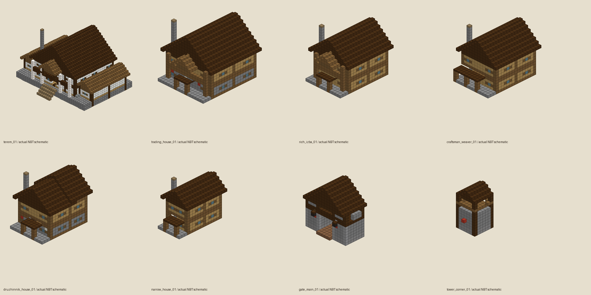
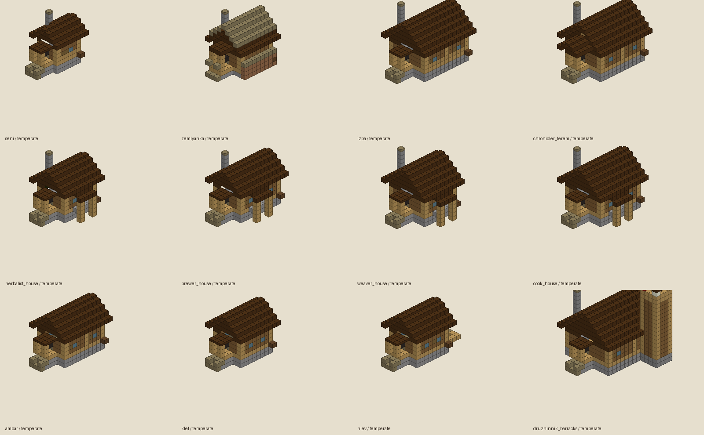
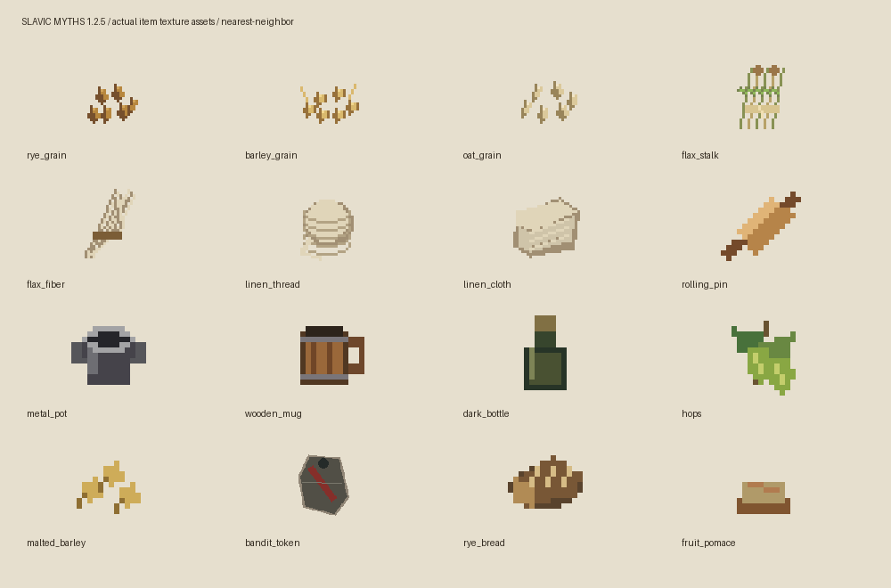

## Актуальная публикация — 1.9.7.3 (14 октября 2026)

Minecraft 1.21.1 · NeoForge 21.1.255 · Java 21. Все текущие локальные изменения мода включены в публикацию: исправления оружия/брони/существ, каталог Creative, крафтовые и инструментальные руны III–IV.

[Сводка реализации для ChatGPT и следующий этап](docs/CHATGPT_HANDOFF_2026-10-14.md). Последние руны прошли build/offline/resource gates; игровая приёмка остаётся открытой. Ниже сохранены исторические описания, числа и версии в них не заменяют актуальные отчёты.

## Патч оружия — ревизия брони поверх 1.9.7

Обновлены иконки и внешний вид существующей брони, сохранён текущий патч оружия. PolyMC Testing установлен после успешных gates. [Аудит, before/after и ручная проверка](docs/armor-revision/REPORT.md).

## 1.9.6 — Змей Горыныч

Горыныч Змеиной горы, яйцо в творческой вкладке «Мобы», два этапа боя и очищение трёх голов, собираемые дыхания, персональные награды, арбалеты, три руны и драконья броня. PolyMC Testing обновлён после clean build и offline/resource gates. Игровых запусков агентом: 0. [Использование](docs/GORYNYCH_1.9.6.md), [результаты](docs/verification/gorynych-1.9.6/REPORT.md).

# Slavic Myths

Мод о славянской мифологии, исследовании мира и хозяйственной жизни: духи и боссы, курганы, разбойники, ритуалы, ремёсла и поселения. Фольклор и исторические мотивы адаптированы для игры; это не реконструкция единой исторической религии.

**Версия 1.9.7.3 · Minecraft 1.21.1 · NeoForge 21.1.255 · Java 21**

Рунные слоты брони: существующая наковальня и хранение рун без новых эффектов. [Таблица и проверки](docs/ARMOR_RUNE_SLOTS_1.3.3.md).

Classes 2.0: дерево навыков, выбор класса, управление и клиентские настройки HUD. [Изменения и проверки](docs/CLASSES_UI_1.3.2.3.md).

Редкое оружие: парные мечи Тугарина, посох Лихо, кистень атамана и копьё победителя. [Характеристики, рецепты и проверка](docs/RARE_WEAPONS_1.3.2.2.md).

*Схематическая проекция действующих NBT-шаблонов, не игровой скриншот. Цвета и форма отдельных блоков упрощены.*

Проклятый Волколак: отдельный 400HP моб и яйцо, две позы, четвёртое поручение Серого Волка, могила/связанный череп и награда Финиста. Прежний Волколак сохранён. [Релиз и проверка 1.4.3](docs/verification/volkolak_1.4.3/REPORT.md).

## Что есть в моде

- Домовой, леший, водяной, русалка, банник и другие духи; приключенческие встречи и боссы, включая Бабу Ягу.
- Алтари, подношения, знания, репутация, ритуалы, руны, фольклорная книга и личная навигация.
- Оружие 2.0: копья, сулицы, кистени, метательные ножи семи материалов и два лука; детали и сборка на оружейном верстаке, просмотр рецептов без JEI.
- Классы 2.0: три базы, 18 ветвей, дерево навыков и эволюции; G/H/J — активные слоты, K — меню. Class XP пока выдаётся через API/debug `/smclass`, отдельно от vanilla XP.
- Курганы с помещениями и наградами, лагеря разбойников, болотные постройки и тематическая природа.
- Обновлённые деревни, одежда жителей для трёх климатов, профессии и торговля; редкое городище с улицами, теремом, торговым домом, площадью, стенами и воротами.
- Работа жителей в стандартном расписании Minecraft, реальные производственные цепочки и общий сундук поселения. Дружинники защищают жителей; разбойники совершают ограниченные налёты.
- Земледелие, садоводство, домашние животные, обработка льна, одежда, кухня, брожение и напитки, мебель и хозяйственное хранение. Мешок в 1.2.5 содержит пять слотов по 64 предмета.

*Схема действующих шаблонов деревни с упрощённым отображением блоков.*

*Реальные текущие текстуры предметов, увеличенные без сглаживания. Это лист ресурсов, а не вид предметов в игре.*

## Установка

1. Подготовьте профиль Minecraft **1.21.1** с NeoForge **21.1.255** и Java **21**. Metadata допускает NeoForge `[21.1.255,21.2)`; проверенная версия — 21.1.255.
2. Установите **Curios API 9.5.1 для 1.21.1** (требуемый диапазон `[9.5.1,10)`).
3. Поместите `slavicmyths-1.3.2.1.jar` в `mods` клиента и сервера. Уберите старую копию этого мода; сохраните резервную копию мира перед обновлением.
4. JEI **19.x** необязателен на клиенте. Xaero Minimap необязателен: адаптер рассчитан на **26.5.0**; без него доступен собственный HUD навигации.

Сборка: `gradlew.bat clean build` при `JAVA_HOME`, указывающем на JDK 21. Результат: `build/libs/slavicmyths-1.3.2.1.jar`. Зависимости загружаются Gradle; локальная `.tools` для production-сборки не требуется.

## Статус разработки

1.3.2.1 реализована: clean build и production-ресурсы PASS, итоговые headless suites 31/31; 11 серверных запусков, ноль клиентов. [Оружие, рецепты и ограничения](docs/WEAPONS_1.3.2.1.md), [ручная приёмка оружия](docs/MANUAL_QA_WEAPONS_1.3.2.1.md). [Классы и ограничения](docs/CLASSES_1.3.1.md), [ручной список](docs/MANUAL_QA_CLASSES_1.3.1.md). Подробности: [городище](docs/GORODISHCHE_1.2.5.md), [состояние проекта](docs/PROJECT_STATUS.md), [подготовка релиза](docs/maintenance/RELEASE_PREPARATION_1.2.5.md).

Клиентская визуальная приёмка, полный город на обычном рельефе и пользовательский перезаход остаются ручными проверками. Измеренных FPS/MSPT нет. Планы в [roadmap](docs/ROADMAP.md) не являются уже работающими механиками. Княжеский AI, будущая экономика и новые религиозные системы городища не реализованы.

Операторская проверка в отдельном тестовом мире: `/sm test village_showcase` и `/sm test gorodishche_showcase temperate`. Команды размещают постройки и изменяют мир. [План игровых кадров](docs/media/readme/CAPTURE_GUIDE.md).

## Права

Metadata указывает **All Rights Reserved**. Отдельного LICENSE в репозитории нет; новая лицензия не выбиралась.

## Тестовая1.5.2 — подземелья Чуди

Город1.5.1 и три режима заброшенных комплексов1.5.2. Технические build/resources/native geometry gates PASS; тестовый кандидат установлен в PolyMC1.21.1. Естественный great и квота четырёх attached/great пока не подтверждены, полная приёмка открыта. [Команды поиска и размещения](docs/verification/chud-1.5.2/COMMANDS.md), [проверки](docs/verification/chud-1.5.2/REPORT.md), [продолжение](docs/verification/chud-1.5.2/CONTINUE.md).

Чуди1.5.2, исправление размещения2026-10-09:до10 точек на область с одним root, горы как предпочтение/Overworld biome allowance, удалён12% forest filter, corrected actual lower construction limits без изменений saved layouts. Build/offline/resource gates PASS;development candidate установлен в PolyMC.0 игровых запусков, runtime QA новой генерации NOT_RUN. Отчёт:docs/verification/chud-1.5.2/placement-fix/REPORT.md.

Патч 1.9.3: две естественные святыни Overworld, ритуалы, предметы и лут. PolyMC Testing обновлён после build/offline/resource gates; игровых запусков 0. Отчёт: [1.9.3](docs/verification/sanctuaries-1.9.3/REPORT.md).

1.9.4: два осквернённых хранителя в существующих святынях, очищение и персональные половины оберега. PolyMC Testing обновлён после успешных gates; игровых запусков 0. [Отчёт](docs/verification/guardians-1.9.4/REPORT.md).

1.9.5: единая Змеиная гора с крепостью, двумя входами, интерьерами, 11 блоками/рецептами и опасной аурой. Команда: /slavicmyths generate_serpent_hill [x y z] [rotation]. PolyMC Testing обновлён; игровых запусков 0. [Отчёт](docs/verification/serpent-hill-1.9.5/REPORT.md).
