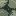
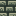
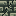
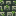
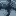

# Курганные текстуры V2 — исходники для #46

**Статус:** художественный кандидат, готовый к технической интеграции после подтверждения владельца. Это **не** текущие игровые текстуры.

Все 11 PNG — **16×16 RGB**, без изменений исходных пикселей при загрузке. Этот каталог — источник артов для задачи [#46](https://github.com/Deserag/slavic-myths/issues/46). Codex должен использовать именно эти файлы, а не отвергнутый `art/kurgan-16-approved/approved.zip` V1. Оригиналы версии 0.9.6 остаются в `art/kurgan-0.9.6/runtime-256-backup/`.

| № | Текстура | Превью |
|---:|---|---|
| 1 | `bog_green_kurgan_stone.png` |  |
| 2 | `bog_green_kurgan_cobblestone.png` |  |
| 3 | `cracked_bog_green_kurgan_cobblestone.png` |  |
| 4 | `mossy_bog_green_kurgan_cobblestone.png` |  |
| 5 | `pale_blue_kurgan_stone.png` |  |
| 6 | `pale_blue_kurgan_stone_variant.png` |  |
| 7 | `pale_blue_kurgan_cobblestone.png` |  |
| 8 | `cracked_pale_blue_kurgan_cobblestone.png` |  |
| 9 | `mossy_pale_blue_kurgan_cobblestone.png` |  |
| 10 | `burial_stone_top.png` |  |
| 11 | `carved_burial_stone.png` |  |

Принцип: крупные формы камней, полноценные разломы, заметные пятна мха, оригинальный лабиринтный орнамент, без идентичного узора для разных состояний. Проверять соотношение normal/cracked/mossy в зелёной и синей палитрах.

**Интеграция:** заменить 11 PNG в runtime resources побайтно, обновить прежние арт-манифесты и генераторы, не менять registry IDs, модели, крафты и баланс. Проверить creative на дублирующиеся визуально материалы. Minecraft и GameTest не запускать.
