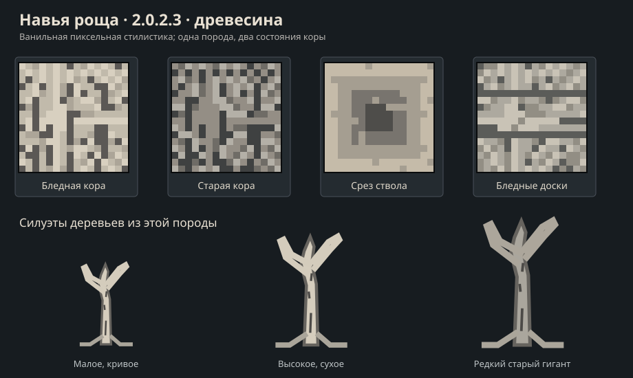

# Навья роща · 2.0.2.3 — технический лист бледной древесины

> Художественное направление **одобрено владельцем** 24.10.2026 в обсуждении. Это точная словесная постановка для будущих 16×16 игровых текстур, **не готовые PNG и не разрешение Codex начать работу**.

**Рабочая задача:** микропатч 2.0.2.3 в [GitHub Project №9](https://github.com/users/Deserag/projects/9/views/1). Зависимость — утверждённая основная палитра в [2.0.2.2](blocks-2.0.2.2.md). Генерация в мире **только в 2.0.2.6**.

## Доступная Codex пиксельная схема

**[Открыть SVG-схему древесины](wood-2.0.2.3-atlas.svg)**. Это ориентир по бледной коре, старой коре, срезу, доскам и силуэтам деревьев. Цветовые образцы — **технические эскизы, не финальные Minecraft PNG**.

## Главная задумка

**Одна порода** с вариациями возраста и размера дерева, а не два разных типа древесины. Древесина — костяно-бледная, мёртвая, сухая, слегка грязно-серая и достаточно светлая, чтобы контрастировать с тёмным навьим грунтом.

### Варианты коры (одна порода)

1. **Основной вариант A — «Костяное дерево»**, выбран как главный: неоднородный бледный серо-бежевый/слоновая кость (ориентиры #d5cdbd, #bcb5a6), узкие вертикальные тёмные трещины (#555251), сухая слоистость, отсутствует зелень и оранжевый тон. Вертикальная ориентация коры при соединении брёвен.
2. **Старый вариант Б — «Мёртвая кора»**, только естественная/декоративная вариация этой же породы на старых гигантах и фрагментах: темнее, серее и более потрескавшаяся (ориентиры #ada99f, #6a6762), сохраняя единый тип древесины и общие рецепты. Не вводить второй самостоятельный набор досок ради такой вариации.
3. **Срез бревна:** годичные кольца серые/выцветшие, контраст умеренный, центр потемневший, без «жёлтого свежего дерева».
4. **Доски:** светло-серо-костяные, параллельные узкие волокна и тёмные аккуратные стыки, видимое направление укладки. Не просто recolor дуба или берёзы.

### Силуэт деревьев

- **Малые:** невысокие, резко искривлённые, мало ветвей; можно встретить группами.
- **Обычные:** высокие мёртвые стволы с асимметричными сухими ветвями и редкими ломаными остатками кроны.
- **Гиганты (редкие):** толстый неправильный ствол, глубокие тёмные трещины, массивные расширенные корни; часть секций может быть темнее (вариант Б). Не моделировать каждый гигант как один тяжёлый меш.
- **Листва практически отсутствует.** Вместо неё сухие ветки, свисающие/наземные корни и редкие пучки мёртвой растительности. Силуэт должен быть узнаваем даже без тумана или частиц.

## Совместимость с FallingTree / TreeCapitator — **обязательное условие приёмки**

> **Решение владельца 24.10.2026:** в Навьей роще должны встречаться **все три формы деревьев** — небольшая искривлённая, обычная высокая и редкая гигантская. Каждое естественно выросшее дерево **должно целиком срубаться одним действием** через установленную в сборке механику рубки. Это важно не только для красоты и лута, но и для удобства выживания. Модификация называется **FallingTree**, она отдельная от Slavic Myths; в тестовом профиле зафиксирован `FallingTree-1.21.1-1.21.1.11.jar`. Не писать собственную вторую систему рубки.

### Почему это отдельное техническое требование

В `src/main/java/org/slavicmyths/wood/TreeShape.java` сосна размещает ярусы листвы через уровень — `tier(y)` на `2, 4, 6...`. Такие разрывы между отдельными уровнями хвои могут мешать внешнему алгоритму обнаружить дерево целиком. Даже когда по правилам Minecraft листва считается находящейся рядом с бревном, **это ещё не доказательство**, что FallingTree в реальной конфигурации срубит весь объект. Тест FallingTree для нашей текущей сосны также зафиксировать как контрольный регрессионный пример (не переписывать сосну без отдельного решения владельца).

### Как готовить все три дерева

- **Непрерывный ствол из деревянных блоков** от нижнего бревна до верхней точки. Для гиганта допускается толщина 2×2 или больше, но массив ствола должен быть **топологически связан**.
- **Скелет каждой ветви** строится как цепочка соседних по грани бревен — соединение одной лишь диагональю или через пустой блок запрещено, если это разделяет дерево для FallingTree. Внешне дерево может быть искривлённым и разветвлённым — геометрия не обязана выглядеть ровной палкой.
- **Крона почти без листвы**, согласно принятому референсу. Редкие сухие листовые/грибные фрагменты, если они нужны распознаванию, реализовать с корректной категорией и тегами, **не заполняя пустоты обычной густой листвой**. Между отдельными клочьями «листвы» допускаются пустоты **только после подтверждения**, что вся древесина и нужная растительность удаляются корректно.
- Основные, очищенные и старые древесные сегменты, **используемые как части единого ствола**, должны определяться FallingTree как одно дерево. Предпочесть вариативность текстуры/состояния базового бревна для старой коры (вместо двух несовместимых registry IDs), если эксперимент подтвердит это для реального профиля. Если всё же нужны разные block IDs, проверить смешанную рубку и исправить конфигурацией/правилами.
- **Ванильные теги:** добавить семейство навьих брёвен в `#minecraft:logs` (и собственный `#slavicmyths:navya_logs` по принятой схеме), бревна как block и item там, где требуется. Сухая листва, если она действительно использует механику листьев, входит в `#minecraft:leaves`; **корни, кусты, грибы, доски, заборы, игроком построенные конструкции** не добавлять в эти теги ради искусственного распознавания.
- **Свисающие корни и декоративные кисти** могут быть отдельно прикреплены к древесине; их визуальная геометрия НЕ должна разрывать цепочку бревен и делать оставшиеся части дерева недоступными. Решить отдельно, что отпадает вместе с деревом, а что остаётся для самостоятельного разрушения — не выдавать произвольное удаление всех корней за нормальную рубку.
- Для **гигантского дерева** проверить используемые FallingTree ограничения размера сканирования и лимит блоков, не увеличивать их вслепую: сканирование не должно охватывать соседние деревья, грунт или постройки. Крупный ствол и ветви могут иметь разную визуальную кору, но не раскалываться на независимые части для рубки.

### Приёмочные тесты (на установленной FallingTree-конфигурации)

1. **Малое дерево:** удар по нижнему бревну разрешённым топором → уничтожается всё дерево, корректный дроп, нет «висячего» отрезка ветви.
2. **Обычное высокое дерево:** тот же сценарий с несколькими ветвями, включая пустые промежутки между редкими фрагментами поросли/листвы.
3. **Редкий гигант:** один удар по нижнему бревну → целиком срубается весь связанный деревянный скелет, включая секции «старой» коры; проверить на 2×2+ стволе и необычных корневых выступах.
4. **Отдельно две соседние кроны** (соседние деревья) и **постройки игрока из этой же древесины**: не должно исчезать соседнее дерево или здание. Не допускать бесконтрольного поиска блоков или принудительной загрузки чанков.
5. **Листва через пустой уровень:** использовать текущую сосну как негативный/регрессионный сценарий, подтверждать фактический результат; не считать тест пройденным по одному условию `logs`-тега.
6. Контроль инструментов, прочности, дропа, поведения на выделенном сервере и в загруженном тестовом мире. В приложении к проверке зафиксировать **версию FallingTree, конфигурацию, игровой seed/координаты и видеозапись либо скриншоты до/после**. Без реального теста статус совместимости — **NOT_RUN**, даже если code review и сборка прошли успешно.

**Разделение работ:** в 2.0.2.3 сделать блоки/формы, теги и **ручные тестовые деревья**, допускающие проверку FallingTree. В 2.0.2.6 — добавить их естественную генерацию и повторить те же тесты на деревьях, реально выросших в биоме. Собственная система массовой рубки в Slavic Myths не нужна.

## Полный vanilla-подобный строительный набор

Базовый минимум: осевое бревно, очищенное бревно, доски, плита, ступени, забор, калитка, дверь, люк, кнопка, нажимная плита. Дерево/очищенное дерево (bark on all faces), таблички/подвесные таблички по результатам проверки API/способа регистрации. Рецепты соответствуют назначению; не плодить десятки декоративных предметов без пользы.

**По игровой задумке древесина не горит, как древесина багрового и искажённого леса Незера.** Точное поведение огня и огнестойкость item/drop нужно сверить отдельно с текущими vanilla/NeoForge API.

## Растительность того же микропатча

- Сухие тонкие ветви, блоки корней и свисающих корней (подходящие для леса и среднего слоя биома).
- Редкие призрачные грибы, слабый свет бело-бирюзовый, не превращать освещение рощи в сплошной cyan.
- Мёртвые низкие кусты / отдельные наросты; мох не должен дублировать поверхностный блок из 2.0.2.2.
- Пока без спавна в мире и biome source, только изготовление ассетов, моделей/форм для будущей генерации.

## Техническая приёмка для будущего Codex

1. Реальные ресурсы в стиле **vanilla Minecraft / Nether**, ориентир исходные 16×16 пиксели. Правильный UV и направление коры.
2. Отсутствие поломанного tile-стыка, крупные стволы собираются из простых кубических блоков.
3. Различимость бревна, очищенного бревна, старой коры, среза и досок; совпадение оттенков со стендом основных блоков.
4. Настоящие assets, registered IDs, модели, `blockstates`, `loot`, `ru_ru`/`en_us`, Creative Tab, recipes и рабочая версия Java 21/NeoForge после отдельного поручения.
5. Скрин в окружении навьего грунта, корневого камня, костяных колонн; потом — **реальный сгенерированный биом в 2.0.2.6**.

**Не включать:** новых мобов, мини-босса, генерации деревьев и новых миров. Все недообсуждённые механики фиксировать как вопросы, а не реализовывать самовольно.
