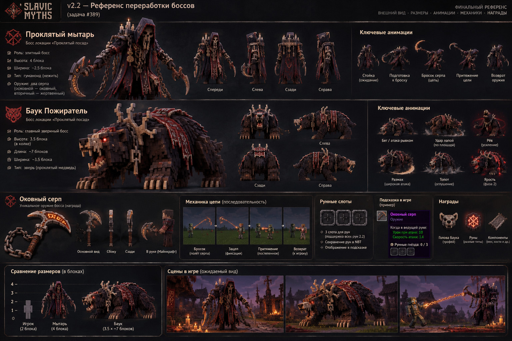

# P0 #389 — обязательный визуальный эталон Мытаря, Баука и Оковного серпа (01.11.2026)

> **Решение владельца от 01.11.2026:** последний единый цветной концепт-лист («v2.2 — Референс переработки боссов») является ЦЕЛЕВЫМ изображением для всей переработки. В Minecraft модели/размер/силуэт/оружие/анимации должны соответствовать именно этому листу, а не прежней упрощённой SVG-схеме. Концепт НЕ доказывает, что работа в игре уже готова. Приёмка — исключительно по настоящим кадрам Minecraft.

## Самое главное: реальный графический файл

- GitHub: [BOSSES_389_VISUAL_TARGET_2026-11-01.jpg](references/BOSSES_389_VISUAL_TARGET_2026-11-01.jpg).
- Размер: **1536×1024**. Это визуально эквивалентная высококачественная JPEG-копия сгенерированного и выбранного владельцем листа, а не ранее использовавшиеся схематичные SVG.
- SHA-256 GitHub JPEG: `285255394e9c2dda3b7956c8e9481e49765ffe80615f1535159a6edf1057ea26`.
- SHA-256 первоначального PNG в разговоре: `3b22028cf6f15e2815584d178ec5a2dba48cf4d34f8279366ecc4b1ec681a76a`. Разница SHA объясняется JPEG-переупаковкой; ассет следует использовать именно визуально, без заявлений о побитовом совпадении.
- База задачи [#389](https://github.com/Deserag/slavic-myths/issues/389); прежние подробные спецификации [#366](https://github.com/Deserag/slavic-myths/issues/366)/[#367](https://github.com/Deserag/slavic-myths/issues/367). При противоречии **внешности** — приоритет этому цветовому листу и этому решению владельца; при противоречии игровых чисел без нового решения сохраняются ранее утверждённые механики. `2.2` — интеграционная ветка по `docs/BRANCH_POLICY.md`; `main` и `hell` не менять.

## Внешность и моделинг Мытаря — не упрощать

- Рост **4 блока**, фигура высокая, тонкая, с костлявыми конечностями и сутулой торжественно-угрожающей позой. На листе визуальный габарит широкого капюшона/плаща около **2.5 блока**, это **размах декоративного силуэта**, не автоматически ширина коллизии: hitbox проектировать отдельно, избегая прохода сквозь стены и несовпадения попаданий.
- Обязательные уникальные объёмные части: широкий *многослойный* острый капюшон; различимая костяная/иссохшая морда внутри тени, янтарно-красные глаза; наплечные железные и тканевые элементы с несколькими свечами/огарками; красно-чёрная многослойная порванная мантия с длинными свисающими лоскутами и тёмно-красным внутренним орнаментом; тяжёлые древние металлические цепи, подвески, старые монеты, три поясных кошеля; костлявые обособленные кисти, реальные ноги и подол.
- На листе **оба серпа видны одновременно** в руках: **ЛЕВАЯ рука босса — обычный короткий металлический серп**, **ПРАВАЯ — тяжёлый Оковный серп с отдельной цепью**. Сверять anatomically left/right босса, не экранную сторону. Во время броска правый серп исчезает из руки, летит физическим снарядом и возвращается; левый всегда остаётся. В мире и на кадрах с разных ракурсов обе модели различимы, у правого кривой массивный клинок, центральный хват и звенья цепи.
- Не заменять плащ плоской коробкой, лицо тёмным прямоугольником, оружие двумя одинаковыми палками. Нужны отдельные bones, правильные UV, текстуры минимум 128–256px; details в Minecraft voxel/pixel-art без попытки выкрутиться одним `pose.scale`.
- Как на листе: фронт/лево/тыл/право + 3/4 hero view, фактическая анимация idle (дыхание, свечи, монеты, цепь), walk, цепной windup/swing, throw, hook, pull, retract, melee двумя разными атаками, фаза II, hurt, death. Свечи и glow **локальные**, не портят FPS и не поджигают мир.

## Баук — приоритет масштаба, массы и звериной анатомии

- **Не маленький медведь.** Новый концепт задаёт **ориентир ~7 блоков длины, ~3.5 блока ширины и ~3.5 блока высоты в холке**. Это намеренное увеличение относительно старого паспорта (4.5×2.5×3) и прямого нового пожелания владельца «гораздо больше». Уточнить размеры и согласовать collision/AI c реальной геометрией; не понижать масштаб до старого без нового owner approval.
- Уникальный громадный **ЧЕТЫРЁХЛАПЫЙ** зверь на базе медвежьей анатомии: приземистый, невероятно широкие плечи/грудь и холка, тяжёлая шея, выпуклая спина, четыре очень толстые лапы с отдельными пальцами/массивными светлыми когтями, все лапы стоят на блоках. Передние лапы заметно массивнее, чем у обычного bear.
- Голова **полноценная объёмная, не прямоугольный блок**: длинный клыкастый хищный череп/морда, широкий рот, отдельная подвижная нижняя челюсть, верхние и нижние клыки, нос, костяные скулы, красно-оранжевые глаза, разветвлённые светло-костяные асимметричные рога / наросты слева и справа, черепные декоративные детали. Голова пропорционально огромна по сравнению с обычным медведем.
- Тело: крупные многоуровневые чёрно-бурые лохматые лоскуты шерсти, слоистая грива, костяные пластины/шипы по голове и спине, местами обугленные и кроваво-красные участки, **тёмно-красная рваная ткань/снаряжение на спине с белыми символами**, куски кованых цепей; угольно-чёрный, бурый, костяно-бежевый и красный. Не делать однотонный куб из `brown_wool` и базовых vanilla блок-текстур.
- Только звериная горизонтальная стойка. НЕТ постоянного полёта, зависания над землёй, двуногой ходьбы, общей Steve-кости. Все 4 лапы корректно соприкасаются с землёй; анатомичная ходьба, охота, тяжёлый бег/рывок, удар лапой (включая широкий размах), укус/захват с челюстью, рёв с движением груди и головы, подскок на задние только кратко во время slam, топот, ярость с красными тлеющими акцентами, смерть с падением тяжёлого тела.
- Ориентировать head/pivot/neck, отдельную челюсть и legs; проверять `root Y`, хитбокс, renderer scale, pathfinding через большие проёмы, anti-stuck, тень и прижим к земле.

## Оковный серп и три руны — вид как на листе, логика не заменяется картинкой

- Отдельный **объёмный** рунный изогнутый серп, не малюсенькая 2D палка: широкий кривой клинок со светящимися янтарными гравировками и тёмным металлом, рукоять с металлическими обмотками, тяжёлая **материальная звеньевая цепь** и отдельные настоящие модели для inventory/held/world/projectile.
- Для игрока: animation `windup (8t) → бросок физического серпа → соединённая с рукой цепь → касание/зацеп → постепенное подтягивание за несколько тиков → retract в руку`, с плавной интерполяцией двух клиентов, звуком, particle trails и server-authoritative коллизиями. На промахе/защите стена или щит — возврат без неправомерного притяжения. Боссовый бросок — отдельная дистанция/тайминг из #366. Никакой замены на мгновенный урон/один velocity impulse.
- ТРИ рабочие rune sockets на **Оковном серпе**: UI / tooltip `Рунные гнёзда: 0/3` → `3/3`, в т.ч. сохранение NBT/data components, каждую руну реально можно поставить и применить; 4-ю вставку запрещать. Три физически обозначенных гнезда, как на листе. Другие типы серпа/оружия не портить.
- У оружия качественный русско-английский tooltip: RPG описание, RMB-способность, 10-блочная дальность, кулдаун 12 с, ограничения по целям, фактические stats, 3 sockets и описание дополнительных эффектов. **Числа `Урон 10` / `Скорость 1.4` в иллюстративной подсказке листа не переопределяют доказанный текущий gameplay contract (#366):** серверные значения и tooltip должны быть одинаковыми, без выдуманных статов.
- Loot: узнаваемая скульптурная **голова Баука** (короткий клыкастый череп с рогами как в правом нижнем углу листа), красный светящийся рунный символ и реальные компоненты/материалы. Голову реализовать как полноценную block/item модель с собственными atlas UV/texture, правильно в мире и GUI. **Чёрно-розовые квадраты запрещены**. Раздельно аудит фиолетово-чёрных item/block моделей, JAR и resource pack.
- Если владелец хочет новые исключительные руны и награды сверх согласованного, подготовить shortlist с эффектами на отдельное owner approval; не изобретать 3 новые награды якобы утверждёнными. Но техническое исправление **3 действующих слотов** — P0 без оговорок.

## Не подменять полноценную реализацию проверкой компилятора

1. Работать **от свежей `origin/2.2`**, изучить #389 + #366/#367/#365 + `docs/BRANCH_POLICY.md`, `AGENTS.md`, текущую source tree, не мержить вслепую ветку `fix/2.2-382-full-recovery-20261031` (её отдельные изменения серпа и масштаба ещё не прошли авторскую приёмку).
2. Сначала model/texture/animation production с реальным `.bbmodel` или иным **редактируемым rig source**, PNG и UV; не объявлять sketch/mockup «готовой» моделью. Сопоставить модели с **этим JPG в репозитории**, затем встроить в Minecraft.
3. Принять только по реальным игровым кадрам в том же ракурсе: each boss hero/front/left/back/right; рядом Steve (1.8), рядом оба босса; оружие на руках/в GUI; пошаговые кадры chain sequence; Баук на земле/бег/укус/рык/ярость; трофей на земле/в GUI/в 4 направлениях; рунная надпись 0/3, 1/3, 2/3, 3/3.
4. Java 21 `clean build` + tests/GameTest + client runtime + dedicated server 2 players + old/new saves, no missing textures/model log. Профиль PolyMC обновить только если законно доступен; иначе `NOT_RUN`, без ложного отчёта.
5. Для каждого: `requirement / source / file+commit / test / real screenshot / PASS|FAIL|BLOCKED|NOT_RUN`. Закрывать только после **видео/скринов и прямой приёмки владельца**. Никакого «фигуры примерно похожи» вместо выполнения деталей листа.

**Нельзя выдавать этот документ или JPG за готовый код/игру. Контракт — сделать именно эти образы в Minecraft, с допустимой лишь обусловленной voxel геометрией адаптацией, не теряя силуэт, детали, пропорции и механику.**
