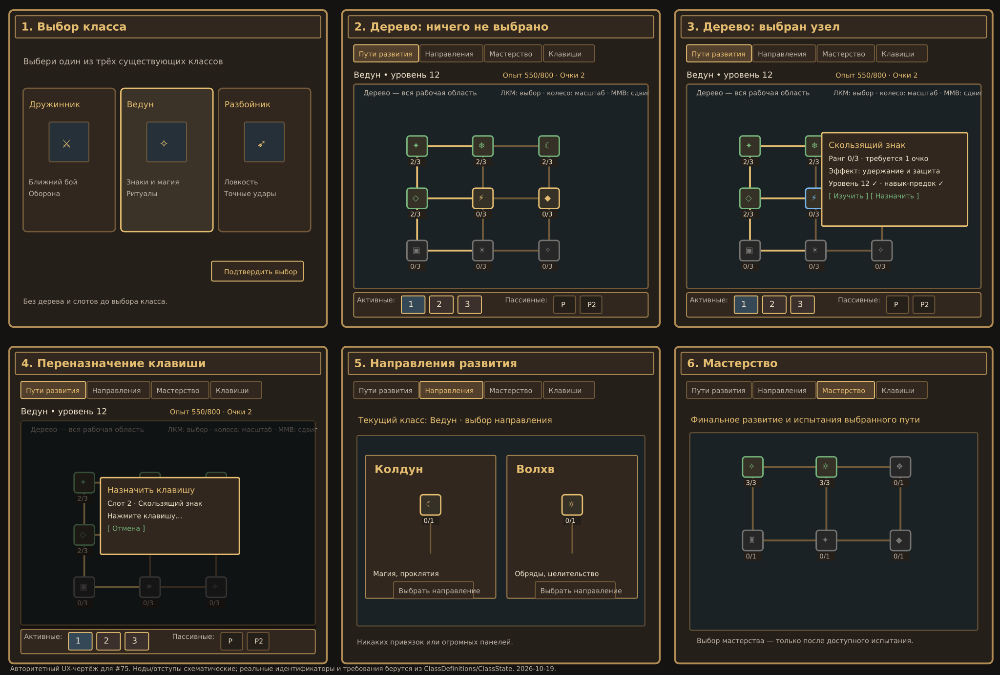

# Slavic Myths 2.0 — обязательные чертежи результата по задачам #73–#91

> 19.10.2026. Этот документ — **контракт для Codex**, не общая подборка настроений. Каждая задача должна показывать, КАК она будет выглядеть/работать, где пользователь нажимает, и что считается ошибкой. Ссылки на существующий код указывают направление: перепроверить новый main перед изменениями. Никакая диаграмма сама по себе не равна готовому игровому функционалу.

## Общие технические правила, применяемые к каждой задаче

1. **Нет показанного результата — нет сдачи.** Для UI — реальные до/после выбранных состояний при 1280×720 и 16:9 GUI scale 2/3/4 без обрезки. Для 3D существ/брони — реальные production model/texture рендеры с 4 ракурсов **front/right/back/3⁄4** при одном масштабе + 2–3 требуемые боевые позы; для 2D предметов — PNG в 1× pixel-perfect и слот 16×16 с контрастным фоном; для логики — рисунок переходов + tests случаев «норма/граница/ошибка» и играющий код.
2. Каждый референс должен иметь **registry ID, исходный asset, границы кадра, цветовой ключ, реальные размеры пиксельной сетки, сценарий, источник фактов**, иначе это просто настроение. Визуальные схемы — направляющие; сохранить оригинальную художественную идентичность. Любое изменение ванильного стиля без согласованного авторского решения показывать **до** mass replace.
3. Скрин/видео из **реального Minecraft** может предъявить только запускавший игру человек. Исходные SVG / Figma / Blender / рендер служат конструктивным proof только, не заявлять IN_GAME.
4. Изменять *только* файлы этой микрозадачи; один writer, никаких «вернём старую ветку»/восстановлений/нового сплошного аудита. Java21 build, ресурсы, сохранения, ID, штатный протокол Git. При расхождении документа со свежим исходником разрешить конфликт явно — **не копировать несуществующую систему**.
5. **После 2–3 выполненных микрозадач** — короткий handoff в **новый чат Codex**: SOURCE HEAD, IDs, commits, paths, что проверено, какие игровые снимки ждём. Не объявлять owner acceptance самостоятельно.

---

## #73 — РУС / EN сообщения: эталон состояний

**До:** «РќРµ хватает»; **после:** «Недостаточно места для размещения…» с фактическими координатами/причиной. Схема: `вызов → проверка → success (зелёное подтверждение) / failure (короткая причина + что делать)`. Единый пунктуационный/цветовой стиль в чатах/tooltip GUI; слова «ошибка» и условие воспроизводимы. Референс — реальный чат со строкой из `chud/ChudGenerateCommands.java` до и после, плюс 5 других типов сообщений; не менять semantics/ID. Проверка `ru_ru/en_us`, placeholders и UTF-8.

## #74 — КОМАНДЫ: чертёж дерева и доступов

```text
/slavicmyths
 ├─ help [category]                        [игрок]
 ├─ navigation <...>                       [игрок, доступные действия]
 ├─ <existing player feature> <action>    [игрок, только по возможности]
 └─ dev
    ├─ <existing feature> debug/info      [OP2, только чтение]
    ├─ <existing feature> spawn/generate   [OP2, меняет мир]
    └─ <existing feature> reset/clear      [OP2, опасное действие]
```
Это **пример группировки, не выдуманный полный список команд**. Итоговый реальный dispatcher должен быть выгружен в `docs/COMMANDS.md`: каждый путь + аргументы + роль + эффект + `old → new` или alias. Визуальная схема: 3 колонки **Игрок / Админ / Консоль** с видимыми только разрешёнными ветками; ошибки запрещённых действий не превращаются в выполнение. Проверить отсутствие дублированной регистрации/неправильных permissions.

## #75 — КЛАССЫ: шесть основных состояний (ОБЯЗАТЕЛЬНЫЙ SVG)



**A. Выбор класса:** только существующие `Дружинник / Ведун / Разбойник`; три сопоставимые карточки с ролью/начальными способностями; выбор с подтверждением; **нет назначений, дерева навыков или рекламных несуществующих классов**.

**B. Дерево — нет выбора:** **всё рабочее окно** занято графом, кроме узкой верхней навигации и компактной строки слотов внизу. Ни один узел не выделен автоматически; никаких постоянных огромных боковых панелей; связи всех веток не «режутся» фоновой доской. Zoom колесом от указателя; pan мышью на пустом полотне; кнопка `Сброс вида`.

**C. Выбран узел:** по клику маленький **контекстный** overlay у доступного свободного угла **либо** всплывающая карточка рядом с выбранным узлом (не блокирует узлы в зоне фокуса). Отображение `название/уровень/требования/статусы/Изучить/Назначить`. ESC/клик на пустоту закрывает только карточку. Hover — только tooltip без назначения.

**D. Горячие клавиши прямо у дерева:** **компактные активные слоты 1/2/3 и пассивные согласно ClassState** в нижней quickbar; нажатие на слот открывает узкий `Назначить навык / Изменить клавишу` popup. Сохранение и отмена; реальные конфликты с Minecraft/модами и невыученные навыки недоступны. **Не занимать всё дерево большими слотами.** Вкладка `Клавиши` дополнительно даёт полный список биндов, но quickbar всегда доступна в основном дереве.

**E. Направления:** отдельная страница выбора `First/Second` из *фактических* ветвей `ClassDefinitions.BRANCHES`; одновременно не смешивать с деревом, кнопками назначения и мастерством. Различимые ветви, блокировки и переходы.

**F. Мастерство:** отдельная страница `Third/Ultimates`, настоящие испытания/требования и «Изучить», без гигантского каталога, отвлекающего от структуры.

Размеры в SVG — **схема поведения**, а не правило «70/80% дерева»: нет магических процентов; всё свободное место отдаётся canvas после компактных связанных элементов управления. **Acceptance:** при старте нет выбранного навыка и инспектора; доступны все узлы панорамированием; слоты меняются без ухода от дерева; ни один текст/кнопка/связь не обрезаны; перепроверить именно JAR, который дал rejected screenshot, и src commit.

## #76 — ПРОКЛЯТЫЙ ОБОРОТЕНЬ: 4-составной чертёж

**Сравнение:** реальные `CursedVolkolakGeometry/Model/Renderer` и конкретный скрин владельца, где тело выглядит как чёрный кузов.

| FRONT | RIGHT | BACK | 3/4 + POSES |
|---|---|---|---|
| Узкая читаемая морда, **2 глаза**, переход скула→шея; четыре конечности | Без провисания: холка/ребра/таз с ритмом, изгиб спины; хвост в заднем силуэте | Спина и таз/бедра без кубического обруба, лапы отделены | Ходьба; атакующая стойка; вертикальная стойка; ложная смерть/возврат |

**Нужна настоящая новая модель/rig**, а не новые цвета старой коробки. Удержать hitbox/механику, адаптировать anchors поз и UV; отдельный новый PNG/UV под новый rig; исходный модельный screenshot front+right+back+three quarter 1:1. Визуальные требования совместимы с пиксельными ограничениями Minecraft.

## #77 — СКИМ-ЗВЕРЬ: 4-составной чертёж

| FRONT | RIGHT | BACK | 3/4 + POSES |
|---|---|---|---|
| Сильная звериная морда, отделимые глаза/челюсть и грудь, передние когти | Отдельная шея/плечевой пояс/брюхо/таз, походка четвероногого, не «пара прямоугольников» | Бёдра и задние лапы, переход в хвост, читаемые части гривы | `ROAR`, `LEAP`, `CLAWS`, `EXHAUSTED`; реальные pivot-ы |

Исходники `SkimMesh`, `SkimModel`, `SkimClient`. В скриншоте силуэт непропорционально блочный. Не менять `GreyWolf` и не запускать звукопроект. Проверить 4 ракурса под одинаковой камерой/освещением, атакующие позы и реальный texture atlas.

## #78 — БОГАТЫРИ: чертёж жизненного цикла

```text
ДОСТУПЕН → ВЫЗОВ → ПОМОГАЕТ (таймер)
                   ├─ здоровье ↓ → ВОССТАНОВЛЕНИЕ (лимит) → ПОМОГАЕТ
                   ├─ лимит восстановлений исчерпан → ОТСТУПЛЕНИЕ
                   ├─ срок истёк → ОТСТУПЛЕНИЕ
                   └─ logout/смена мира → СОХРАНЕНИЕ/ОТЗЫВ
ОТСТУПЛЕНИЕ → УДАЛЕНИЕ ЕДИНСТВЕННОГО MOB → КД → ДОСТУПЕН
```
Илья/Добрыня/Алёша/Финист: одинаковые термины/отображение, но локальные квестовые исключения; без дюпов и неограниченного `recovering`. В HUD компактная иконка **время, здоровье, КД**; 4 случая `первый призыв/истёк таймер/2 восстановления/перезаход`; проверить сценарные арены. Не принимать неутверждённые численные параметры за финальный баланс.

## #79 — ГЛОБАЛЬНАЯ ВРАЖДА: фракционная схема

```text
Entity registry + тип/класс/тег + owner UUID + Mor state + story/quest state
                              ↓
        СУЩЕСТВУЮЩИЙ CombatTargeting / CreatureSafety
                              ↓
        [ally | neutral | hostile | protected] + причина
                              ↓
  targetSelector / ответ на атаку / стрела-AoE / damage gate
```
`docs/ENTITY_RELATIONS.md` — **каждый зарегистрированный класс/семейство**, строки attacker→target и reverse, динамические переходы `infected/cleansed`, замирённость, приручение, репутация, фракция, защищённые игроки. Ключевой тест `Серый Волк vs высшее моровое Лихо`. Ни глобальной войны NPC, ни квадратичного сканирования всех существ каждую секунду.

## #80 — СУЩЕСТВО БЕЗ ГЛАЗ: контрольный лист крупного плана

Сначала **опознать конкретный entity ID**; нельзя приписывать проблему любой модели. Рендеры `FRONT` (оба глаза), `SIDE` (нет провалов), `DARK/LIGHT` (различимость с emissive или без), `EYES-CLOSED/BLINK` (если существует анимация). Масштаб x1 и crop морды x4; назначение UV/overlay для обоих глаз, нельзя заменить PNG «отдельными глазами», которые не отрисовывает renderer. Если существо не идентифицируется — блокировать и запросить фактический игровой снимок, не выдавать исправление другого зверя.

## #81 — МАТЕРИАЛЫ/ТРОФЕИ: эталон 16×16-слота

```text
[сырьё A] [сырьё B] [металл] [трофей A] [трофей B]
     ↓          ↓       ↓          ↓          ↓
1:1 actual PNG / 3:1 pixel grid / слот 16px / светлый и тёмный фон
```
8–12 конкретных ID с неперепутываемым силуэтом и узнаваемым материалом. `docs/PIXEL_ART_GUIDE.md` задаёт ***общую*** стилистику #82–#91, но не меняет сами item IDs.

## #82 — РАСТЕНИЯ: 4 стадии

По каждой проблемной культуре: `семечко (слот)` → `росток (мир)` → `половина роста` → `плодоносящее растение` → `урожай (слот)`. У разных видов читаемые **листья/плоды/силуэты**, верные `age` blockstates, единый light/shadow, без пикселей «другого калибра». Таблица 8–12 ID и 2 фона.

## #83 — ЕДА: семейства пиктограмм

Три эталонные строки: `ингредиент`, `готовое блюдо`, `пирог/выпечка`; 8–12 item IDs. Разная форма/начинка/степень готовности, а не перекрашенный одинаковый круг. 1× native pixel, 2× nearest neighbor и фактический hotbar slot. Не затрагивать отдельные сорта пива (#84).

## #84 — ПИВО: матрица восьми разных кружек

```text
light | dark | hopped | honey
forest | thunder | veles_dark | witch_berry
```
Для каждой — **три независимых визуальных признака**: цвет жидкости, рисунок/объём пены, рунический знак/накладка на ёмкости. Единый читаемый minecraft-style силуэт кружки; варианты бутылок/кувшинов моделируются отдельно, `BeverageItem.filled`/`CustomModelData` маршрутизирует корректный вид; не одинаковая иконка для 8 item IDs. 8-ячеечный эталон до/после на светлом и тёмном фоне.

## #85 — ОПЬЯНЕНИЕ: временная шкала (обычное пиво)

```text
0 → 1 кружка → 2 → 3       = без отрицательных эффектов
           → 4             = первая заметная стадия
           → 5–6           = нарастающая, но управляемая стадия
           → decay         = обратный путь, без бесконечного refresh
```
Отдельно крепкие/особые напитки (`load=2`), смешанные порции, паузы, logout/relog, смерть, качество напитка. UI сообщений и tooltips «сколько накоплено/почему действует». Точное время decay — доказать игровыми ситуациями, не оставлять нынешнюю ошибку от двух кружек.

## #86 — РУНЫ: матрица символов и тиров

Столбцы `одно семейство` и `другие семейства`, строки `базовая/продвинутая/редкая`; общая толщина пиксельной линии, одинаковая плотность, заметные отличия цветового акцента и центрального глифа, ровный орнамент по краю. **Все отсутствующие** model/PNG — обязательная починка; 8–12 реально разных дополнительных иконок, рендер native 16×16 + tooltip/rank. Не подменять неизвестные руны выдуманными идентификаторами.

## #87 — ИНСТРУМЕНТЫ И ОРУЖИЕ: 4 диагностических ракурса

Для 8–12 item IDs: **инвентарь** (статичный slot, 1× pixel), **правая рука** (1st person), **третье лицо front**, **третье лицо side** (диагностика `display` transform/модель). Особо перунитовая кирка; наконечник/рукоять должны быть читаемы как Minecraft-инструмент. Не менять принятые модели боссов и их руку.

## #88 — БРОНЯ/ОДЕЖДА: референс манекена

Для 3–5 комплектов: `голова+нагрудник+поножи+ботинки` на **Steve/ Alex**, ракурсы front/right/back/3⁄4, при стойке/ходьбе/повороте рук, плюс инвентарные иконки на подложках. Проверить UV, layer_1/layer_2, armour trim и геометрию тела без clipping. Не менять stats, эффекты и ID.

## #89 — ДОСТИЖЕНИЯ: ДО / ПОСЛЕ

**Текущий реальный пример:** `meet_leshy → defeat_leshy → leshy_heart` (3 уведомления за связанный эпизод). Желаемый образ: **одна значимая веха**, а остальные события — скрытые условия или справочные заметки, не самостоятельные тосты. До/после: схема реальных parent–child JSON ссылок, точные `Criteria`, событие server award, старый сохранённый игрок. Первый пакет — конкретная ветка, не автоматическое удаление всех 130 файлов.

## #90 — HUD 1–4 БОГАТЫРЕЙ: размещение

```text
[иконка Ильи]    █████░  HP  / Состояние / Время
[иконка Алёши]   ████░░  HP  / Восст.    /  КД
[иконка Добрыни] █████░  HP  / Состояние / Время
[иконка Финиста] ███░░░  HP  / Восст.    / Время
```
В `HeroHud.java` сейчас `Math.min(2, heroes.size())`: проверять **1, 2, 3, 4 спутника** и GUI scale 2/3/4 с миникартой/чатом/боссбаром. Доступные слоты компактные, строки скрываются только по сознательному режиму компактности игрока, **не из-за hard cap 2**. Таймеры из #78 только из real synchronized data.

## #91 — ДЕКОР/СТРОЙКА: 6 поверхностей

Каждая изменяемая палитра: `side`, `top`, `bottom`, `item in hotbar`, `2×2 tiled wall`, `door/slab/stair rotations`. Для 8–12 ID исправить явно диссонирующие плитки и сохранить **семейство древесины/материала**. 216 позиций `decor` — исходное множество, **не значит 216 ошибок**.

---

## Нельзя считать сделанным

- «Скомпилировалось», если узел по-прежнему не нажимается, карточки перекрывают ветку или 8 кружек выглядят одинаково.
- «У нас есть Java Model», если шея/лапа/глаз не читаются с требуемого ракурса.
- «Тестируем 6 пар мобов», если глобальная матрица заявлена для всех реальных семейств.
- «Есть docs», если изменения не вошли в production или скрин не из actual files.
- «Модель принята» без явного решения владельца.