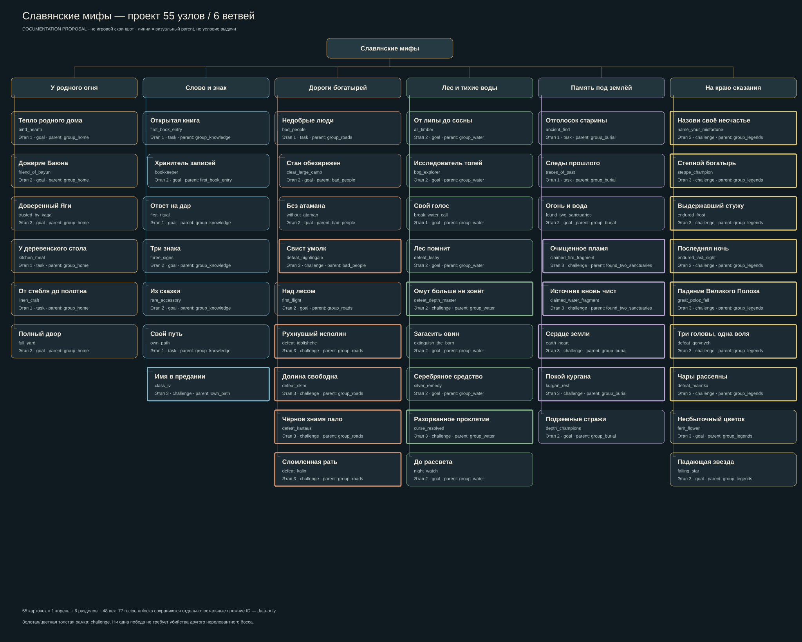

# Новое дерево: 55 узлов, шесть самостоятельных ветвей

**Проект для рассмотрения владельцем, этап A #30.** После его принятия — отдельный implementation PR с серверными тестами и настоящей проверкой интерфейса. Текущий PR не меняет ни одного runtime JSON или класса.

[Открыть SVG отдельно](TREE.svg). Это схема проекта, не снимок игрового интерфейса. Все 55 карточек с полными RU/EN названиями, подсказками, parent, stage, frame, icon и display flags перечислены в [TREE_TABLE.md](TREE_TABLE.md); машиночитаемый источник — [TREE.json](TREE.json). Судьба **всех** прежних ID — [DECISIONS.md](DECISIONS.md) и [DECISIONS.json](DECISIONS.json).

## Ритм и визуальная композиция

В одном дереве шесть дорожек: **У родного огня → Слово и знак → Дороги богатырей → Лес и тихие воды → Память под землёй → На краю сказания**. Стрелки в этой фразе означают порядок чтения дорожек, не обязательную последовательность прохождения. Все шесть — прямые дети root, выдаются штатным section tick без toast/chat. Вехи каждой дорожки распределяются на колонки обычного vanilla layout; рамка challenge выделяет большие завершения, goal — ремесло/отношения/элитное испытание.

Начало даёт несколько понятных ориентиров: книга, кухня, полотно, след древности и выбор пути. Средняя часть — доверие, руны, экспедиции, полноценный стан. Поздняя — самостоятельные боссы и испытания. На старте нет серии наград за бересту → свиток → предмет книги → ПКМ. Подсказки называют фактический результат, не обещают новые предметные rewards.

| Дорожка | Вех без раздела | Характер |
|---|---:|---|
| У родного огня | 6 | Домовой, Баюн, Яга, кухня, полотно, разведение трёх видов |
| Слово и знак | 7 | Открытие/освоение Книги, обряд, руны, редкий аксессуар, класс I и IV |
| Дороги богатырей | 9 | Лагерь, серьёзная зачистка, Атаман, Соловей, полёт; Идолище/Ским/Картаус/Калин |
| Лес и тихие воды | 9 | Коллекция дерева, болота, песня; Леший/Водяной/Овинник/Волколак/проклятие/Ночница |
| Память под землёй | 8 | Древность, первый след, оба святилища, два хранителя, Земля, курган, подземные элиты |
| На краю сказания | 9 | Лихо, Тугарин, Морозко, Карачун, Полоз, Горыныч, Маринка; цветок/звезда |
| **Всего** | **48** | **+6 разделов +1 root =55** |

Это единая свободная прогрессия, а не кампания с обязательным порядком боссов. Родитель определяет визуальную связь и поле `Available` Книги, **не условие выдачи**. Ни одна новая criteria не проверяет completion родителя. `class_iv` следует `own_path`; `bookkeeper` — открытию книги; фрагменты — обзорной вехе двух святилищ; лагерные результаты — обнаружению лагеря. Все боссы остальных глав — братья, а не цепочка убийств. Можно честно победить босса до открытия его визуального родителя и сразу получить achievement. Начальные milestones и разделы не требуют принудительного изучения Книги для свободной игры.

Выбор шести дорожек сохраняет различия домашних отношений, мастерства, путешествий, природы, археологии и великих испытаний. У root больше нет отдельного «висячего» ряда Морозко/Карачуна. В Память перенесён Дух Земли; случайные forest_guardian/learn_armorer/two_rings убраны из старых чуждых рубрик. Иконки используют существующие item assets, без нового art или ребаланса. Толстые рамки в SVG — challenge, не оценка DPS босса.

## Условия 44 сохраняемых узлов

Точные текущие trigger, все criterion names, predicates и логическая форма requirements находятся в соответствующей строке [полной ведомости](DECISIONS.md) и [SOURCE.json](SOURCE.json). **Критерии и rewards каждого старого ID сохраняются**; новые parent/display — только из TREE. Stage0 — рубрика, 1 — освоение, 2 — экспедиция/мастерство, 3 — большая история; это UX-метка, не новый уровень/рецепт/проверка.

Не меняются OR `ancient_find` (монета ИЛИ осколок), `bad_people` (малый ИЛИ средний лагерь), `traces_of_past` (любая из6), AND `all_timber` (4 породы), `bog_explorer` (6 строений), `full_yard` (гусь+утка+коза). `bad_people` намеренно оставлен с текущим OR: большой стан имеет собственный серьёзный итог; новый критерий large не добавляется ради косметики и сохранности partial progress.

Уточнения server dispatch, не формата сохранённых критериев:

- `defeat_depth_master`, `without_ataman`, `name_your_misfortune`, `steppe_champion`: подтверждённая личная победа вместо радиуса/непроверенного source Player; adapter не меняет бой и право на старый loot. Проектная co-op политика и native-only ограничения — в BOSS_COVERAGE. Там, где факта участия нет, требуется ограниченный encounter-local tracker, а не глобальный поиск.
- `great_poloz_fall`: victory только в accepted native завершении; `TaleService.read` с ядром изучает запись, но больше не создаёт новую победу. Уже выданное (включая показ ядра) сохраняется как историческое done. Честная новая подсказка — победа, `hidden=false`, без загадки, навсегда скрывающей поздний контент.
- `claimed_fire_fragment`, `claimed_water_fragment`: одно завершение каждой истории хранителя, подсказывается **claim после очищения**. Criterion `claim` не переименовывается. Новая медаль проверяет принадлежность к завершённой встрече и participation; сами выдача фрагмента/Claims/receipt не перерабатываются. Старые claims/advancements, даже без восстановимой заслуги, не отзываются.
- `kitchen_meal` и claimed_* полагаются на исправленный dispatch #25. `first_book_entry` — успешное серверное open; `bookkeeper` — десять записей stage≥4, не три бита legacy Knowledge mask. `lore_keeper` остаётся data-only со своей прежней семантикой.
- `bind_hearth` сохраняет настоящее событие привязки. Его текст не требует отдельного нового threshold дружбы. `silver_remedy` сохраняет серебряный fatal strike; ordinary `volkolak` не Cursed Volkolak.
- `falling_star` оставлен как единственный выразительный результат редкого звёздного оберега; self_playing_music/table_is_set/not_today/full_speed_ahead убраны из display. `rare_accessory` — экипировка, не победа. Ни редкое украшение, ни цветок не подменяют boss credit.

## Условия 11 новых узлов

Все ID в `slavicmyths`, без рецептов и новых предметных наград. Для каждой новой медали — один criterion `victory` (`minecraft:impossible`), а для `class_iv` — `mastery`; список requirements из одной группы с этим criterion. Все новые `rewards={}`: историческое восстановление не начисляет XP, лут, рецепты или достижения повторно. Заголовки/подсказки/иконки/рамки/parent — в TREE_TABLE, без неоговорённых fallback.

| Новый ID | Фактический server callback / eligibility | Что не засчитывать | Историческое восстановление |
|---|---|---|---|
| defeat_gorynych | Реальный GorynychLedger instance, !Standalone, mask7 и переход в PURIFIED после native таймера; личный Participants, survival/non-debug | EXHAUSTED, die(), debug/standalone, предмет чешуи/печать, claim с full inventory | PURIFIED + personal receipt Claimed + !CreativeClaim + !Standalone; одного общего PURIFIED недостаточно |
| defeat_idolishche | После accepted BogatyrLedger.victory и durable participationFlag/defeatCount | spawn, последний hit без native допуска, показ материала | RewardLedger.history(0): participationFlag && defeatCount>0 |
| defeat_marinka | После WitchYard.victory accepted participant/contributed и записи progress | только освобождение Добрыни, debug, spectator, зритель | marinka_defeated && marinka_participation && DefeatCount>0 |
| defeat_skim | SkimValley.win для native eligible игрока (contributor OR attendance≥60) | подарок клыка/вызов Алёши, nearby без attendance | skim_beast_defeated && participationFlag && defeat_count>0 |
| defeat_kartaus | KartausEncounter.finish(true) после записи victory/clear_count, native owner | смерть чужого босса, ABANDONED/restart cancellation | player story.finist_kartaus.victory && clear_count>0 |
| defeat_kalin | KalinEncounter.finish(win) после native credited owner, калин сдался | raw death, GENERIC_KILL, зритель, обычный солдат | kalin_battle_won && times_kalin_defeated>0 |
| class_iv | Успешный ClassState.branch: ClassUltimates definition, level≥40, matching Second, completed trial, Third установлен | creative/debug прямое изменение NBT, выбор класса I, открытие окна | валидный Third из ClassUltimates, Level≥40, completed trial для parent; invalid состояние не чинить автоматически |
| curse_resolved | VolkolakStory.handOver после проверки Owner/Encounter/Nonce настоящего черепа, returned UUID, SKULL_RETURNED/ready | CursedVolkolak.die, фаза ESCAPED, чужой череп, общий RESOLVED | личный returned в том же encounter; не один мировой stage |
| kurgan_rest | Native KurganEncounters.died: principal boss (Prince либо tier1 Voevoda), actual dead и accepted instance transition; новый local player credit | chunk unload, retire/restore slot, RuneSummoned, смерть каждого Upyr; не nearby | **Нет**: нынешний bossDefeated не содержит личной заслуги |
| depth_champions | Actual accepted death bound encounter Kladovik ИЛИ LargePodzemnik, EncounterPopulation.defeat(key) + новый player credit | обычный podzemnik, debug/unbound, consumed flag без игрока | **Нет**: consumed map — world state |
| night_watch | Actual accepted player-causal death Nochnitsa после native cancellation checks, non-debug/survival; поддержать projectile owner | proximity, /kill, падение без личной заслуги, PvP | **Нет**: старого personal ledger не существует |

Eligibility/anti-debug guards относятся только к **новым** awards; настоящие правила native encounter/loot не заменяются. Где старый ledger уже содержит принятый персональный факт, его не переоценивают по текущей экипировке/классу/нахождению игрока. Исторические данные могут не доказать отсутствие старого creative обхода: такие случаи описать в отчёте, а не выдавать несуществующие runtime гарантии.

Classes 3 в main уже содержит ClassXpService, 12 ClassUltimates, ClassTrialService и проверку Level40/trial в ClassState.branch. Значит, узел имеет survival server route в коде; полный ручной Survival путь к IV и скорость прокачки **не измерены этой задачей**. Его нельзя объявить принятым на основании таблицы.

## Display и игровая проверка

Корень/рубрики: task, toast=false, chat=false. Task/goal milestones: toast=true, chat=false. Challenge: toast=true, chat=true, только первый личный completion. `hidden=false` у всех55; отсутствие story-spoiler до готовности решается текстом, а не исчезновением босса из карты. Vanilla сам ограничивает раскрытие дерева; 55 — количество карточек в полном дереве, не требование показать все при первом входе.

У Книги `Available` сейчас вычисляется из parentDone; её легенда/tooltip должна объяснять «ветка открыта», а не обещать запрет боя или выдачи. Не менять эту сетевую структуру и не вводить новые пакеты ради дизайна. После удаления display у legacy эти узлы исчезают из snapshot, но их done остаётся источником reconcile. Все видимые parent указывают на видимые узлы этого дерева.

На этапе B обязательны: vanilla и Книга, RU/EN, scales1/2/3/4, 1366×768 и1920×1080, новая/старая игра; проверить clipping длинных русских названий, соединения, late cards, completed-before-parent, drag/pan/zoom/scroll, отсутствие пустых рубрик/data-only карточек и логическую доступность. SVG не заменяет эти проверки. Никакого автоматического client запуска в этапе A.

# Полный предложенный display-контракт

Это проект, не установленные достижения. Все 55 карточек (включая root и 6 разделов) перечислены ниже. `hidden=false` у всех; `task/goal/challenge` — рамки. Все иконки — существующие предметы. RU/EN descriptions — буквальный текст будущих подсказок. Условия старых узлов точно приведены в SOURCE/DECISIONS, изменения и новые события — в NEW_TREE.

| ID | Parent | RU / EN | Подсказка RU / EN | этап | frame | icon | toast / chat / hidden |
|---|---|---|---|---|---|---|---|
| root | — | Славянские мифы / Slavic Myths | Впишите свою историю в мир сказаний. / Write your story in a world of tales. | 0 | task | minecraft:book | False / False / False |
| group_home | root | У родного огня / By the Hearth | Дом, дружба и доверие. / Home, friendship and trust. | 0 | task | slavicmyths:hearth | False / False / False |
| group_knowledge | root | Слово и знак / Word and Sign | Книга, обряды и собственное мастерство. / The book, rituals and your own mastery. | 0 | task | slavicmyths:lore_book | False / False / False |
| group_roads | root | Дороги богатырей / Heroes' Roads | От разбойничьего стана до княжеского войска. / From bandit camps to a royal army. | 0 | task | minecraft:compass | False / False / False |
| group_water | root | Лес и тихие воды / Woods and Quiet Waters | Узнайте край и выдержите его испытания. / Learn the land and face its trials. | 0 | task | minecraft:oak_sapling | False / False / False |
| group_burial | root | Память под землёй / Memory Beneath | Руины, святилища и древние хранители. / Ruins, sanctuaries and ancient guardians. | 0 | task | slavicmyths:ancient_coin | False / False / False |
| group_legends | root | На краю сказания / At the Edge of Legend | Великие испытания и редкие чудеса. / Great trials and rare wonders. | 0 | task | slavicmyths:fern_flower | False / False / False |
| bind_hearth | group_home | Тепло родного дома / A Hearth of Your Own | Привяжите очаг с помощью Домового. / Bind a hearth with the Domovoy's help. | 1 | goal | slavicmyths:hearth | True / False / False |
| friend_of_bayun | group_home | Доверие Баюна / Bayun's Trust | Заслужите дружбу Кота Баюна. / Earn Cat Bayun's friendship. | 2 | goal | minecraft:cod | True / False / False |
| trusted_by_yaga | group_home | Доверенный Яги / Yaga's Confidant | Дойдите до доверия Яги в её поручениях. / Earn Yaga's trust through her quests. | 2 | goal | slavicmyths:lore_book | True / False / False |
| kitchen_meal | group_home | У деревенского стола / At the Village Table | Заберите приготовленное блюдо из кухни. / Collect a prepared dish from the kitchen. | 1 | task | minecraft:bowl | True / False / False |
| linen_craft | group_home | От стебля до полотна / From Stalk to Cloth | Получите льняное полотно. / Obtain linen cloth. | 1 | task | slavicmyths:linen_cloth | True / False / False |
| full_yard | group_home | Полный двор / A Full Yard | Разведите гусей, уток и домашних коз. / Breed geese, ducks and domestic goats. | 2 | goal | minecraft:wheat | True / False / False |
| first_book_entry | group_knowledge | Открытая книга / An Open Book | Впервые откройте Книгу сказаний. / Open the Book of Tales for the first time. | 1 | task | slavicmyths:lore_book | True / False / False |
| bookkeeper | first_book_entry | Хранитель записей / Keeper of Records | Доведите десять записей Книги до полного изучения. / Fully study ten entries in the Book. | 2 | goal | minecraft:writable_book | True / False / False |
| first_ritual | group_knowledge | Ответ на дар / An Offering Answered | Успешно завершите обряд у алтаря. / Complete a ritual at an altar. | 1 | goal | slavicmyths:ancient_sign | True / False / False |
| three_signs | group_knowledge | Три знака / Three Signs | Установите три руны на одном предмете. / Install three runes on one item. | 2 | goal | slavicmyths:ancient_sign | True / False / False |
| rare_accessory | group_knowledge | Из сказки / Out of a Tale | Наденьте редкий сказочный аксессуар. / Equip a rare tale accessory. | 2 | goal | slavicmyths:warding_charm | True / False / False |
| own_path | group_knowledge | Свой путь / Your Own Path | Выберите свой первый класс. / Choose your first class. | 1 | task | minecraft:iron_sword | True / False / False |
| class_iv | own_path | Имя в предании / A Name in Legend | Достигните 40-го уровня, пройдите испытание и примите класс IV. / Reach level 40, complete a trial and adopt a class IV path. | 3 | challenge | minecraft:nether_star | True / True / False |
| bad_people | group_roads | Недобрые люди / Ill Company | Найдите малый или укреплённый лагерь разбойников. / Find a small or medium bandit camp. | 1 | task | minecraft:crossbow | True / False / False |
| clear_large_camp | bad_people | Стан обезврежен / The Stronghold Falls | Завершите настоящую зачистку большого стана. / Complete the clearing of a large bandit camp. | 2 | goal | minecraft:iron_axe | True / False / False |
| without_ataman | bad_people | Без атамана / Without an Ataman | Победите Атамана; добыча из сундука не считается победой. / Defeat an Ataman; looting a chest is not a victory. | 2 | goal | slavicmyths:spear | True / False / False |
| defeat_nightingale | bad_people | Свист умолк / The Whistle Falls Silent | Одержите засчитанную победу над Соловьём-разбойником. / Earn a credited victory over Nightingale the Robber. | 3 | challenge | slavicmyths:mysterious_black_feather | True / True / False |
| first_flight | group_roads | Над лесом / Above the Woods | Совершите первый полёт на сказочном транспорте. / Take your first flight on a tale vessel. | 2 | goal | minecraft:feather | True / False / False |
| defeat_idolishche | group_roads | Рухнувший исполин / The Fallen Colossus | Заслужите победу над Идолищем Поганым. / Earn victory credit against Idolishche Poganoe. | 3 | challenge | minecraft:shield | True / True / False |
| defeat_skim | group_roads | Долина свободна / The Valley Is Free | Заслужите победу над Скимом в его долине. / Earn victory credit against Skim in its valley. | 3 | challenge | minecraft:bow | True / True / False |
| defeat_kartaus | group_roads | Чёрное знамя пало / The Black Banner Falls | Завершите встречу с Картаусом вместе с Финистом. / Complete the Kartaus encounter with Finist. | 3 | challenge | minecraft:black_banner | True / True / False |
| defeat_kalin | group_roads | Сломленная рать / The Broken Host | Добейтесь засчитанного завершения битвы с Калином. / Earn a successful resolution of the Kalin battle. | 3 | challenge | minecraft:iron_helmet | True / True / False |
| all_timber | group_water | От липы до сосны / From Linden to Pine | Соберите древесину всех четырёх местных пород. / Collect logs from all four local tree families. | 2 | goal | minecraft:oak_log | True / False / False |
| bog_explorer | group_water | Исследователь топей / Explorer of the Bogs | Посетите все шесть видов болотных построек. / Visit all six kinds of wetland structures. | 2 | goal | minecraft:lily_pad | True / False / False |
| break_water_call | group_water | Свой голос / Your Own Voice | Освободитесь от зова Русалки. / Break free of the Rusalka's call. | 1 | goal | minecraft:nautilus_shell | True / False / False |
| defeat_leshy | group_water | Лес помнит / The Forest Remembers | Победите Лешего; его редкое сердце не требуется. / Defeat a Leshy; its rare heart is not required. | 2 | goal | slavicmyths:leshy_heart | True / False / False |
| defeat_depth_master | group_water | Омут больше не зовёт / The Pool Falls Silent | Заслужите победу над Старшим Водяным. / Earn victory credit against the Elder Vodyanoy. | 2 | challenge | minecraft:trident | True / True / False |
| extinguish_the_barn | group_water | Загасить овин / Quench the Barn | Победите Овинника. / Defeat an Ovinnik. | 2 | goal | minecraft:campfire | True / False / False |
| silver_remedy | group_water | Серебряное средство / A Silver Remedy | Победите Волколака серебряным оружием. / Defeat a Volkolak with a silver strike. | 2 | goal | minecraft:iron_sword | True / False / False |
| curse_resolved | group_water | Разорванное проклятие / The Curse Unbound | Верните подлинный череп и завершите историю Проклятого волколака. / Return the authentic skull and resolve the Cursed Volkolak story. | 3 | challenge | slavicmyths:cursed_volkolak_skull | True / True / False |
| night_watch | group_water | До рассвета / Until Dawn | Победите Ночницу в честном бою. / Defeat a Nochnitsa in legitimate combat. | 2 | goal | minecraft:clock | True / False / False |
| ancient_find | group_burial | Отголосок старины / An Echo of Old | Получите древнюю монету или осколок идола. / Obtain an ancient coin or idol fragment. | 1 | task | slavicmyths:ancient_coin | True / False / False |
| traces_of_past | group_burial | Следы прошлого / Traces of the Past | Найдите любую из шести болотных построек. / Find any of the six wetland structures. | 1 | task | minecraft:mossy_stone_bricks | True / False / False |
| found_two_sanctuaries | group_burial | Огонь и вода / Fire and Water | Откройте оба вида древних святилищ. / Discover both kinds of ancient sanctuary. | 2 | goal | minecraft:ender_eye | True / False / False |
| claimed_fire_fragment | found_two_sanctuaries | Очищенное пламя / A Flame Renewed | Заберите свой огненный фрагмент после очищения хранителя. / Claim your fire fragment after the guardian is cleansed. | 3 | challenge | slavicmyths:mor_fire_amulet_fragment | True / True / False |
| claimed_water_fragment | found_two_sanctuaries | Источник вновь чист / The Spring Runs Clear | Заберите свой водный фрагмент после очищения хранителя. / Claim your water fragment after the keeper is cleansed. | 3 | challenge | slavicmyths:mor_water_amulet_fragment | True / True / False |
| earth_heart | group_burial | Сердце земли / Heart of the Earth | Заслужите победу над Духом Земли. / Earn victory credit against the Earth Spirit. | 3 | challenge | minecraft:emerald | True / True / False |
| kurgan_rest | group_burial | Покой кургана / Rest for the Barrow | Завершите бой с главным хранителем кургана. / Complete the battle against a barrow's principal guardian. | 3 | challenge | minecraft:bone | True / True / False |
| depth_champions | group_burial | Подземные стражи / Wardens Below | Победите Кладовика или Большого подземника в их встрече. / Defeat a Kladovik or Large Podzemnik in its encounter. | 2 | goal | minecraft:raw_gold | True / False / False |
| name_your_misfortune | group_legends | Назови своё несчастье / Name Your Misfortune | Заслужите победу над Лихом Одноглазым. / Earn victory credit against Likho the One-Eyed. | 3 | challenge | slavicmyths:odnoglazyy_obereg | True / True / False |
| steppe_champion | group_legends | Степной богатырь / Champion of the Steppe | Заслужите победу над Тугарином. / Earn victory credit against Tugarin. | 3 | challenge | slavicmyths:poyas_tugarina | True / True / False |
| endured_frost | group_legends | Выдержавший стужу / One Who Endured the Frost | Завершите испытание Морозко; его смерть не требуется. / Complete Morozko's trial; killing him is not required. | 3 | challenge | minecraft:blue_ice | True / True / False |
| endured_last_night | group_legends | Последняя ночь / The Last Night | Завершите испытание Карачуна. / Complete Karachun's trial. | 3 | challenge | minecraft:coal | True / True / False |
| great_poloz_fall | group_legends | Падение Великого Полоза / Fall of the Great Poloz | Заслужите победу над Великим Полозом. / Earn victory credit against the Great Poloz. | 3 | challenge | minecraft:gold_ingot | True / True / False |
| defeat_gorynych | group_legends | Три головы, одна воля / Three Heads, One Will | Доведите настоящую встречу с Горынычем до полного очищения. / Bring a real Gorynych encounter to full purification. | 3 | challenge | slavicmyths:serpent_seal | True / True / False |
| defeat_marinka | group_legends | Чары рассеяны / The Spell Is Broken | Заслужите победу над Маринкой в ведьмином дворе. / Earn victory credit against Marinka in the witch yard. | 3 | challenge | minecraft:amethyst_shard | True / True / False |
| fern_flower | group_legends | Несбыточный цветок / The Impossible Flower | Обретите цветок папоротника. / Obtain a fern flower. | 3 | goal | slavicmyths:fern_flower | True / False / False |
| falling_star | group_legends | Падающая звезда / A Falling Star | Пусть звёздный оберег спасёт вас от опасного падения. / Let the star charm save you from a dangerous fall. | 2 | goal | minecraft:glowstone_dust | True / False / False |
