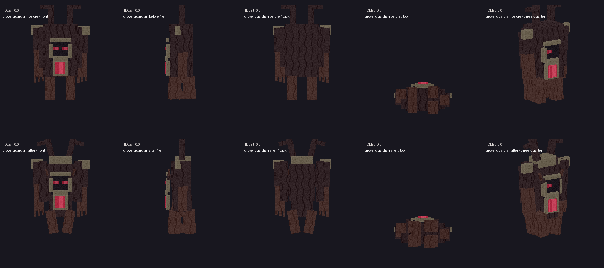
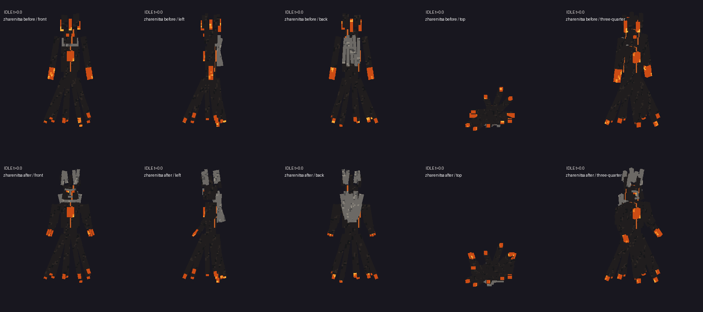
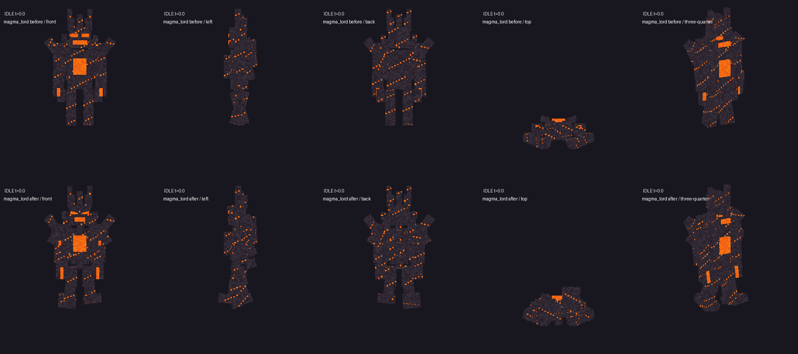

# #331 — повторный технический аудит, 28.10.2026

**Результат: прежняя художественная приёмка не пройдена. Исправления не выполнялись.**
Scope этого прохода: read-only production/установленный JAR/существующие native exports/журналы; локальные отчёты. Minecraft, PolyMC, GameTest и сервер исполнителем не запускались. Issues/Project/owner-accepted не изменялись. Clean build этого аудита NOT_RUN: production не менялся; старая сборка не объявляется новым доказательством.

## 1. Источник и фактическая сборка

- Единственный worktree: `D:/slavic-myths`, ветка `hell`, HEAD и origin/hell после fetch равны `d97a625fbe23b9345e7879f39463099fa676b71f`.
- Сохранены существующие изменения docs/отчётов и `gradle.properties` (локальное повышение версии2.0.9). Pull/reset/clean/rebase/commit/push и переустановка в этом аудите не выполнялись.
- Реальный selected HELL test instance: `C:/Users/pavel/AppData/Roaming/PolyMC/instances/Slavic-Myths-2.0.0-HELL`.
- Установлен один `slavicmyths-2.0.9-HELL.jar`, SHA256 `d5fbefe1e0041dc3d2c3b32779c4c8f5eee23274089a811fb7843c209f0991f9`.
- [Упаковка/метаданные/четыре головы](jar-head-paths.json). Source = указанный HEAD + локальное изменение номера версии. Не чистый опубликованный2.0.9commit.
- При предыдущем повышении версии побайтово сравнены2.0.8 и2.0.9: отличаются только MANIFEST.MF и neoforge.mods.toml; все классы и игровые ресурсы одинаковы. Предыдущая установленная2.0.8 SHA4a76d2198a7c3dbad006774586ef8d041bb8df8dfefb5d02f6935896bcec830b сохранена в backup20261028-203253-version209.
- **Последний фактический пользовательский запуск установлен:** latest.log от28.10.2026:20:36:06 обнаружен2.0.9JAR;20:36:36 запущен интегрированный мир;20:39:04 остановлен. [Точные строки](owner-log-excerpts.txt). Это запуск владельца, не исполнителя. Журнал подтверждает имя/версию, но сам не содержит SHA бинарника на момент запуска. Текущий SHA и квитанция установки согласуются с этой версией; подмену файла между событиями журнал не исключает криптографически.
- Сведения #331 про старый установленный102952... относятся к прежнему другому пути `C:/Users/user/...` и прежнему моменту. **Последний местный тест не следует списывать на старый JAR.** Какую сборку использовали более ранние скриншоты/каждый отдельный эпизод замечаний, без их времени и артефактов установить нельзя.

## 2. Реальные различия трёх моделей

Сравнены native-before/native-after из#327, JSON rigs до `c0dafcac` и сейчас, Java NavyaMesh до/после, PNG pixel bytes. Все три after PNG побайтово совпадают с текущими source PNG. Детальные значения каждого изменённого поля, UV/размеры/pivots, SHA и bounds: [model-differences.json](model-differences.json). Аудит воспроизводится `python docs/implementation/boss-audit-331/audit.py`.

| Босс | Геометрия в idle native export | Фактическое изменение | Что осталось проблемным |
|---|---|---|---|
| Сторож |192→240quad faces,32→40видимых кубов;256²PNG,46801изменённых пикселей | основной body36×56×24 заменён28×38×20; добавлены trunk_base24×24×20, два burls, broken_collar,4twig-детали; наклон crowns/burls/legs; UV перепакован после изменения кубов | face20×22×2 неизменён; внешний диапазон ширины62единицы почти тот же, фронтальная композиция «лицо+яркий прямоугольник ядра» сохранена. Это объёмные добавки, но узнаваемый прежний тотем сохраняется |
| Жареница |282→402faces;47→67parts;512²PNG,12774изменённых пикселя | arm4×22×5→6×12×6; отдельные forearm/shoulder/fingers, руки переподчинены, cheeks/brows/nose/lip,4ash_tress; волосы2→3ед. ширины/3→4глубины; венец получил новые material/наклоны | общий веер длинных лент и очень узкий торс сохранены; существенная светлая масса венца/затылка вместо угольной женской формы требует сверки с original. Большинство ribbon changes — UV, не новый силуэт |
| Повелитель |216→396faces;36→66parts;512²PNG,31369изменённых пикселей | forearms/shins/feet/ribs/crest/shoulder rocks, cheeks/brows/tusks; head15×13×12→12×12×11; переподчинены claws; UV изменены | прежняя гуманоидная композиция с большим прямоугольным светящимся грудным пятном сохраняется, width≈50.58ед. не изменился; добавление деталей не доказывает нужный парящий многосегментный образ |

Количество пикселей не мера качества: включает перепаковку UV. Native idle bounds содержат текущую позу/время экспортера, не коллизию и не runtime размер. 32→40 кубов у Сторожа относится к видимой idle выборке: скрытый held_trunk в неё не входит.

**До — верхняя строка; после — нижняя. Пять одинаковых ракурсов и один масштаб для каждого босса.** Просмотрены фактические материалы:

Это экспорт реальных ModelPart/UV, а не Minecraft screenshots и не художественный PASS. GIF тех же источников находятся рядом; отдельные P1/P2, все windup/release, освещение/шейдеры/расстояния и clipping остаются owner runtime NOT_RUN.

## 3. Полный путь четырёх голов

Общий путь: `TrophyHeads.Kind → BLOCKS/ITEMS → BlockItem → TrophyHeadBlock(FACING,HALF) → LOWER Tile → TrophyHeads.TILE(trophy_head) → TrophyHeadsClient.renderers/RegisterClientExtensions → Head → RenderType.entityCutoutNoCull + eyes`.
TILE принимает все BLOCKS. `newBlockEntity` создаёт Tile только для LOWER; это правильный anchor для двухъячеечных старых голов, новые четыре имеют height1. RenderShape=ENTITYBLOCK_ANIMATED: обычная block JSON не заменяет отсутствующий Tile/BER. BlockState variant пустой — fallback на все facings/half, а не отсутствие вариантов. Блок поворачивается BER по FACING. Все base/glowPNG, models/item, models/block, blockstates, loot_table присутствуют **в установленном JAR**; размеры текстур и SHA в jar-head-paths.json. Наличие файла/регистрации не доказывает реальный bake/render/placement.

| ID | item/блок/Tile/BER | Источник head+texture | Получение | Заключение |
|---|---|---|---|---|
| grove_guardian_head | ModBlocks+ModItems,BlockItem; общий trophy_head/BER; builtin/entity item | NavyaMesh.nodes.face; entity/grove_guardian.png и glow | NavyaMob.dropCustomDeathLoot: player→guardian_head inbox; без player→world item | цепь source+JAR есть; плоский face/subtleFX подтверждены; пропажу item не воспроизвели |
| zharenitsa_head | **старые CinderBlocks.ALL/ITEMS**, тот же BlockItem ID, теперь TrophyHeadBlock; общий Tile/BER; builtin/entity item | HallsMesh zharenitsa_trophy.head; entity/lost_halls/zharenitsa_trophy.png и glow | CinderMob: только home!=null и canClaim, player→inbox, безplayer→world item | ручной summon/egg без home **не даёт ни головы, ни остального boss batch**. Это подтверждённая ветка, не доказательство невидимой модели |
| posten_head | ModBlocks+ModItems BlockItem; общий Tile/BER; builtin/entity item | HallsMesh posten.head→mask_ring→mask_0…3; entity/lost_halls/posten.png и glow | Nether bind/journal, финал всех копий,80t ending→inbox | в Overworld Постень discard на первом server tick; убийство тела не равно финальной победе; возможно принять за пропавшую награду |
| magma_lord_head | ModBlocks+ModItems BlockItem; общий Tile/BER | IslandsModel.head с jaw/shards; entity/burning_islands/magma_lord.png+glow | MagmaEncounters/player/legal kill→inbox, readyAt+80t | **GUI/held item intentionally generated static icon** item/magma_lord_head.png; BEWLR extension регистрируется, но generated model не вызывает custom head rendering. Это штатное отделение GUI от placed3D |

У новых трёх item-моделей builtin/entity, GUI scale0.7; item renderer рисует base, не glow. Поэтому тёмные heads в GUI не получают placed emissive pass — отдельная проверка читаемости, не утверждение «головы нет». Magma icon отдельная, как требовалось.

### Наиболее конкретный обнаруженный путь отсутствия результата — Жареница

`CinderMob.dropCustomDeathLoot:134–140`: rewarded=true, затем `home==null || !canClaim → return`. У обычного /summon или яйца home не задаётся; natural CinderArenaPiece устанавливает home, а server tick регистрирует UUID. Natural player kill пинит только голову в BossRewardInbox, прочие награды падают отдельно; глава не обязана лежать на земле. Inbox применяет весь batch лишь при наличии места, повторяет каждые40ticks и при login. Ошибка authority-файла/read-only блокирует доставку с `Boss reward preserved/blocked` в журнале.

**Нельзя назвать именно эту голову тем неизвестным эпизодом владельца без воспроизведения его /give/placement/death.** В latest.log нет ошибки missing model/texture/BER для этих ID и нет точной записи неудачного получения головы. Нельзя менять loot gate для свободного summon-фарма как «исправление визуала».

### Старое размещение Жареницы — отдельный риск

Раньше CinderBlocks.Head был обычным HorizontalDirectionalBlock(FACING), без BE; класс ещё есть, но registration уже TrophyHeadBlock(FACING,HALF). ID сохранён, default HALF=LOWER. Старый placed block мог сохраниться без `block_entities` записи. Явного адресного migration-handler для него не найдено. Vanilla lazy creation BlockEntity может восстановить часть сценариев; **его реальное поведение и сетевую синхронизацию здесь не проверяли**. Поэтому это риск/NOT_RUN, не доказанная причина невидимости. Проверять исходную копию старого чанка до любого пересохранения; не ломать/ставить заново до фиксации исходного NBT.

Block loot четырёх голов привязан к half=lower и survives_explosion; player break source path даёт1, но explosion может не дать item по vanilla probability. Поэтому «ровно1 при любом взрыве» нельзя объявлять PASS. FLOOR/WALL — один блок с facing, отдельного mount-face свойства нет; shape symmetric и не проверяет поддержку. Проверка смены поддержки/стены обязательна.

## 4. Сторож: лицо, FX и реальный босс

- Head создаётся **из face subtree**, не из всего rig. Дочерние brow/jaw/cheeks/eyes/twigs присутствуют: фраза «только face» не означает один единственный куб. Но основной face имеет глубину2при ширине20/высоте22, задней оболочки нет. Подтверждён источник плоского трофея.
- Трофей: два twig ±0.025rad(1.43°); jaw в общей ранней ветке pose не анимируется; proximity logic только MAGMA_LORD/POSTEN, Сторож не реагирует на6/8блоков. Уже есть eyes-pass pulse175±45, поэтому «свечения совсем нет» неверно. Particle:1ASH/60ticks, дистанция24, только при render, без burst. Эти эффекты закономерно трудно различить.
- Живой босс: NavyaPose имеет замах ветвями, roots/summon gestures, поднимаемый held_trunk72ед.(4.5блока), фазное движение/пульс core. NavyaRenderer eyes pass повышает alpha воIIфазе; не полноценное динамическое освещение.
- Корни: NavyaEffectRenderer зарегистрирован NavyaClient, фактическая3Dгеометрия, warning plate и glow, подъем age15–24; NavyaRoots наносит damage на20. Следовательно damage происходит **до полного подъёма**. Предупреждение23ticks существует, но читаемость плоской плиты на реальном грунте NOT_RUN.
- Аура: server Weakness в радиусе6каждые40ticks на60ticks. **Отдельного визуального контура ауры в NavyaMob/Renderer нет**; статус эффекта не заменяет читаемую область. Призыв/удар также не имеют отдельного ground marker в просмотренном renderer.
- NavyaSounds реально ведут на vanilla events (например idle=mangrove_roots.place, hurt=bone_block.break). Это правомерные существующие звуки, но не оригинальный утверждённый голос. Проигрывание/различимость на слух в этом аудите NOT_RUN.

## 5. Постень: размер трофея

Уменьшается **трофей**, не PostenRenderer босса. `Head.scale=.85*min(.94/width,.94/depth,.9/height)` при Kind.height1. Удаление .85 даст+17.65% линейного размера к текущему, а не+15%. Четыре физические mask_* дочерние к mask_ring сохраняются. BER ведёт smooth90° переход по16tick в45tick cycle,6/8hysteresis.

Безопасный первый вариант — одноячейковая голова с увеличенным центральным объёмом и полноценным fit по **всей sweep-геометрии**: ring0…360°, parent gaze±.35, все facings и движения; просто удалить.85без bounds проверки небезопасно. Текущий fit снят в нейтральной позе, diagonal sweep может выходить заAABB. Старый native тест вращает whole head, а не полный набор реальных parent+ring-relative поз. Не менять height/старые BlockStates, пока одноячейковый вариант не исчерпан. Двухъячеечный переход требует отдельного согласования и миграции, не включён в предлагаемый первый патч.

## 6. План точечных изменений — следующий этап, НЕ реализован

| Приоритет/проблема и причина | Конкретные файлы/parts | Ожидаемый результат | Проверка |
|---|---|---|---|
| P0 неизвестная пропажа головы | TrophyHeads.java,CinderBlocks.java,TrophyHeadBlock.java,TrophyHeadsClient.java,CinderMob.java,BossRewardInbox.java; менять только подтверждённый слой | отделить item/GUI/placed/oldsave/loot; для старой Жареницы при подтверждении bounded loaded-chunk repair, без registry rename/глобального поиска | четыре /give отдельно от summon; BlockItem.place/Tile.type/validBlock; old palette безhalf/BE; server+client relog; естественная Жареница, fullinventory/repeat/MP. Никакого снятия canClaim |
| P1 плоский guardian trophy | отдельный trophy rig/helper в TrophyHeadsClient или NavyaMesh, generator tools/halls_assets.py/tools/nether_boss327_geometry.py; base+glow PNG для новой head UV | объёмный skull_shell/occiput, cheek layers, bone brow, jaw hinge, асимметричные ветви, задняя кора. Не переносить body в трофей | front/side/back/top/¾; sourceUVнепересекающиеся острова; static/animated silhouette, bounds/support/facing, old head IDs |
| P1 слабые trophyFX | TrophyHeadsClient.Head.pose/Renderer.particle,Tile transient fields; glow mask | jaw awaken6/8,2–3branches4–7° и короткий ограниченный burst. Это proposal для preview, не утверждённый баланс. cosmetic-only | client-only per-head cooldown, distance/frustum; cap видимых активных голов+общий particle budget, pause/unload;10/50голов FPS/MSPT при разрешённом runtime |
| P1 малая голова Постеня | Head constructor/create/Renderer; posten.json head+mask_ring при необходимости; TrophyHeads.bounds/TrophyHeadBlock.Tile AABB только по измерению | убрать необоснованное уменьшение, увеличить видимую форму, сохранить4mask rotation и1occupied cell | native sweptbounds для4facings/parentgaze/ring/distance; GUI/floor/wall/reload. Сравнить текущий и enlarged при одинаковом camera/player scale |
| P1 силуэт Сторожа всё ещё тотем | NavyaMesh GUARDIAN,NavyaPose,NavyaRenderer; grove_guardian base/glow; navya_entity_assets generator |6–7блоков, широкая древняя крона/слоистый ствол, асимметричные корни/ветви, лицо в середине, менее плоское яркое ядро | canonical#256+original; native5views/attacktimeline; owner lit client at4/8/16blocks |
| P1 женская форма Жареницы | cinder_rigs/zharenitsa.json,CinderModel.pose,CinderRenderer; base/glow; cinder_assets + nether_boss327_geometry + halls_assets trophy extraction | объёмный torso/shoulders/forearm, ash hair/crown, читаемая парящая юбка вместо тонких палок; отдельный head artifact синхронен UV | originalSHAad805...;5views/P1/P2/ring/spikes/shift/vortex/hurt/death, alpha и освещение; не менять750HP |
| P1 парящие сегменты Повелителя | burning_islands_rigs/magma_lord.json,IslandsModel.pose,IslandsClient renderer; base/glow; burning_islands_assets/nether_boss327_geometry | визуально отделить torso/ribs/core_shell/longfloatinglimbs; раскрываемое ядро, другой силуэтII; head jaw/shards сохранить | originalSHA354c...;5views,6attacks/corewindow/phase/death; trophy GUIstatic;850HP/neutral untouched |
| P2 боевые телеграфы Сторожа | NavyaEffectRenderer,NavyaPose,NavyaRoots,NavyaMob; навя roots/glow textures | читаемая ground warning/ограниченный aura ring, release согласован с геометрией доdamage. Геймплей не изменять самовольно | видео windup→release→damageframe, обычный грунт/блоки/низкая яркость; queued action/reset/load; MP один serverdamage |
| P2 звук | NavyaSounds/CinderSounds/IslandsMob calls,ModSounds,sounds.json,langRU/EN; legalOGG/license/source map | различимые idle/aggro/windup/release/phase/hurt/death,не synthetic filler | event→реальныйфайл→callsite, decodedOGG/JAR,subtitle,gain,distance,ручное прослушивание. Источник205 BLOCKED_NEEDS_AUDIO_SOURCE |

Регистрировать головы повторно не требуется: все4ID/BlockItem/TILE уже есть. Потребуется новая регистрация только если реально выбран новый звук/particle type; предпочтительны существующие boundedparticles и прежние registryIDs. Не добавлять общий tick polling для косметики или chunk loads ради поиска старых голов.

## 7. Референсы и обязательные gates

Свежие #331/#256/#266/#293/#302/#317/#318 сохранены в issues/. Прочитаны реестр NETHER_BOSS_REFERENCE_HANDOFF,guardian spec,threeheads lock,requirements00/10/12/13 и текущие project docs. Повторная физическая проверка docs/concepts,Downloads,attachments: [references.json](references.json) —14originalMISSING,guardianUNVERIFIED_SOURCE,архивов0. Предыдущий более широкий home search10639PNG/343ZIP также не нашёл originals; это не проверка всех дисков/всех архивов без ограничений. SVG/nativeнеподмена. Художественная часть BLOCKED_REFERENCE_BINARY/OWNER_REJECTED, не PASS.

| REQUIREMENT | EVIDENCE | RESULT |
|---|---|---|
| Фактический origin/worktree/installed | HEAD/status;jar-head-paths.json,owner-log-excerpts | PASS только идентификация |
| Реальные ModelPart/UV/PNG отличаются | audit.py,model-differences.json,3просмотренных5viewrenders | PASS только source difference |
| Полнота item→BER→texture4heads | source и installed packaging | PASS static; реальная выдача/placement NOT_RUN |
| Плоская guardian head/subtleFX | face20×22×2,TrophyHeadsClient earlypose/particle | FAIL относительно нового отзыва |
| Posten head размер | .85source,4mask ring | FAIL относительно нового отзыва |
| Manual Zharenitsa loot | home/canClaim gate | подтверждена sourceветка безнаграды; ownerэпизод NOT_IDENTIFIED |
| Old Zharenitsa migration | registryIDsame,newBE,explicitrepairне найден | NOT_RUN; риск,не доказанныйdefect |
| Original art match | originalbytesMISSING/ownerrejection | BLOCKED_REFERENCE / NOT_ACCEPTED |
| Runtime/MP/relоg/visibility/performance | запуск запрещён;своихзапусков0 | NOT_RUN |

## 8. Как проверить владельцу, риски/откат и следующий шаг

На копии тестового инстанса/мира сверить JAR/SHA выше; сначала **без установки новой сборки** локализовать неотображаемую голову. Диагностические команды (OP, не доказательство доступности):
`/give @s slavicmyths:grove_guardian_head`, затем отдельно `zharenitsa_head`,`posten_head`,`magma_lord_head`.
Снять GUI, held и placedfloor/wall4facings каждого. В точке размещения `/data get block X Y Z`: ожидается type `slavicmyths:trophy_head` уLOWER; отсутствие NBT зафиксировать до ломания/перестановки. Проверить latest.log на model/texture/BER exception. Полныйinventory сравнить с освобождёнными слотами через40ticks/relog. Старую zharenitsa_head проверять в исходной копии oldworld. В Nether natural Жареница должна иметь CinderHome/registeredUUID, вручнуюsummonedбезhome — ожидаемая текущая ветка безbatch. Для Постеня финал всех4копий+80ticks,дляПовелителя+80ticks;предмет может оказаться вinventory.

Обычный игрок: survivalпортал→естественныйбиом→арена→победа→inventory/head→поставить/снять→save/relog; повторнаяпобеда/перезаход не дублируют. Для2.0.5 naturalpath пока BLOCKED отсутствующей генерацией,не считать summon заменой. MPдва игрока: доставка только получателю/единыйbatch. После будущего патча повторить копию старого мира, предыдущие6голов, lowbrightness,10/50heads и реальные timings.

Все перечисленные runtime шаги здесь NOT_RUN, текущая неидентифицированная голова требует конкретного runtimeартефакта. Аудит не меняет JAR/миры/registry, поэтому productionоткат не нужен. Сохранены все прежние локальные изменения. Следующий шаг — точечная реализация согласованного плана; в этом проходе она намеренно не начиналась.
