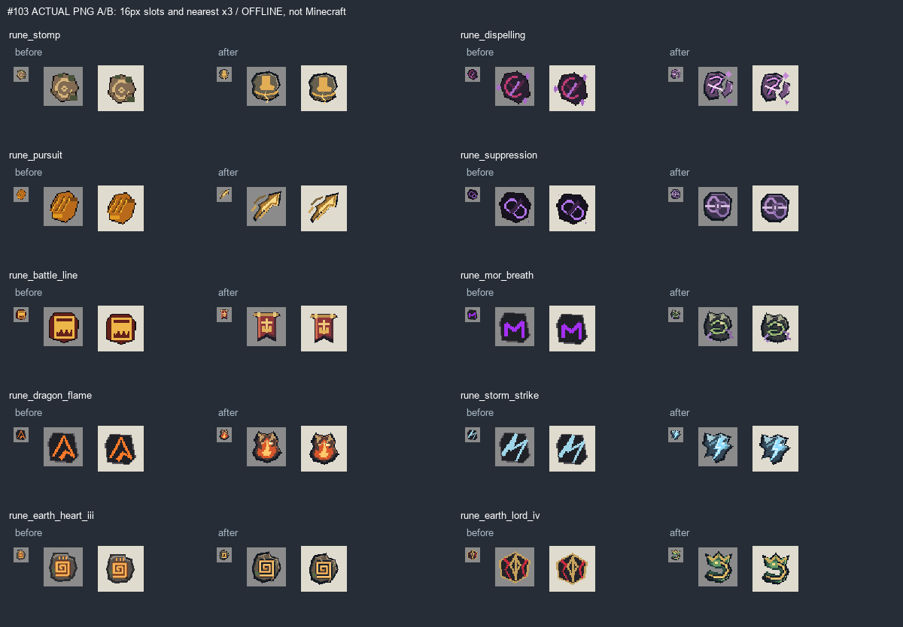

# #103 — боссовые и наградные руны, 1.9.7.39

**IN_PROGRESS / OWNER_PENDING.** Переработаны все10 основных ID задания. Три
дополнительно проверенных ледяных/тёмных руны сохранены. Автоматического закрытия
Issue, owner-accepted, commit или push нет. Прямое поручение владельца
«по рунам есть еще одна подзадача, только та связана с рунами с боссов, реализуй ее»
разрешает полный исполнительный пакет; это не приёмка конкретных PNG в игре.

Это offline-рендер реальных исходных/изменённых PNG, не концепт-постер и не
скриншот игры. Все10 используют прежние `minecraft:item/generated` модели;
ModelPart/UV/трансформы не менялись. Native64px сохранены у пяти наградных и
Сердца Земли; native32px — у трёх Горынычевых и Владыки Земли. Alpha бинарная.

## Файлы и источники

[Полный аудит13](AUDIT.md) / [машинный inventory с SHA](inventory.json) /
[исходные спрайты](BEFORE.png) / [10 индивидуальных листов](../../design/boss-runes/INDEX.md).
Снимки `before/` и `after/` содержат настоящие файлы; before включает13 моделей и PNG.
Исходник10 новых изображений — `tools/boss_runes103.py`. Старые writer-пути
точечно направлены в этот исходник в rewards_assets.py, gorynych_assets.py,
earth_resources.py, poloz_full_assets.py. Их широкие генераторы, аудио, модели
существ и прочие ресурсы не запускались.

Из production относительно начала #103 менялись только10 PNG и номер версии.
В сборку также вошла предыдущая полная серия #102 (24 руны +4 заготовки),
проверенная на неизменность. Эффекты/награды/дроп/NBT/ID/рецепты не менялись.

## Матрица требований

| REQUIREMENT | EVIDENCE | PASS/FAIL/BLOCKED/NOT_RUN |
|---|---|---|
| Аудит реальных13 ID, источников/размеров/моделей/дефектов | AUDIT.md, inventory.json, before/ | PASS |
| Индивидуальные чертежи10 рун | docs/design/boss-runes/*.md + *.svg; authored pixel geometry | PASS |
| A: три разные руны Горыныча, самостоятельная буря, общий мотив | AB-10.png, отдельные листы mor/flame/storm | PASS offline |
| B: пять наградных с разными силуэтами/знаками | AB-10.png, source image() | PASS offline |
| C: две земляные, спираль/коронованный змей | AB-10.png, source image() | PASS offline |
| Ледяные и Карачун: особая оценка без массовой замены | AUDIT.md, SHA до/после | PASS |
| Нативные размеры, alpha0/255,10 различных силуэтов в32px и16px | verify_boss_runes103.py | PASS |
| Byte parity генератора в sandbox; защита старых writer-путей | generator-check.json | PASS offline; широкие exporters NOT_RUN |
| ID/модели/UV/NBT/эффекты/дроп/рецепты/VFX и остальные ресурсы | baseline-source-sha256.json, whitelist10 PNG+version | PASS |
| Сохранение28 ранее внедрённых крафтовых и13 masters | verify_boss_runes103.py | PASS |
| Java21 clean build | BUILD.log: SUCCESSFUL in49s | PASS |
| Production JAR CRC/metadata39, resources/class parity | jar-check.json, source manifest | PASS |
| Сохранить именно исторический BOSS_RUNE_CONCEPT.png | отсутствует вложение/оригинал в доступных материалах | BLOCKED |
| Личная приёмка этих10 концептов/PNG владельцем | ещё не получена; прямой старт не подменяет приёмку | NOT_RUN |
| Реальная игра: инвентарь/рука/GUI и reward/effect binding | запусков0, только source audit | NOT_RUN |
| Установка в выделенный тестовый PolyMC, backup и один JAR | installed.json | PASS, TEST PREVIEW / IN_PROGRESS |

## Сборка и установленный файл

JAR `D:\slavic-myths\build\libs\slavicmyths-1.9.7.39.jar`. SHA256 `b8f3016d5918d8ad3706bae3f66654c7786b950d2277220237ca988cfd0c4deb`.
Проверены 7431 ресурсов, 1337 PNG, 1732
Java21 классов, JSON/CRC/metadata и отсутствие smoke-кода в production.

Установлен `C:\Users\pavel\AppData\Roaming\PolyMC\instances\Slavic-Myths-1.21.1-Testing\.minecraft\mods\slavicmyths-1.9.7.39.jar`. SHA256 совпадает со сборкой.
Backup `C:\Users\pavel\AppData\Roaming\PolyMC\instances\Slavic-Myths-1.21.1-Testing\codex-backups\before-1.9.7.39-20261020-173308\slavicmyths-1.9.7.36.jar`, SHA256 `de33a23866ab1bb5c7616d488f3eb009550e042f4a856ae484ae23968c096dd7`.
Один активный Slavic Myths JAR; шесть соседних модов сохранены по SHA.
Миры и настройки не изменялись. PolyMC/Minecraft/сервер/GameTest не запускались.
Это тестовый preview с перечисленными недоделками, не final/release.

Source base commit `f5d42cd5ff52cdcd0624dd8709bcd855b3809339` плюс незакоммиченный рабочий diff.
Точный состав source — build-source-sha256.json, fingerprint `e285a0cef2cd78d9539995ec8534c27fa461e5239953ee9d2d5fa45f72b07c81`.
Отдельного commit этой реализации нет (AGENTS.md запрещает автоматический commit).

## Что осталось

1. Ручной прогон владельца: все10 слотов/рука/GUI, различимость3 Горынычевых,
   фактические награды и соответствие эффекта. Принятие владельцем остаётся обязательным.
2. Получить и сохранить оригинальный ранее утверждённый постер. Не заменять его новой
   картинкой с тем же именем и не объявлять отсутствующий файл выполненным результатом.

Все10 указанных production-иконок созданы; незавершённость относится к историческому
референсу и приёмке/проверке в игре. Issue должна оставаться OPEN.
