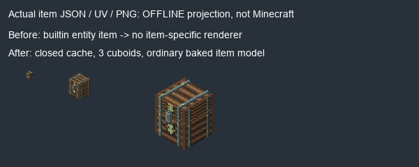

# Creative: заготовки и невидимый тайник — 1.9.7.40

**IN_PROGRESS / OWNER_PENDING.** По скриншотам владельца исправлены два конкретных
дефекта отображения. Реальная игра не запускалась; требуется ручная проверка.

## Что изменилось

Пустые руны I/II не были повторной регистрацией: RuneFoundation.creative() выдавал
I iron/gold и II diamond/perunite с одинаковыми названиями/спрайтами. Теперь выдаётся
один стандартный ItemStack на каждый зарегистрированный предмет, включая уровни I–IV.
Материальные альтернативы, RuneBase и их рецепты/подтипы JEI сохранены. Для других
материалов используются прежние рецепты; отдельные лишние клетки Creative убраны.

Тайник ссылался на `minecraft:item/chest` (специальный builtin/entity путь), без
собственной обычной геометрии предмета. Для инвентаря/руки теперь собственная baked
модель из корпуса, крышки и замка, деревянная32px текстура с металлическими полосами
и ритуальной печатью. Это предметная модель; установленный блок сохраняет прежний
ChestRenderer, анимацию крышки, двойной сундук, запирание, loot и NBT. Их дизайн
и поведение эта правка не заменяет. Registry ID остаётся sanctuary_ritual_cache.

Рендер использует реальные JSON elements/UV и PNG, исходник `tools/preview_cache40.py`.
Это не Minecraft screenshot и не подтверждение реального GUI/руки. Исходная модель
сохранена в before/, реальный исходный пустой слот показан на скриншоте владельца.
Без игрового renderer builtin/entity воспроизводимый source before не содержит
item geometry; не выдаём нарисованную пустую картинку за игровой тест.

## Файлы

Production: RuneFoundation.java (только creative()), models/item/sanctuary_ritual_cache.json,
textures/item/sanctuary_ritual_cache.png, gradle.properties.
Генератор: tools/ritual_cache_item40.py; точечный вызов из sanctuary_assets.block_assets().
Аудит Creative приведён к одному стеку на ID в verify_creative_inventory.py.
Старый широкий генератор святилища/аудио не запускался. Старый глобальный аудит
Creative не запускался с его историческими baseline и логами; текущая проверка отдельная.

| REQUIREMENT | EVIDENCE | PASS/FAIL/BLOCKED/NOT_RUN |
|---|---|---|
| Одна заготовка каждого уровня в Creative | RuneFoundation.creative(): один add на каждый уникальный registry entry | PASS source; runtime NOT_RUN |
| Сохранить рецепты/альтернативные материалы/сейвы | baseline whitelist, остальная Java и рецепты неизменны | PASS |
| Реальная видимая item geometry и собственная текстура тайника | JSON3 cuboids/6 faces each, native32 PNG, PREVIEW.png | PASS offline |
| UV и воспроизводимость ресурсов | verify_creative_cache40.py, ritual_cache_item40.py | PASS |
| Не менять размещённый блок/награды/открывание | все исходники sanctuary/client и blockstates сохранены по SHA | PASS source |
| Сохранить38 ранее изменённых иконок рун | полный baseline-source-sha256.json whitelist | PASS |
| Java21 clean build | BUILD.log: BUILD SUCCESSFUL in2m13s | PASS |
| Production JAR CRC/metadata/ресурсы/PNG/Java21 classes | jar-check.json | PASS |
| PolyMC40 installed/backup/один активный JAR/6 соседних модов | installed.json | PASS |
| Игровой Creative, слот/рука/установка и открывание тайника | запусков0; владелец проверяет | NOT_RUN |
| Ручная приёмка владельца | ещё не получена | NOT_RUN |

7432 ресурса,1338 PNG,1732 Java21 класса проверены в production JAR.
JAR `D:\slavic-myths\build\libs\slavicmyths-1.9.7.40.jar`, SHA256 `112db2736609251bc27e1f13f6619e2786c2c5573c6f03dc12bf79b31bcf85ab`.
Установлен `C:\Users\pavel\AppData\Roaming\PolyMC\instances\Slavic-Myths-1.21.1-Testing\.minecraft\mods\slavicmyths-1.9.7.40.jar` с тем же SHA.
Backup `C:\Users\pavel\AppData\Roaming\PolyMC\instances\Slavic-Myths-1.21.1-Testing\codex-backups\before-1.9.7.40-20261020-194433\slavicmyths-1.9.7.39.jar`, SHA256 `b8f3016d5918d8ad3706bae3f66654c7786b950d2277220237ca988cfd0c4deb`.
Source base commit `f5d42cd5ff52cdcd0624dd8709bcd855b3809339` плюс незакоммиченный diff;
точный source manifest build-source-sha256.json, fingerprint `2292b785fc3c1a9af25867d77bac793e8df14216c535c3f4b6f7fde9e5e69e32`.
Автоматического commit/push/закрытия Issues нет. Minecraft/PolyMC/сервер/GameTest не запускались.

Ручная проверка за один прогон: по одной заготовке I–IV в Creative; тайник видим
в слоте и в руке; установка/крышка/содержимое работают как прежде.
