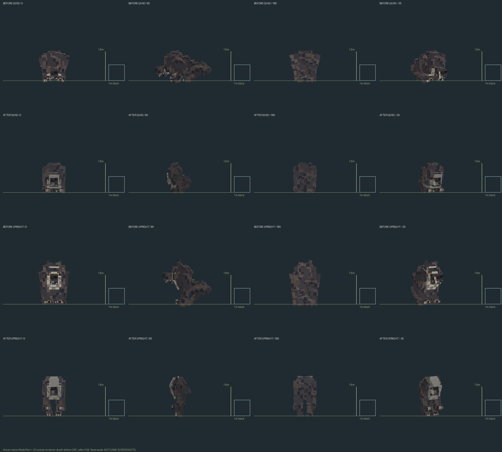
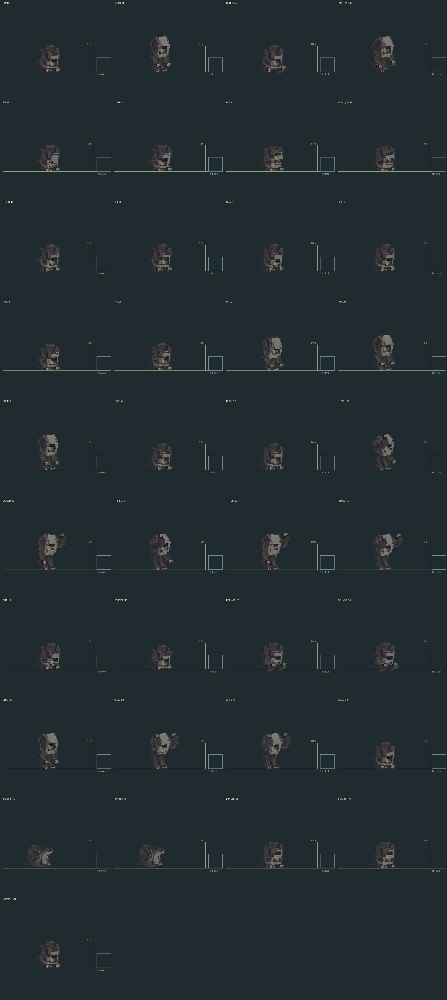
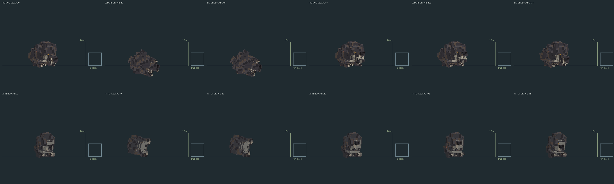

# #55 — Проклятый Волколак: IN_PROGRESS

Задача остаётся OPEN. Игровой проверки и ручного принятия владельцем нет.
Minecraft, PolyMC, GameTest и сервер не запускались. Версия не повышена,
новый JAR в PolyMC не установлен.

Это проекции реальных baked ModelPart vertices с настоящими UV и atlas PNG,
не игровые скриншоты. Камера и единицы масштаба одинаковы; учтён действующий
renderer depth scale: до 0.85, после 0.68. Baseline 957b1055 сохранён до
перестройки геометрии в before-native.json.gz; старая текстура читается из Git.

## Изменения

Маска укорочена, грудь сужается к талии, передние конечности массивнее,
уши/глаза меньше, хвост короче и сужается. Уменьшено число одинаковых шерстяных
пластин. Палитра тела холоднее и темнее, без изменения предметов/черепа/GUI.
Сохранены отдельные локтевые и скакательные суставы, когти и клыки.

Высота таза вычисляется из длины задних конечностей, стопы компенсируют угол
колена. На четвереньках кисти ставятся на пол через две ограниченные цепочки
суставов. Это вычисление рендера, без обхода мира или сущностей. Фаза бега
зависит от limbSwing, а не времени простоя. Полный reset включает position,
rotation, scale, visibility; прежнее смешивание по WeakHashMap сохранено.
getTarget() на клиенте не используется: визуальное напряжение берётся из
существующего синхронизированного Move.

RISE сохраняет низкую позу до серверной смены коллизии на 8-м тике; DROP
опускается до перехода на низкую коллизию на 6-м. Размеры сущности не менялись:
quad 1.65×1.9, upright 1.65×2.8. Сжатие renderer только по глубине позволяет
вместить обе базовые позы в прежнее квадратное основание. Размашистые атаки
и лежащая поза могут выступать за основание, как и обычные анимации конечностей.

ESCAPE: падение 0–19, неподвижность 19–49 с погашенными глазами, возвращение
глаз/дыхания на существующем 49-м тике, подъём 60–87, вой/уход с 87-го.
Поправка высоты при повороте корпуса устраняет провал в пол; проверяются все
132 тика, а не только кадры storyboard. POUNCE сгибает ноги в подготовке,
сохраняя опоры, затем подбирает задние лапы. Кисти GRAB остаются парными;
физический захват, предел 20 тиков и серверный контакт не менялись.

CursedVolkolak.java, canStand, урон, NBT, owner/nonce/provenance, могила,
Плакун-трава, выдача черепа, поручение Волка и награда Финиста сохранены.
Базовый volkolak, другие существа, предметы и все аудиофайлы не менялись.
Генератор получил --model-only: воспроизводит только rig/manifest/два atlas PNG.

## Аудио: обнаруженное ограничение, не исправление озвучки

Повторно проверены страницы [coldvet/Harvey Dog Growl](https://freesound.org/people/coldvet/sounds/404920/)
и [egomassive Growl](https://freesound.org/people/egomassive/sounds/536761/):
обе указывают CC0. Вторая ссылается на исходную запись Cylon8472, но отдельная
первичная страница этой записи здесь не установлена. [Wolf howls](https://commons.wikimedia.org/wiki/File:Wolf_howls.ogg)
помечен как public domain U.S. Fish and Wildlife Service.

Однако tools/volkolak_143_audio.py использует один growl для многих событий,
4–5% harmonic layer и процедурный noise/тон для ряда foley. Это обнаруженный
legacy-дефект относительно нового quality gate, а не принятые финальные записи.
Этот генератор НЕ запускался, все старые OGG сохранены побайтно. Их качество и
новые реальные отличимые foley пока не приняты; звуковая часть остаётся FAIL /
IN_PROGRESS. Установка по цепочке #59/#47 удерживается, silent-решения не выдаются
за исправленный звук. Исторические sound credits не заменяют новое прослушивание.

## REQUIREMENT | EVIDENCE | STATUS

| REQUIREMENT | EVIDENCE | STATUS |
|---|---|---|
| Геометрия/палитра, две разные стойки | Реальные PNG выше, production model/atlas | PASS (source) |
| Одинаковая камера/масштаб до и после | Baseline native archive, actual UV, renderer scale | PASS (offline) |
| Опоры при беге/RISE/DROP, reset | Native transform checks, 48 gait phases, обе стороны | PASS (offline) |
| Обе базовые позы в прежних hitbox | gates.json: границы после renderer scale | PASS (offline) |
| Переходы совпадают с физической сменой стойки | Проверка высоты всех кадров RISE/DROP | PASS (offline) |
| ESCAPE 0/19/49/87/102/131, без провала | 37 pose samples; проверка каждого тика 0–131 | PASS (offline) |
| UV/размеры atlas/генератор/JAR | Native fixture и verify_cursed_volkolak_55.py | PASS (offline) |
| Квест/таймеры/бой/NBT/ID/исходное аудио | Exact source/resource scope против 957b1055 | PASS (source) |
| Реальные отличимые foley и принятая озвучка | Legacy procedural foley/повтор growl обнаружены; новые записи не поставлены | FAIL |
| Ручная приёмка звучания | Отсутствует | NOT_RUN |
| Реальный GRAB/бой/relog/blend в игре | Запуск запрещён, игровых свидетельств нет | NOT_RUN |
| Визуальная приёмка владельцем | Не получена | BLOCKED |

## Воспроизведение

Java 21: `gradlew.bat clean build -PvolkolakModelOfflineCheck verifyCursed55 verifyVolkolakModel`.
`python tools/cursed_volkolak_55_previews.py` строит проекции native poses.
`python tools/verify_cursed_volkolak_55.py` проверяет scope, детерминизм,
фактические UV/границы и побайтное соответствие ресурсов production JAR.
Чистая сборка Java 21: PASS, 1m24s; native pose/ground/transition: 829916 checks,
прежний native fixture: 2284 checks (92 parts / 94 cubes); resource/JAR: 90259 checks.
Точные результаты и SHA256 находятся в [gates.json](gates.json).
Существующие предупреждения deprecated/unchecked не скрываются.
Компиляция, source audit и NBT-код не выдаются за runtime или реальный перезаход.
