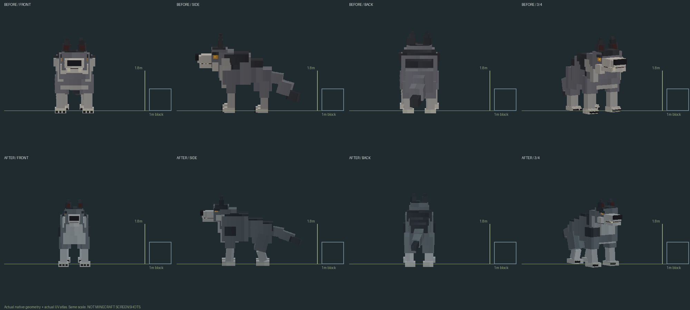
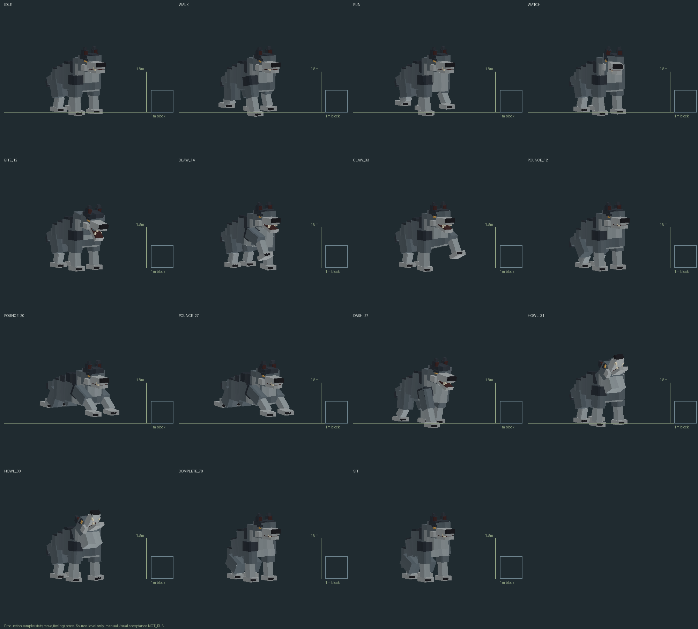

# #54 — Серый Волк: source rework, IN_PROGRESS

Ручная приёмка владельцем отсутствует. Задача OPEN, не DONE. Minecraft/client/
server/GameTest/PolyMC:0запусков. Сборка не установлена из-за обязательной
звуковой приёмки Русалки по#59/#47.

Это native ModelPart vertices + реальные atlas UV, не screenshots Minecraft.
Для масштаба показаны куб1блок и отметка1.8м. Baseline8888d0e1: исходные15поз
сохранены до изменений в before-native.json.gz, texture читается прямо из Git.
Новая модель рендерится по той же камере/шкале; декоративного дорисовывания нет.

## Что изменено

- Реальный GreyWolfGeometry/PNG/manifest и tools/grey_wolf_resources.py:
  69кубов вместо87 при сохранении30суставов. Сужение от мощной груди к талии/
  тазу, более узкие морда/глаза/уши, массивные плечи и лапы со сгибами, хвост
  из3последовательно сужающихся секций. Палитра холоднее, глаза небольшие;
  без фотошума, уменьшения512картинки или копирования vanilla wolf.
- Gait зависит от пройденного пути (limbSwing), диагональные опоры, сгибы
  локтей/скакательных суставов. footPlant вычисляет высоту опоры и компенсирует
  угол ступни. Проверена фактическая transform chain, а не только формула.
- NPC/watch спокойны; посадка вычисляет высоту таза из суставов, без провала
  задних ног. Howl остаётся на четырёх опорах; bite12, two claws14/33,
  pounce/flank27 используют старые настоящие hit ticks. В прыжке передние
  лапы вытянуты, задние отталкиваются/подбираются; при recovery полный сброс.
- WeakHashMap<GreyWolf,Blend> и прежний sync state/move сохранены; production
  sample вызывается setupAnim, а тесты вызывают этот же sample без Entity/world.
  Полный reset positions/angles/scales/visibility, без getTarget() на клиенте.
- GreyWolf.java/WolfTimeline/quest/pack/NBT/XP/ID/renderer/hitbox/аудио не менялись.
  Ресурсный генератор воспроизводит точный новый PNG/manifest/Java geometry.

## Ограничение хитбокса — НЕ скрыто

Registry остаётся2.2×3.5блока (квадратное основание2.2×2.2).
Native idle old: ширина1.875, высота3.485, длина4.756блока.
New: ширина1.45, высота3.068, длина4.608. Ширина/высота укладываются;
**полное строгое вмещение вдольZ не выполнено**: морда и хвост продолжают
выходить за квадратную collision footprint. Это унаследованная проблема,
не повод автоматически менять сохранённый hitbox/арену/урон. Визуальная модель
не объявляется полностью принятой. Если требуется строгое совпадение всего
силуэта с bbox, нужно решение владельца по пропорциям/физическому размеру;
без него размер сущности и gameplay оставлены прежними.

## Матрица REQUIREMENT / EVIDENCE / STATUS

| REQUIREMENT | EVIDENCE | STATUS |
|---|---|---|
| Реальная геометрия/texture/защита от regen rollback |4source assets + generator, native comparison | PASS(source) |
| Front/back/side/3⁄4, единый масштаб,15poses |PNG выше, baseline native archive | PASS(offline) |
| Лапы/посадка/прыжок/позы по реальным hit ticks |actual transforms + WolfTimeline checks | PASS(offline) |
| UV/finite/reset/blend/atlas |native fixture + generator/PNG/JAR gates | PASS(offline) |
| Ширина/высота в прежнем bbox |gates.json exact bounds | PASS |
| Строгое вмещение всего длинного силуэта в bbox |4.608>2.2 поZ | FAIL / owner decision pending |
| Quest/AI/NBT/pack/ID/damage/renderer/audio сохранены |exact source scope/old bytes | PASS(source) |
| Реальный relog/gameplay/MP/визуальная приёмка |нет игровых запусков | NOT_RUN |
| Принятие владельцем |не получено | BLOCKED |

## Проверки и воспроизведение

Java21: `gradlew.bat clean build -PgreyWolfModelOfflineCheck verifyGreyWolf54 verifyGreyWolfModel`.
Native new:25049checks,15poses; прежний native test:1684checks,30parts/69cubes.
Фактические foot transforms проверяются на48walk/run фазах,4опорах sit,
отрыве всех4лап mid-pounce, сбросе после каждого move/visibility.
Допуск0.01native pixel≈0.625мм учитывает Minecraft Mth lookup sin/cos.

`python tools/grey_wolf_54_previews.py` — картинки.
`python tools/verify_grey_wolf_54.py` — source scope, generator bytes,
actual mesh/UV/границы, PNG и production resource/JAR parity.
[gates.json](gates.json) содержит точные bounds/SHA/число проверок и незавершённое.
Архив before не перезаписывается; -Pwolf54Baseline был применён один раз до
изменения геометрии/поз, а не к новой модели под видом старой.
Существующие deprecated/unchecked warnings остаются; compile не выдаётся за игру.
