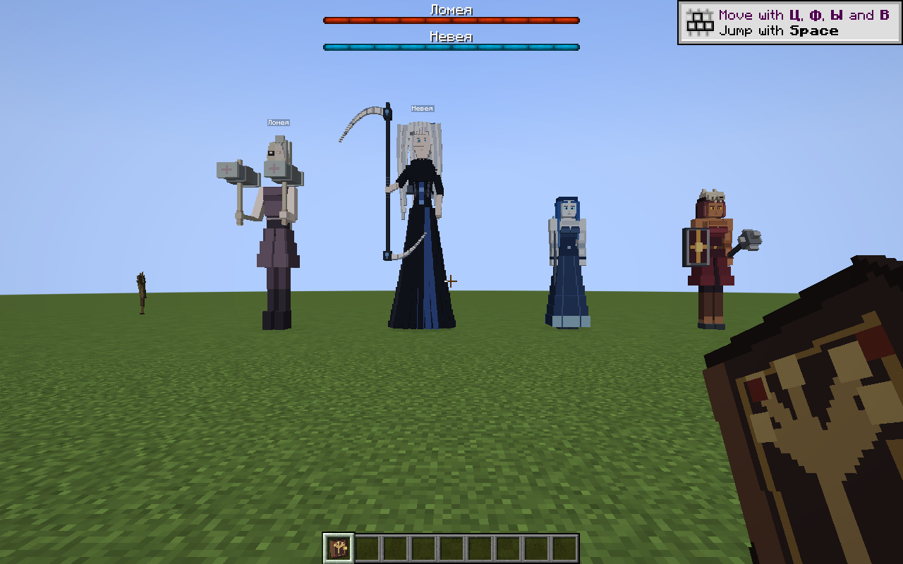

# Startup fix1 — 2026-11-05

Owner crash identifies SlavicMyths.java:140: Cannot register DeferredRegister to more than one event bus. Integration added ModEffects.EFFECTS registration while existing KurganCurse.EFFECTS is an alias to the same object. Prior static report incorrectly said once; this runtime failure corrects that conclusion. Fix uses canonical ModEffects registry at original registration position, removes duplicate, preserves all effect IDs including Fracture/Death Mark.

Build PASS Java21, version2.5-INTEGRATION-20261105-fix1. Initial normal clean/build attempts blocked by open files in shared build directory; unrelated running processes left untouched. Separate build-launchfix1 used. Found incomplete cached class output (AgneyaBoss missing); forced compileJava --rerun-tasks --no-build-cache, then verified all four boss classes inside production JAR. No QA classes packaged.

Actual isolated client run PASS: hidden GLFW/no focus, title, disposable copy of prior QA world, four actual boss entities (AI disabled for render smoke), confirmed Lomeya2000/Neveya2400 HP, screenshot, save and normal shutdown. One actual Minecraft process launched after owner authorization; earlier QA compile failure did not launch a client. Logs: work/launchfix-client.log; result work/launchfix-runtime/posad-client-evidence/result.txt. Full mechanics, AI combat, multiplayer and PolyMC-launcher-specific behavior NOT_RUN. Game loaded production JAR via NeoForge client harness; no claim that launcher itself was exercised.

Installed exact tested JAR in new PolyMC profile Slavic-Myths-Integration-20261105-Testing, display name Slavic Myths 2.5 INTEGRATION fix1 - 05.11.2026 TEST. Previous failing JAR preserved under profile/mod-backups/launch-fix1-20261105; all older profiles and player worlds untouched. Installed hash recorded in INSTALL_MANIFEST.json. Preexisting kitchen JSON/unknown recipes and mytar_shackled_sickle errors remain deferred, not crash causes fixed here. Issue416 and art/combat owner acceptance remain incomplete.
