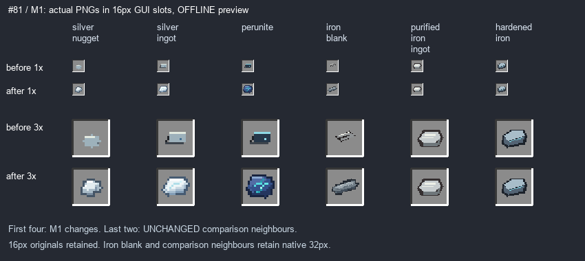

# #81 / #96 — пакет M1, четыре иконки · 1.9.7.33

**IN_PROGRESS / OWNER_PENDING.** Завершена адресная source-правка первого атомарного пакета; #96 и родитель #81 не закрыты и не объявлены принятыми. Остальные пакеты #97–101 не исполнялись: ТЗ запрещает менять все 26 за один проход. Следующий пакет — M2/#97 после handoff и сопоставления результата M1.

HEAD и origin/main: `7e6d64d41b330d675c65cb10ac738f7a1091a9b8`. Коммит не создавался. Предыдущие незакоммиченные #78/#79 сохранены до начала: [PREVIOUS_PACKAGE.json](PREVIOUS_PACKAGE.json). Полный source baseline до M1: [manifest](baseline-source-sha256.json). Владелец явно принял #77–79, закрытие выполнено по его поручению, но owner-acceptance-guard автоматически переоткрыла #77–79: нет метки owner-accepted от владельца. Итоговый GitHub статус OPEN; AGENTS.md запрещает Codex выставлять эту метку за владельца. Требуется личная метка владельца. Это не превращает прежние NOT_RUN в инструментальный PASS. #80 отменена владельцем, уже closed/not_planned, физически не удалена: коннектор не умеет delete Issue, браузер не авторизован.

## Дефект → реальный asset → изменение

Все четыре ID имеют `minecraft:item/generated`, layer0 строго `slavicmyths:item/<id>`; JSON менять не требовалось. Регистрация первых трёх — ModItems, iron_blank — WeaponCatalog.register через ModItems.ITEMS. Creative catalog `resources` проверен, порядок не менялся.

| ID | Дефект | Native PNG | Новая форма | A/B | Ресурсы/JAR | Статус |
|---|---|---|---|---|---|---|
| silver_nugget | Бледное пятно без объёма | 16×16, textures/item/silver_nugget.png | Неровный компактный самородок, холодные тени и светлые грани | AB-slots.png | byte parity PASS | OWNER_PENDING |
| silver_ingot | Плоская прямоугольная полоска | 16×16, textures/item/silver_ingot.png | Скошенный светлый слиток, тонкая однопиксельная голубая жила | AB-slots.png | byte parity PASS | OWNER_PENDING |
| perunite | Тёмный прямоугольник с одиночной точкой | 16×16, textures/item/perunite.png | Массивная асимметричная сине-стальная форма, локальные бирюзовые жилы | AB-slots.png | byte parity PASS | OWNER_PENDING |
| iron_blank | Тонкая незаконченная полоска | 32×32, textures/item/iron_blank.png | Плотная грубая поковка со ступенчатыми краями, окалиной и следами ковки | AB-slots.png | byte parity PASS | OWNER_PENDING |

[Полные пути ID→registration→model→PNG→source, старые/новые SHA256, число пикселей и фактическая палитра](assets.json). Оригинальные байты всех четырёх PNG/model JSON и двух соседей — `before/src/main/resources/assets/slavicmyths/`. Нативное разрешение и бинарная alpha сохранены, blur/AA/hue-shift не использованы. Грани и прожилки — только обычные непрозрачные пиксели; glint/emissive/particles не добавлялись.

## Сопоставление

Это **offline компоновка фактических ресурсов**, не скриншот Minecraft. Для всех шести сравниваемых предметов используется одна и та же 16px GUI сетка и nearest sampling. Последние два столбца — purified_iron_ingot и hardened_iron, байтово UNCHANGED. Дополнительный [native detail](after-inspect.png) увеличивает все исходники для осмотра пикселей, это не замена slot preview.

Серебро: светлая скошенная вытянутая форма с тонкой однопиксельной жилой; очищенное железо справа остаётся старой более тяжёлой серой горизонтальной формой. Перунит отличается асимметричной массой и тёмными боковыми гранями, а не перекраской серебра. Самородок — компактный неровный фрагмент. Заготовка — вытянутая поковка, без магических линий.

## Source и защита от исторических генераторов

Единственный новый authored source — `tools/materials81_m1.py`: четыре явные ручные пиксельные схемы, никаких случайных картинок или массовой перерисовки. Его запуск воспроизводит только четыре PNG.

Найдены старые писатели: generate_041 (silver), generate_045 (silver/perunite), generate_textures (perunite), weapon_resources_1321 (iron_blank). Добавлен узкий вызов write_owned для **точных четырёх путей** перед старым выводом. Прочие targets сохраняют старую ветку. Полные исторические генераторы не запускались; [diff только guards](legacy-writer-gates.patch). Reproducibility и guard отказ на чужом пути проверены. Новые ассеты не зависят от запуска старого общего каталога.

Production diff только четыре PNG и gradle.properties `.32→.33`. Все Java, JSON моделей, blockstates, рецепты/loot, названия/RU/EN, registry IDs, properties, creative catalog, оружие/трофеи, звуки, AI/модели существ и предыдущие #78/#79 — байтово совпадают с baseline. Python tools и документы — отдельные служебные изменения.

## REQUIREMENT | EVIDENCE | PASS/FAIL/BLOCKED/NOT_RUN

| REQUIREMENT | EVIDENCE | PASS/FAIL/BLOCKED/NOT_RUN |
|---|---|---|
| Свежие правила, статус, HEAD/main/dirty state, один writer | ISSUE_81.md, ISSUE_96.md, source baseline, архив предыдущего пакета | PASS |
| Правильные четыре registry ID, JSON→texture | assets.json; ModItems / WeaponCatalog, creative_catalog | PASS source |
| Адресная переработка 4 иконок, нативный размер/alpha | assets.json, asset-check.json, фактические PNG | PASS offline |
| Серебро/перунит/заготовка разные по форме и материалу | AB-slots.png, native detail; ручная игровая оценка не запускалась | PASS offline; OWNER_PENDING |
| Все четыре вместе, соседи purified/hardened UNCHANGED | AB-slots.png 1× и 3× nearest; source isolation | PASS offline |
| Генератор воспроизводит актуальные PNG, исторические писатели защищены | materials81_m1.py, idempotent bytes, gated diff, Python AST syntax | PASS offline |
| Нет посторонних production изменений | exact baseline SHA diff: 4 PNG + версия | PASS |
| Model paths/UV/alpha, отсутствие blockstate изменений | generated layer0, полное JSON/PNG чтение, unchanged models/blockstates | PASS offline |
| Java21 clean build | BUILD.log, BUILD SUCCESSFUL in 58s | PASS |
| Production JAR ресурсы/классы/версия/fixtures | jar-check.json; verify_materials81_m1.py | PASS offline |
| Внешность в игре / инвентарь / held item / освещение | Игровых запусков агентом 0 | NOT_RUN / OWNER_PENDING |
| Ручная приёмка именно M1/#96 | Не получена | NOT_RUN / OWNER_PENDING |
| Остальные обязательные #97–101 | Ещё не исполнялись, порядок родителя соблюдён | NOT_RUN |
| Установка .33 в PolyMC | Не запрашивалась; installed .32 сохранена | NOT_RUN / POLYMC_NOT_INSTALLED для .33 |

## Сборка

Команда: `gradlew.bat clean build`, JAVA_HOME только для процесса: `C:/Program Files/Java/jdk-21.0.12`. Ни Minecraft, ни сервер, ни GameTest, ни PolyMC не запускались. Native проверка классов Java21 = major65, тестовые fixtures не упакованы.

JAR: `D:\slavic-myths\build\libs\slavicmyths-1.9.7.33.jar`

SHA256: `67367490a975b8ed90316c2c75bf2ae0b9b5db9d4eaeab7ca3aa9a50403b4ea1`

Source base: `7e6d64d41b330d675c65cb10ac738f7a1091a9b8`, source commit: **UNCOMMITTED**, fingerprint `bc387b5a04284204093e359cd1f019902e5a00ec7f156d2857e098c9fc92290e` ([full manifest](build-source-sha256.json)).

Проверены 7431 ресурсов, 1337 PNG, 1732 classes; каждый ресурс/класс в JAR сравнен с processed build output. ZIP CRC и mod metadata PASS.

## Короткая проверка владельцем

После отдельного запроса на установку .33 сравнить четыре предмета в инвентаре с очищенным/закалённым железом, затем в руке/выброшенном виде на светлом и тёмном фоне. Подтвердить читаемость силуэтов, светлое серебро с тонкой жилой, синий тяжёлый перунит и грубую плотную поковку. До этого #96 OWNER_PENDING; родитель #81 не завершён.
