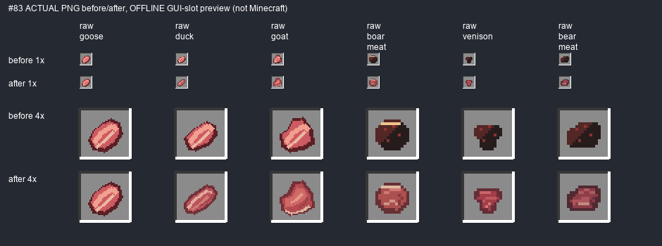

# #83 — микропатч сырого мяса, 1.9.7.35

**IN_PROGRESS / OWNER_PENDING, Issue OPEN.** Реализована небольшая правка пяти сырых иконок, не реворк еды. Приготовленные пары и гусятина сохранены. Агент не запускал Minecraft/PolyMC/GameTest/сервер: 0 запусков. Ручная игровая приёмка отсутствует.

Свежий main до публикации: `f48e42c2c4ec06dc81f7a241c3250a47b520031b`; fast-forward добавил только owner-бриф и концепт #83. Предыдущие пакеты и JAR34 сохранены: [PREVIOUS_PACKAGE.json](PREVIOUS_PACKAGE.json). Явное поручение пользователя в этом ходе разрешает commit/push и установку после реализации. #78/#79/#81-M1/#82 уже присутствуют в рабочем дереве и войдут в публикуемую .35; это не новая приёмка незавершённого #81 или #82.

Прочитаны AGENTS.md, три project docs, весь ISSUE_83_MEAT_MICROPATCH_GUIDE.md и PIXEL_ART_GUIDE.md. [Концепт](reference-inspect.png) — только направление. [Реальный baseline 6 raw + 6 cooked](baseline.png), [ванильные ориентиры](vanilla-reference.png) взяты из установленного Minecraft resources JAR для сравнения плотности, **не скопированы в новые PNG**.

## Диагноз и изменения

| ID | Дефект/решение | Статус | old/new PNG | slot1× | Проверки |
|---|---|---|---|---|---|
| raw_goose | OK: читаемый светлый кусок птицы; сохранён | UNCHANGED | before/src/main/resources/assets/slavicmyths/textures/item/raw_goose.png → src/main/resources/assets/slavicmyths/textures/item/raw_goose.png | AB-slots.png | PASS source; runtime NOT_RUN |
| cooked_goose | OK: естественные коричневые жареные оттенки, соответствует паре; без замены | UNCHANGED | before/src/main/resources/assets/slavicmyths/textures/item/cooked_goose.png → src/main/resources/assets/slavicmyths/textures/item/cooked_goose.png | baseline.png / unchanged | PASS source; runtime NOT_RUN |
| raw_duck | Слишком близка гусятине: грудка чуть уже, розово-красная темнее, тонкий жир | CHANGED | before/src/main/resources/assets/slavicmyths/textures/item/raw_duck.png → src/main/resources/assets/slavicmyths/textures/item/raw_duck.png | AB-slots.png | PASS source; runtime NOT_RUN |
| cooked_duck | OK: естественные коричневые жареные оттенки, соответствует паре; без замены | UNCHANGED | before/src/main/resources/assets/slavicmyths/textures/item/cooked_duck.png → src/main/resources/assets/slavicmyths/textures/item/cooked_duck.png | baseline.png / unchanged | PASS source; runtime NOT_RUN |
| raw_goat | Птичьи параллельные полосы: красный мышечный срез и жировая кромка снизу | CHANGED | before/src/main/resources/assets/slavicmyths/textures/item/raw_goat.png → src/main/resources/assets/slavicmyths/textures/item/raw_goat.png | AB-slots.png | PASS source; runtime NOT_RUN |
| cooked_goat | OK: естественные коричневые жареные оттенки, соответствует паре; без замены | UNCHANGED | before/src/main/resources/assets/slavicmyths/textures/item/cooked_goat.png → src/main/resources/assets/slavicmyths/textures/item/cooked_goat.png | baseline.png / unchanged | PASS source; runtime NOT_RUN |
| raw_boar_meat | Чёрное пятно: более ясная тёмно-красная мякоть и умеренная прослойка | CHANGED | before/src/main/resources/assets/slavicmyths/textures/item/raw_boar_meat.png → src/main/resources/assets/slavicmyths/textures/item/raw_boar_meat.png | AB-slots.png | PASS source; runtime NOT_RUN |
| cooked_boar_meat | OK: естественные коричневые жареные оттенки, соответствует паре; без замены | UNCHANGED | before/src/main/resources/assets/slavicmyths/textures/item/cooked_boar_meat.png → src/main/resources/assets/slavicmyths/textures/item/cooked_boar_meat.png | baseline.png / unchanged | PASS source; runtime NOT_RUN |
| raw_venison | Чёрное пятно: постный красно-бордовый срез с минимумом жира | CHANGED | before/src/main/resources/assets/slavicmyths/textures/item/raw_venison.png → src/main/resources/assets/slavicmyths/textures/item/raw_venison.png | AB-slots.png | PASS source; runtime NOT_RUN |
| cooked_venison | OK: естественные коричневые жареные оттенки, соответствует паре; без замены | UNCHANGED | before/src/main/resources/assets/slavicmyths/textures/item/cooked_venison.png → src/main/resources/assets/slavicmyths/textures/item/cooked_venison.png | baseline.png / unchanged | PASS source; runtime NOT_RUN |
| raw_bear_meat | Чёрное пятно: глубокий бордовый объём, приглушённые мышечные участки | CHANGED | before/src/main/resources/assets/slavicmyths/textures/item/raw_bear_meat.png → src/main/resources/assets/slavicmyths/textures/item/raw_bear_meat.png | AB-slots.png | PASS source; runtime NOT_RUN |
| cooked_bear_meat | OK: естественные коричневые жареные оттенки, соответствует паре; без замены | UNCHANGED | before/src/main/resources/assets/slavicmyths/textures/item/cooked_bear_meat.png → src/main/resources/assets/slavicmyths/textures/item/cooked_bear_meat.png | baseline.png / unchanged | PASS source; runtime NOT_RUN |

[Полные model→PNG пути, размеры и old/new SHA](inventory.json). Все item model JSON сохранены, включая действующий эквивалентный vanilla parent `item/generated` у диких видов и `minecraft:item/generated` у домашней птицы. Новые renderer/CustomModelData не добавлялись.

Это offline GUI-slot comparison, не скриншот игры. У диких трёх видов **alpha/силуэт байтово совпадает с исходным** — изменены только внутренний тон/мышечные группы/небольшой жир. Утка чуть вытянутее/темнее гуся, козлятина сохраняет свой крупный срез, но отличается естественным красным мясом вместо птичьих полос. Размеры native16/native32 сохранены; no blur/AA/upscale, alpha только0/255. Никаких радужных палитр или копий vanilla.

Точный production diff #83: пять `textures/item/raw_{duck,goat,boar_meat,venison,bear_meat}.png` и `gradle.properties` .34→.35. Все прочие production файлы равны baseline SHA: vanilla, остальные блюда/рыба, все cooked пары, raw_goose, FoodProperties/recipes/smelting/loot/ID/NBT/lang/creative, пиво/алкоголь, предыдущие растения и материалы.

`tools/meat83_assets.py` — точечный pixel source пяти PNG. Legacy `generate_065.png` и `husbandry_resources.save` направляют только эти точные target paths в новый source ([diff](generator-gates.patch)). Обе реальные writer-функции отдельно проверены в sandbox через AST; полные исторические генераторы не запускались. Чужие/vanilla targets не перехватываются. Повторный вывод byte-identical.

## Обязательная матрица

| REQUIREMENT | EVIDENCE | PASS/FAIL/BLOCKED/NOT_RUN |
|---|---|---|
| Актуальные правила/HEAD/защита предыдущей работы | source baseline, archive, ISSUE_SNAPSHOT.md | PASS |
| Диагноз 6raw и краткий осмотр 6cooked | baseline.png, inventory.json, vanilla-reference.png | PASS offline |
| Минимум замен, не более5 | ровно5 raw, goose и6 cooked UNCHANGED | PASS source |
| Реальный old/new A/B одинакового ID/фона | AB-slots.png, before bytes, SHA | PASS offline |
| Модели/texture paths, native sizes, alpha, воспроизводимость | verify_meat83.py | PASS offline |
| Wild outlines сохранены, естественные оттенки | alpha equality и осмотр actual preview | PASS offline; OWNER_PENDING |
| Соседи, vanilla, механики, пиво/алкоголь без изменений | полный baseline SHA, только5 PNG+version | PASS source |
| Legacy writers защищены без массовой перегенерации | 2 sandbox tests, generator-gates.patch | PASS offline |
| Java21 clean build | BUILD.log, BUILD SUCCESSFUL in52s | PASS |
| Production JAR CRC/meta/resource/class parity, fixtures excluded | jar-check.json | PASS offline |
| Minecraft GUI/hand/drop/light/owner acceptance | агент запусков0, владелец ещё не принимал #83 | NOT_RUN / OWNER_PENDING |
| Установка PolyMC и публикация Git | точный post-build receipt добавляется отдельно в ../polymc-19735/ | На момент source snapshot PENDING; см. receipt |

## Production build

`gradlew.bat clean build`, JDK21 `C:/Program Files/Java/jdk-21.0.12` задан только процессу. `test NO-SOURCE` не является игровым тестом. ZIP integrity, JSON, PNG и byte-for-byte сравнение всех processed ресурсов/classes проверены; Java class major65; smoke/native fixtures исключены.

JAR `D:\slavic-myths\build\libs\slavicmyths-1.9.7.35.jar`

SHA256 `6a55ae13ee18bb7b55f70575e1922e591dd8b81b5d27fb916248aeacdf6dd672`

7431 resources / 1337 PNG / 1732 Java21 classes. Source fingerprint `31d3ba87a9234441e7e992146516998ed7c6b00f0f974ca2b5f9f2bba6011b5c` ([full manifest](build-source-sha256.json)); committed source SHA будет в квитанции установки после явной публикации.

Короткая ручная проверка: в установленной .35 сравнить шесть raw рядом, приготовленные пары, предметы в руке/выброшенном виде и фон свет/тень. После явного решения владельца возможна приёмка #83; до этого не закрывается.
