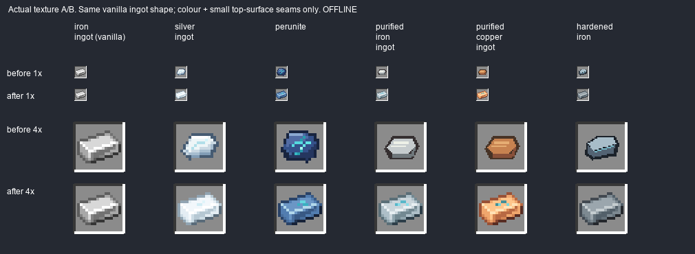
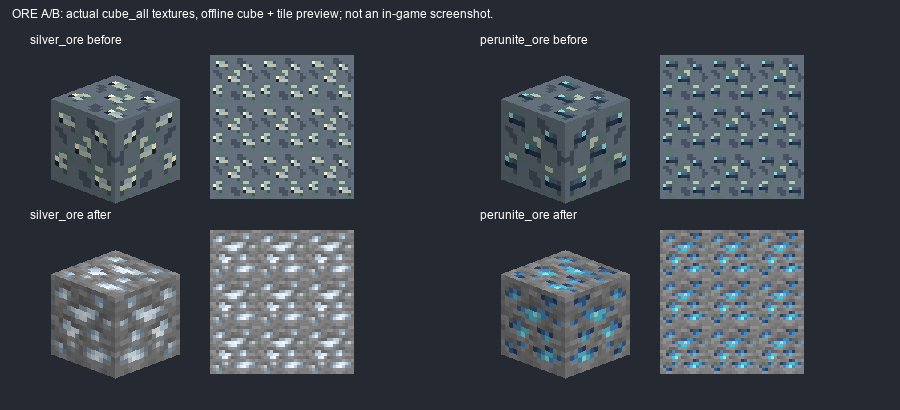

# Коррекция металлов по двум скриншотам владельца — 1.9.7.36

**IN_PROGRESS / OWNER_PENDING.** Новое прямое указание владельца: вид как у vanilla, различаются цвета и небольшие детали/жилки. Это заменяет прежнее решение #81/M1 о самостоятельных силуэтах серебра и перунита. Цель исправления — тот же обычный ванильный слиток, не новая форма куска металла.

## Что изменено

Пять слитков имеют **одну точную pixel topology `minecraft:iron_ingot`**: тот же контур/наклон/границы граней и светотень по плоскостям. Разница только в палитре и нескольких верхних пикселях жилок:

- Серебро — светлое холодное, тонкие бело-голубые прожилки.
- Перунит — сине-стальной, небольшие бирюзовые жилки.
- Очищенное железо — более тяжёлое серо-стальное, циановые жилки.
- Очищенная медь — медно-оранжевая, циановые жилки.
- Закалённое железо — тёмно-стальное, без магических жилок.

Два рудных блока имеют vanilla `iron_ore` расположение включений и каменную основу; меняется только цвет рудных пикселей. Все каменные RGB и их координаты совпадают с vanilla источником. Vanilla ресурсы **никогда не записываются**. Item/block models, registry IDs, блокstates/loot/recipes/баланс и свойства не менялись.

Нативное разрешение сохранено: silver/perunite/ores16px, purified/hardened32px. У32px иконок логический16px пиксель занимает точную клетку2×2 — тот же vanilla рисунок в GUI, без интерполяции и новых пиксельных деталей. Самородок, железная заготовка, янтарь, оружие и остальной каталог не менялись.

## Реальное A/B

Это **offline source preview**, не скриншот Minecraft. Изображения «до» получены из production .35 и лежат в before/. Верх/бок/плитка руд используют один и тот же действующий cube_all texture, фиксированные масштаб и освещение. Посадка в реальном инвентаре/мире и визуальная приёмка ещё не запускались.

Оба исходных пользовательских скриншота сохранены рядом: `owner-e210cf0b.png`, `owner-f2266675.png`. Vanilla topology и исходная палитра считаны из установленного Minecraft1.21.1 resources JAR, reference/ingot.png и reference/ore.png — оригинальные ориентиры; `tools/vanilla_metal_topology.json` хранит точные logical pixels, материал создаёт `tools/metals36_assets.py`. Использование одинакового шаблона соответствует новому прямому указанию владельца, а не прежнему требованию самостоятельной геометрии.

## Ресурсы

| ID | PNG | Native | Результат |
|---|---|---|---|
| silver_ingot | src/main/resources/assets/slavicmyths/textures/item/silver_ingot.png | 16×16 | CHANGED, same vanilla topology |
| perunite | src/main/resources/assets/slavicmyths/textures/item/perunite.png | 16×16 | CHANGED, same vanilla topology |
| purified_iron_ingot | src/main/resources/assets/slavicmyths/textures/item/purified_iron_ingot.png | 32×32 | CHANGED, same vanilla topology |
| purified_copper_ingot | src/main/resources/assets/slavicmyths/textures/item/purified_copper_ingot.png | 32×32 | CHANGED, same vanilla topology |
| hardened_iron | src/main/resources/assets/slavicmyths/textures/item/hardened_iron.png | 32×32 | CHANGED, same vanilla topology |
| silver_ore | src/main/resources/assets/slavicmyths/textures/block/silver_ore.png | 16×16 | CHANGED, same vanilla topology |
| perunite_ore | src/main/resources/assets/slavicmyths/textures/block/perunite_ore.png | 16×16 | CHANGED, same vanilla topology |

Полные пути/model bindings/old-new SHA: [inventory.json](inventory.json). Production baseline .35: [baseline-source-sha256.json](baseline-source-sha256.json), исходные PNG/models и старые generator bytes — before/. После изменения production diff ровно **7PNG+gradle.properties (.35→.36)**, остальные input hashes совпадают.

Legacy protection: materials81_m1 делегирует актуальные metal/ore пути новому source; generate_045 проверяет guard также для block PNG; industry_resources, unique_armor_resources и polish_046 используют тот же whitelist. Имеющиеся generate_041 и generate_textures уже вызывают materials81 guard. [Узкий diff](generator-gates.patch). Старые генераторы целиком не запускались. Реальные legacy functions и все7 target paths проверены в sandbox; repeat output byte-identical.

## REQUIREMENT | EVIDENCE | PASS/FAIL/BLOCKED/NOT_RUN

| REQUIREMENT | EVIDENCE | PASS/FAIL/BLOCKED/NOT_RUN |
|---|---|---|
| Новый референс владельца вместо отвергнутого M1 | 2 owner PNG, новый scope выше | PASS |
| Одинаковый ванильный слиток, только цвета/жилки | точная alpha topology всех5; logical cells и confined top seams | PASS offline |
| Vanilla ore stone/background/layout, новые цвета включений | pixel equality для всех stone positions, cube_all bindings | PASS offline |
| Не менять vanilla файлы/самородок/заготовку/другие assets/механику | полный production baseline diff7PNG+version | PASS source |
| Модели/texture links, native resolution, прозрачность, repeatability | verify_metals36.py, inventory.json | PASS offline |
| Исторические writers не откатывают правку | sandbox actual functions + delegate7paths, AST syntax | PASS offline |
| Java21 clean build | BUILD.log, BUILD SUCCESSFUL in1m40s | PASS |
| Production JAR/meta/resource/class parity | jar-check.json | PASS offline |
| Minecraft GUI/world/light и приёмка владельца | запусков агента0 | NOT_RUN / OWNER_PENDING |
| Установка/публикация | отдельная post-build квитанция будет добавлена после gates | PENDING до receipt |

Отдельно: это не полная реализация #81/#97 и не изменение оставшегося янтарного блока/прочих партий. Issue/owner-accepted не закрываются автоматически. Старые отчёты M1 — исторический as-was, новая геометрия .36 имеет приоритет по решению владельца.

## Сборка

JAR `D:\slavic-myths\build\libs\slavicmyths-1.9.7.36.jar`

SHA256 `de33a23866ab1bb5c7616d488f3eb009550e042f4a856ae484ae23968c096dd7`

Source fingerprint `a09a2482cb461e2938ac5148bcc682ba8fc72e35dc0b3183a9fa09ce2be544c7`; [полный manifest](build-source-sha256.json). 7431 resources / 1337 PNG / 1732 Java21 classes проверены byte-for-byte в production JAR, ZIP CRC и metadata36 PASS.
