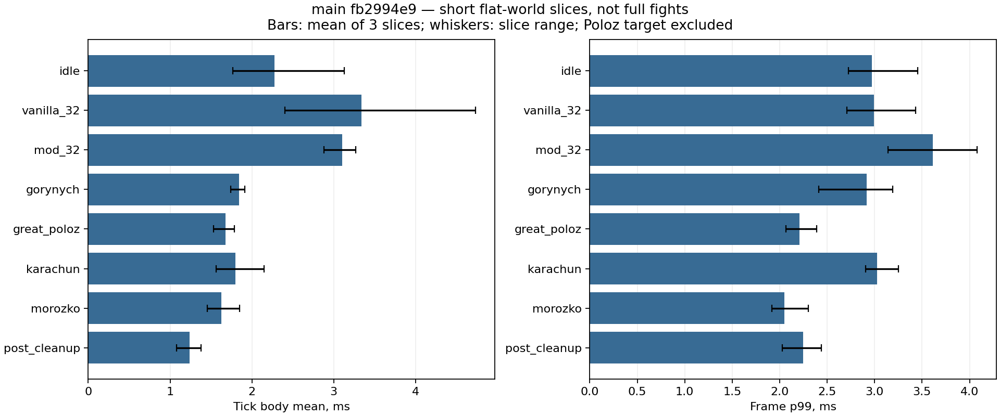

# Аудит производительности Slavic Myths — issue #28

Дата: 15 октября 2026 (MSK). Baseline: GitHub main `fb2994e958911169317523e1066b8a1ca7a155af`, версия **1.9.7.5**, Minecraft1.21.1 / NeoForge21.1.255 / Java21.0.12, official mappings. Аудит не меняет production, механику, баланс, модели или registry IDs. Отдельная ветка `codex/performance-audit`, worktree; чужие незакоммиченные материалы сохранены.

## Итог всех четырёх запусков

Реально запущены **4 dev clients и 4 integrated servers**: 09:31:26, 09:46:45, 10:17:33 и 10:34:04 MSK. Второй прогон прерван из-за ошибки тестового fixture: высота незагруженного чанка дала minY, игрок оказался в пустоте. Его extended/raw сохранён как INVALID и исключён из итоговых чисел. Один запрет launch guard не запускал JVM. Наблюдавшийся чужой Minecraft стартовал 10:01:39; дождались закрытия и выдержали 15 минут. Чужие процессы не останавливались. Три валидных прогона: **17800 sampled ticks / 56 строк агрегатов**, но это не 56 независимых повторений. После четвёртого запуска Minecraft больше не запускался.

### Боссы на земле — отдельный focused-прогон

Свежий FLAT, реальная поверхность Y=-60, без воздушной платформы. По одному циклу: 200 ticks warmup +1800 sampling; cleanup 400 sampling. Игрок survival, Entity.invulnerable=false, Resistance V; native AI и атаки боссов исполнялись. Тестовые 100 damage через boss.hurt каждые40 ticks после warmup ускоряют переходы фаз: это **не ручной Survival бой, не DPS/TTK и не оценка баланса**. Карачун/Морозко используют созданные fixture native sessions, Горыныч standalone, не естественный путь крепости/ритуала. Снимки фаз и CSV/JFR дают дополнительный overhead, отдельно не измеренный.

|Босс|Средний tick body живого активного боя, ms|p95 / p99, ms|Средний FPS всей сцены|TPS всей сцены|
|---|---:|---:|---:|---:|
|Великий Полоз|3.84|5.80 / 8.45|967.8|20.00|
|Змей Горыныч|2.07|2.87 / 3.79|1006.9|20.00|
|Карачун|1.77|2.46 / 3.29|1428.4|20.00|
|Морозко|1.69|2.55 / 3.30|1375.3|20.00|

Активные окна отфильтрованы по alive/nonremoved и состоянию боя: [cycle coverage](focused/cycle-coverage.json), исходные [combat ticks](focused/raw/combat.csv). FPS относится ко всей сцене, включая ожидание после завершения; сравнивать напрямую с отфильтрованным боевым временем нельзя. Полные показатели сцены и хвосты: [focused METRICS](focused/METRICS.md), [ticks](focused/raw/ticks.csv), [frames](focused/raw/frames.csv.gz).

Подтверждены естественные переходы Полоза1/2/3, смерть и world loot (core/whip/head/scales); автоматическое удаление трупа до fixture cleanup не подтверждено. Полоз имел живую цель699 ticks и action435 ticks, значит боевой AI реально исполнялся. Горыныч прошёл0–6, три native cleanse SUCCESS, маска1/3/7, PURIFIED; получение его награды НЕ ПОДТВЕРЖДЕНО. Карачун завершился с native removal и наградами; Морозко — с native removal и наградами. Подробные состояния/инвентарь: [events](focused/raw/events.txt). Удерживаемая fixture ссылка после удаления не считается живым AI. Очистка следующей сцены до одной сущности не доказывает естественную очистку всех tickets/queues.

### Normal terrain, массовые сцены, классы и руны

[Расширенные метрики](extended2/METRICS.md), [coverage](extended2/coverage.json), [события](extended2/raw/events.txt). По3 среза100 warmup +200 sampling ticks. На боевых сценах одноразовая платформа Y=121, 128 native pillagers с целью игроком и test-only увеличенным HP. Это искусственная плотная сцена, не естественное массовое событие.

|Сцена|Средний tick body, ms по срезам|FPS по срезам|Границы|
|---|---:|---:|---|
|Полоз, terrain stress|6.11–6.84|462.8–660.2|Активные действия были в warmup; в sampled окнах target/action отсутствовали. Не sustained combat.|
|Горыныч, native phase activity|3.23–3.57|786.4–875.4|Цель/действия наблюдались; не полный Survival маршрут.|
|Classes IV +128 мобов|8.62–10.66|298.6–533.6|10/12 попыток активации successful; living_wall/false_ambush NOT_EXERCISED, не доказанный дефект production.|
|Руны +128 мобов|7.20–8.37|375.5–390.1|45 targeted native attack attempts; 6/54 рун, не полное покрытие. Один tick70.18ms.|
|Три режима арбалета +128 мобов|7.01–10.22|217.3–290.7|Native performShooting с injected charged stack; не проверка Survival ammo/reload/burst queue.|

В terrain-сценах воспроизведены предупреждения native sound pool247 / failed sound handle и до примерно9800 tracked client particles. Они встречались с Полозом и волнами128 pillagers. Это наблюдаемый симптом насыщения, но отдельного такого же no-mod/без разрушений контроля нет: точная причина и вклад мода не доказаны. Число попыток разрушения в коде не равно измеренному числу разрушений/пакетов.

### Генерация мира: только синтетический стресс

**Y=200 используется исключительно как воздушная точка телепортации для chunk-loading stress.** Каждые40 ticks fixture синхронно вызывает getChunk для удалённой точки и телепортирует игрока. Это не обычная ходьба/полёт игрока; FPS из воздуха не является обычным gameplay FPS. Измерены avg18.75/64.62/58.49ms, max0.889/5.013/5.674s, TPS20.00/14.30/16.27. Длительные блокировки воспроизведены под принудительной синхронной загрузкой, но **не атрибутированы worldgen мода**. По ChunkEvent.Load наблюдались172/166/121 новых chunks в sampled окнах; rates22.26/11.87/9.84s⁻¹ зависят от этой траектории и не равны общей скорости генератора.

Сцена worldgen_old тоже создала136/193/180 новых chunks: это revisit, не чистый контроль уже сгенерированного мира. Начальные idle47.34→23.42→5.57ms загрязнены startup/worldgen и не steady baseline. Для выводов об исследовании нужен отдельный наземный маршрут и совпадающий no-mod контроль без принудительного synchronous getChunk.

### Память и профиль поздних прогонов

Extended2 JFR473.43s:232 GC, сумма пауз4098.76ms, max199.31ms; used heap в sampled окнах примерно646–2292MiB. Focused JFR441.053s:118 GC, сумма580.83ms, max74.84ms, sampled heap458–1693MiB. Это записи со startup/warmup/переходами, не суммы пауз только sampled окон. [Extended GC](extended2/raw/gc.csv), [focused GC](focused/raw/gc.csv), streaming summaries и SHA256 находятся в соответствующих каталогах. JFR бинарники остаются локально из-за process/system metadata; публикуются summaries и hashes. Пилообразный used heap и оценочный allocation weight не доказывают retained-memory leak. 5–10 повторных полных lifecycle циклов, full-GC retained heap, длинный idle, MP/packets и relog НЕ ПРОВЕРЕНЫ.

### Матрица итогового покрытия

- MEASURED: dev FPS/frame tails, integrated tick body/interval/TPS, heap/GC/JFR,32 AI и128 pillagers, ground native boss cycles, отдельные class/rune/crossbow paths, синтетическая chunk нагрузка.
- PARTIAL:10/12 IV activations,6/54 runes, native scripted boss damage/сессии, Полоз loot и Карачун/Морозко rewards. Награда Горыныча не подтверждена.
- NOT_RUN: dedicated/2-client MP, ручные Survival маршруты, обычное исследование мира, no-mod контроль, независимые повторы, полный balance/DPS/TTK, настоящее сохранение/перезаход, долгосрочная утечка.
- NOT_MEASURED: GPU time/draw calls, bytes/packets per second, отдельная стоимость каждого handler, естественная частота спавна, влияние profiler overhead.

## Что означают результаты

Это реальные **короткие инструментированные срезы dev-client и integrated server**, не заключение «весь мод оптимизирован» и не полная Survival/MP приёмка. Измерения серверного tick body получены между NeoForge ServerTickEvent.Pre/Post; они не включают всю работу остальных Post listeners и instrumentation самого Post. Tick intervals приведены отдельно. FPS =1000/mean интервала RenderFrameEvent.Post; это не GPU time и не p1-low. p95/p99 вычислены nearest-rank из сырых значений; heap — used heap до GC, не retained heap.

Первая серия: по5s warmup +10s sampling (100+200 ticks),3 последовательных среза в одном процессе. Первое создание мира/JEI/JIT дают явный warmup bias: idle avg3.13→1.77ms, vanilla32 avg4.74→2.41ms. Это ограничивает точность сравнений; полноценные независимые ≥3 процесса / длительные прогоны пока НЕ ВЫПОЛНЕНЫ. Срезы Карачуна/Морозко задают разные исходные HP (.9/.5/.2), поэтому не являются тремя одинаковыми повторениями. Все переходы сцен/спавн/очистка происходят test-only кодом в одноразовом мире.

Первый прогон Полоза ошибочно использовал invulnerable player, исключаемого `validVictim`; его цифры описывают locomotion/sync/render, **не боевой AI**. Первый Горыныч standalone без scripted damage, исходное состояние — не полный бой. Фазы/loot/ритуалы не доказаны одним наличием сущности. Исправленный боевой fixture и расширенные сценарии описаны ниже по фактическому результату.

## Окружение и воспроизводимость

- CPU AMD Ryzen5 5600H; RAM16 520 085 504bytes (~15.39GiB). Runtime GPU **AMD Radeon RX6600M** (подтверждён renderer string), драйвер32.0.21045.5002; также установлена встроенная Radeon27.20.21018.1012.
- Окно1280×720, render distance8, simulation distance5, VSync off, vanilla maximum slider260 (фактически uncapped); отдельный свежий options/world directory. Файл raw/options.txt содержит дисковые defaults, не применённые overrides: в первом run они выставлены кодом в памяти и не сохранены. Это отмечено в файле; extended отдельно пишет ACTIVE_OPTIONS и сохраняет настройки. Не переносить этот FPS на тяжёлый модпак или другое разрешение.
- Java `-Xms2G -Xmx4G`, Gradle daemon3G — отдельный процесс, не heap Minecraft. Mod runtime: SlavicMyths1.9.7.5, Curios9.5.1+1.21.1, JEI19.51.0.418, NeoForge21.1.255; dev loader dependencies входят в dev среду. Spark/оптимизационные моды не установлены. Это baseline с установленным модом, vanilla32 — контроль типа мобов **в той же модовой среде**, не чистая Minecraft без мода.
- Одноразовый мир seed280015. Первая серия FLAT, structures=false, normal difficulty, ночь18000, natural spawning/daylight cycle off, survival player без предметов, invulnerable/noGravity test target. Normal worldgen отдельно, нельзя выводить его стоимость из FLAT.
- JFR Java21 configuration=profile, started at title screen, все сцены/переходы/warmup внутри записи. Sampled stacks — статистика исполнения, не точное число вызовов или миллисекунды метода. Allocation weights — оценки, не утечки. Профилирование, CSV и очень высокий uncapped FPS сами создают overhead; отдельного unprofiled control нет.
- Первый Minecraft launch09:31:26MSK (launcher), завершение09:38:09; один реальный клиент и один integrated server. Перед запуском не было Minecraft JVM, чужая Gradle-сборка уже завершилась. Resource gate пересекался с первым idle; его нельзя считать идеально изолированным.
- Интервал запусков ≥15min проверяется `tools/performance-audit/run.ps1` через timestamp и отсутствие Minecraft процесса; никто из чужих процессов не останавливался. Старые PolyMC/миры не используются.

Команды из корня отдельного worktree:

```powershell
$env:JAVA_HOME='C:/Program Files/Java/jdk-21.0.12'
./gradlew.bat clean build compilePerformanceAuditJava -I tools/performance-audit/init.gradle
python tools/performance-audit/gates.py
python tools/check_event_subscribers.py build/libs/slavicmyths-1.9.7.5.jar
./tools/performance-audit/run.ps1                 # opt-in first suite
# Не ранее15min после предыдущего запуска:
./tools/performance-audit/run.ps1 -Extended       # opt-in extended suite
python tools/performance-audit/summarize.py
python tools/performance-audit/jfr_summary.py
python tools/performance-audit/summarize.py --extended
python tools/performance-audit/jfr_summary.py --extended
```

JAVA_HOME задаётся в дочерней команде/скрипте; постоянные настройки системы не меняются. Не запускать smoke/GameTest/ещё один клиент между этими стартами. Для независимых повторов сначала скопировать evidence в новый каталог; не перезаписывать результаты предыдущего запуска. Fixture никогда не входит в main source set / production JAR.

## Первая серия: реальные метрики

[Полная таблица24 срезов](METRICS.md), [числа без округления](metrics.json), [raw ticks](raw/ticks.csv), [raw frame intervals](raw/frames.csv.gz), [scene/spawn/end ledger](raw/events.txt), [sanitized runtime log](raw/client.sanitized.log). 

В каждой строке200 измеренных тиков, всего4800. Средние TPS около20, доля tick body >50ms —0% во всех24 срезах. Это не исключает spikes вне sampling windows.

|Сценарий|MSPT avg диапазон|FPS диапазон|Что проверено|
|---|---|---|---|
|Idle|1.77–3.13|1206.8–1761.9|Один survival игрок в прогруженном flat мире|
|32 vanilla zombie|2.41–4.74|817.1–1060.8|Native AI с test target,33 world entities|
|32 volkolak|2.88–3.27|510.5–631.2|Native mod AI,33 world entities; видна клиентская разница, server regression не доказана|
|Горыныч standalone|1.74–1.92|848.1–1047.1|Tick/render присутствуют в JFR,2–4 entities; без полного боя|
|Полоз locomotion|1.53–1.78|1104.7–1161.9|Tick/sync/render; invulnerable target, combat исключён|
|Карачун synthetic sessions|1.56–2.15|702.1–821.0|Native session AI,6–7 entities, три исходныхHP; не полная победа|
|Морозко synthetic sessions|1.45–1.85|1255.0–1340.8|Native session AI,2–6 entities, три исходныхHP; не полная победа|
|Post fixture cleanup|1.08–1.38|1800.2–2127.0|Одна world entity (multipart parts отдельно не считаются), cleanup через fixture; не доказательство event/loot cleanup|

JFR первой серии: **366.208s**,812013 events; execution samples Render thread7438, Server thread862. Самый частый CPU leaf `BufferBuilder.addVertex`:3316 samples (~37.6% execution samples), затем vanilla `IntArrays.mergeSort`717. Это профиль данного uncapped render workload, не доказательство дефекта модели. Inclusive mod render stacks: PolozRenderer988 across3 scenes; GorynychRenderer810 (пересекающиеся дочерние вызовы не суммировать). GuardianClient.cube — подтверждённый leaf allocation site (~1.05% давления); отдельный кандидат устранения временных массивов без изменения геометрии.

Серверных samples мало для точного ранжирования десятков handler.

GC:88 collections, sum of pauses469.8071ms, longest68.6479ms **за всю запись с warmup/startup**, а не только4800 sampled ticks. [GC events](raw/gc.csv), [heap before/after young GC](raw/gc-heap.csv), [heap chart](heap.png). After-GC heap349.25MB в ранней загрузке→466.84MB (~445.21MiB) к концу записи: это не full-GC retained-heap comparison. Used heap в windows примерно444–1672MiB с sawtooth; рост retained heap и memory leak НЕ ДОКАЗАНЫ. Estimated allocation weight Vec3~22.37GB за всю запись — не живой heap. Leaf allocation sites PoseStack.Pose copy11.52%, Vec3.add10.66%, StringConcatHelper.newString8.38%; fixture CSV/string concatenation входит в overhead. Нет оснований приписать весь вес Vec3 моду.

[JFR streaming summary](raw/jfr-summary.tsv), [размер и SHA256 бинарной записи](jfr-summary.json). Сам JFR24 197 670bytes хранится локально в `docs/implementation/performance-audit/raw/profile.jfr`, в PR не добавлен из-за system/process/player metadata. JSON-экспорт дал чрезмерное расширение и был остановлен после завершения игры; итог получен streaming RecordingFile без полного JSON в памяти. Это проблема обработки профиля, не игровой memory leak. Изменён только собственный untracked export; файлы репозитория не удалялись.

## Матрица первой серии (историческая, итог выше)

|Область|Статус первой серии|
|---|---|
|Real client frames + integrated server tick sampling + JFR|MEASURED, короткие срезы|
|32 vanilla/mod AI|MEASURED; не чистый no-mod контроль|
|Четыре босса|PARTIAL: native entities/render/session AI, полные battles/loot NOT_RUN|
|Normal new/revisit worldgen / структуры|Первая серия NOT_RUN; см. extended evidence|
|ClassesIV/руны/наградное оружие|Первая серия NOT_RUN; см. extended evidence|
|Dedicated+2 connected players, packets/s/KB/s|NOT_RUN/NOT_MEASURED; интегрированная сеть не является удалённой MP нагрузкой. Второй клиент и dedicated не поднимались, их runtime не принимается за пройденный.|
|GPU time/draw calls/particle lifetime counters|Первая серия NOT_MEASURED; наличие renderer stacks не измеряет draw calls.|
|5–10 полных lifecycle циклов / retained-heap / долгий idle / relog|NOT_RUN. Entity count после fixture discard не равен проверке утечки, tickets и durable cleanup.|
|Естественная частота спавна / env block reads|NOT_MEASURED; natural spawning был выключен.|

## Main и параллельные PR

Первичный `git fetch origin` подтвердил main fb2994e9 (merge#23 Classes3). Повторно проверены main и открытые PR перед публикацией: #31/#27/#25/#24/#21/#14/#13/#12/#11/#2. #31 — только дизайн Advancements2.0, не runtime-патч; не входит в baseline. Для приоритетных PR прочитаны GitHub metadata:

- #27 `codex/legendary-weapon-balance@8b75b7fb` — open, не merged; версия1.9.7.6/урон оружия **не входит** в этот baseline.
- #25 `codex/advancements-micro-patch@e2ca8a8f` — open, не merged; четыре advancement fixes **не входят**.
- #24 `codex/classes-3-final-qa@40566fb2` — draft, evidence followup; реализация классов уже входит через#23. Не путать design PR#21 с действующим кодом.
- Старые оружейные PR содержат частично уже интегрированные по другим путям решения. Их повторное слияние для аудита не выполнялось.

Не менялся main и не интегрировались параллельные ветки. Документационные записи добавлены в конец трёх status-файлов, чтобы уменьшить пересечение с QA PR#24. При новом merge baseline надо переснять; нельзя переносить эти числа на новые damage values без проверки.

## Сборка, ресурсы и Git hygiene

Финальный Java21 `clean build compilePerformanceAuditJava -I tools/performance-audit/init.gradle -PauditFocused`:PASS ([log](focused-build.log)); предыдущие успешные сборки также сохранены; ранний build с ошибками только нового fixture Difficulty/getEntityCount сохранён в[build.log](build.log), исправлен до первого запуска. Production compile не изменялся. [Gates](gates.json):3919 JSON parsed,1325 PNG verified,6804 source-resource byte parity,1685 class parity/Java65;221 nonempty event subscribers. Это структурные gates, не проверка всех механик. NeoForge production JAR: `build/libs/slavicmyths-1.9.7.5.jar`,19 696 852bytes, SHA256`77b79947b0c0df4ae2157410d7fa25c5ec225ecc9700fd603b04d3bf4cda887f`, test audit classes исключены. JAR не устанавливался в PolyMC.

[Tracked inventory](inventory.json):19546 файлов,971 019 757bytes (~926MiB) текущих blobs; docs10140/426 600 919bytes, release34/271 851 981bytes, work666/179 959 562bytes, art41/34 718 063bytes. Это не размер клона с history и не причина низкогоFPS. `.gitignore /work/` не отменяет tracking уже внесённых файлов. `git count-objects` дополнительно сообщил локальные orphan idx/tmp objects; аудит не выполняет gc/prune/repair и не объявляет это доказательством повреждения GitHub. Regex-инвентаризация635 static handler signatures /156 argument types доступна в[static inventory](static-inventory.json); это не runtime call graph. Поимённые94 archive/release candidates и18 групп идентичных больших blobs перечислены в[hygiene manifest](hygiene-manifest.json), все с решением KEEP. Отдельный keep/archive/release manifest в[PLAN](PLAN.md), никаких удалений.

## Вывод и следующий этап

Подтверждено исполнение render/AI paths и измерены короткие baseline windows. Устойчивый server bottleneck/P0 crash/memory leak этим baseline не воспроизведены. Клиентская нагрузка32 mod mobs заметно отличается от32 zombie на этом железе; причинный вклад geometry/animation/particles/lighting надо разделить контролируемым профилем, сохраняя визуальную детализацию. [Топ10 кандидатов](HOTSPOTS.md) отделён от PROFILE_CONFIRMED фактов; [планP0/P1/P2](PLAN.md) требует маленьких before/after PR и полной механической/визуальной регрессии.
