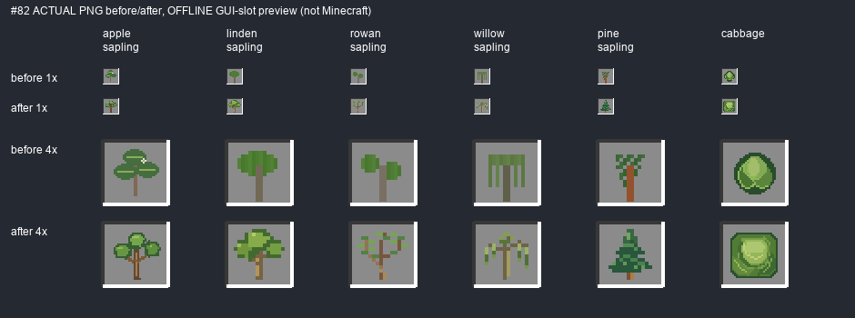
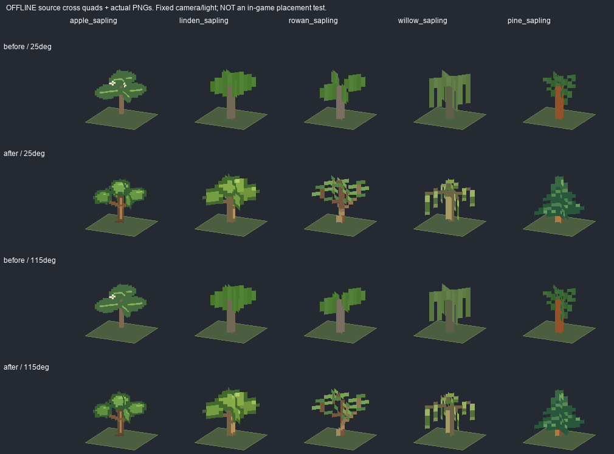

# #82 — адресный pixel art модовых саженцев и капусты, 1.9.7.34

**IN_PROGRESS / OWNER_PENDING, Issue OPEN.** Все 11 разрешённых ID проаудированы. Source-правка исполнена для пяти древесных саженцев и капусты, ягодные иконки UNCHANGED. Реальных запусков Minecraft/PolyMC/GameTest/сервера: **0**. Игровые placed/hand/drop проверки не подменяются offline изображениями.

Свежий main `5976ef3c37a56b49fbd8a9eb45a18e5f324c60a8`: безопасный fast-forward добавил только два утверждённых файла брифа и SVG #82. Предыдущие незакоммиченные пакеты #78/#79/#81 сохранены отдельным архивом вместе с JAR33: [PREVIOUS_PACKAGE.json](PREVIOUS_PACKAGE.json). Source baseline перед #82: [baseline-source-sha256.json](baseline-source-sha256.json). Автоматических commit/push нет.

Прочитаны ТЗ v4, весь ISSUE_82_PLANT_ART_GUIDE_V4.md и PIXEL_ART_GUIDE.md; полный чертёж просмотрен как концепт. [reference-inspect.png](reference-inspect.png) — служебная растеризация SVG для осмотра, **не production**. «До» получено исключительно из реально существовавших PNG, [baseline.png](baseline.png), оригинальные байты в `before/`.

## Ведомость 11 ID

Пути ниже относительны `src/main/resources/assets/slavicmyths/`. Полная связка item model→PNG→placed block model/blockstate, native size, SHA до/после и источник — [inventory.json](inventory.json).

| ID | changed/UNCHANGED | Причина | PNG | A/B 1× | placed | PASS/FAIL/NOT_RUN |
|---|---|---|---|---|---|---|
| apple_sapling | CHANGED | Три рыхлые округлые группы с цветком, силуэт слишком мягкий: компактные угловатые листья без цветения | textures/block/apple_sapling.png | AB-slots.png | AB-cross-offline.png; actual game NOT_RUN | PASS source / NOT_RUN runtime |
| linden_sapling | CHANGED | Сплошная округлая шапка и толстый ствол: плотные отдельные широкие листовые группы | textures/block/linden_sapling.png | AB-slots.png | AB-cross-offline.png; actual game NOT_RUN | PASS source / NOT_RUN runtime |
| rowan_sapling | CHANGED | Два пятна на прямом стволе: расходящиеся тонкие ветви с мелкими отдельными листьями | textures/block/rowan_sapling.png | AB-slots.png | AB-cross-offline.png; actual game NOT_RUN | PASS source / NOT_RUN runtime |
| willow_sapling | CHANGED | Ровная перекладина с одинаковыми полосами: четыре коротких побега разной длины | textures/block/willow_sapling.png | AB-slots.png | AB-cross-offline.png; actual game NOT_RUN | PASS source / NOT_RUN runtime |
| pine_sapling | CHANGED | Редкие разрозненные штрихи без конуса: три чётких хвойных яруса | textures/block/pine_sapling.png | AB-slots.png | AB-cross-offline.png; actual game NOT_RUN | PASS source / NOT_RUN runtime |
| raspberry_sapling | UNCHANGED | OK: вытянутый молодой побег, листовые группы читаемы; видимого дефекта нет | textures/item/raspberry_sapling.png | baseline.png / byte-identical | game NOT_RUN; bush unchanged | PASS source / NOT_RUN runtime |
| blueberry_sapling | UNCHANGED | OK: компактные небольшие листья и тонкий побег; видимого дефекта нет | textures/item/blueberry_sapling.png | baseline.png / byte-identical | game NOT_RUN; bush unchanged | PASS source / NOT_RUN runtime |
| blackcurrant_sapling | UNCHANGED | OK: широкие более тёмные листья; видимого дефекта нет | textures/item/blackcurrant_sapling.png | baseline.png / byte-identical | game NOT_RUN; bush unchanged | PASS source / NOT_RUN runtime |
| lingonberry_sapling | UNCHANGED | OK: маленькие плотные листья; видимого дефекта нет | textures/item/lingonberry_sapling.png | baseline.png / byte-identical | game NOT_RUN; bush unchanged | PASS source / NOT_RUN runtime |
| cranberry_sapling | UNCHANGED | OK: низкие стелющиеся веточки; видимого дефекта нет | textures/item/cranberry_sapling.png | baseline.png / byte-identical | game NOT_RUN; bush unchanged | PASS source / NOT_RUN runtime |
| cabbage | CHANGED | Круглый кочан: плоские бока и длинный плоский верх, срезанные углы, слои листьев | textures/item/cabbage.png | AB-slots.png | hand/drop NOT_RUN | PASS source / NOT_RUN runtime |

## Фактическое A/B

Первая иллюстрация использует тот же 16px GUI slot до/после, одинаковый фон и nearest sampling. Нативные 32px apple/cabbage не уменьшались в production; остальные деревья сохраняют native16px. Полупрозрачных контуров/blur/bilinear/upscale исходников нет.

Вторая иллюстрация — **offline проекция действующей cross-модели**, а не игровой скриншот посаженного саженца. `tools/plants82_previews.py` читает реальный `minecraft:block/cross` из установленного Minecraft resources JAR: from/to/rotation/rescale, две пересекающиеся плоскости, фактические texture texels. [Считанная геометрия](actual-vanilla-cross.json). До/после одинаковые камера (25° /115°), масштаб и фиксированный свет; простой плоский фон почвы служит только ориентации. Native graphics loader, cutout/mipmapping, случайный offset, world освещение, actual placement/hand/drop этим не подтверждаются. Двусторонняя мировая визуальная проверка владельцем остаётся NOT_RUN.

## Реализация и границы

`tools/plants82_assets.py` — адресный воспроизводимый источник ровно шести PNG, явные целочисленные пиксельные формы. Яблоня — широкие компактные листовые группы без цветков/плодов; липа — более плотные группы; рябина — раздельные листья и расходящиеся ветви; ива — четыре коротких поникающих побега; сосна — ступенчатые хвойные ярусы. Капуста получила плоские бока и более длинный плоский верх с небольшими срезанными углами; внутренние слои/жилки сохраняют образ листового кочана вместо зелёного минерала.

Старые actual writers `woodlands_0801.texture`, `gardens_resources.save`, `farming_resources.save` для точных шести texture paths вызывают новый authored source. [Минимальный diff](generator-gates.patch). Каждая из трёх реальных функций исполнена отдельно через AST в sandbox с заведомо неверным старым image: итог byte/pixel-identical новому source. Top-level исторические генераторы не запускались, соседние каталоги не перегенерировались. Чужие/vanilla paths guard отклоняет.

Production diff #82 относительно baseline **только**:

- `textures/block/apple_sapling.png` — 32×32;
- `textures/block/linden_sapling.png`, `rowan_sapling.png`, `willow_sapling.png`, `pine_sapling.png` — 16×16;
- `textures/item/cabbage.png` — 32×32;
- `gradle.properties` — `.33 → .34`.

Все остальные production файлы проверены по SHA и неизменны: vanilla resources, 5 berry saplings, все bush/crop age PNG, seeds, item/block models и blockstates, Java registration/gameplay/growth/worldgen/soil/loot/recipes/food effects, creative catalog, RU/EN, звуки/анимации и ранее изменённые материалы #81. Порядок: сначала древесные, затем капуста; ягоды — диагностический проход без замены.

## Обязательная матрица

| REQUIREMENT | ID/FILES | REAL A/B EVIDENCE | PASS/FAIL/BLOCKED/NOT_RUN |
|---|---|---|---|
| Актуальные main/правила/бриф; сохранность прежнего | HEAD выше, ISSUE_SNAPSHOT.md, PREVIOUS_PACKAGE.json | baseline PNG + SHA | PASS source |
| Ровно 11 approved ID, привязки/creative | inventory.json, actual item model layer0, unchanged catalog | baseline.png | PASS source |
| 5 молодых деревьев, разные морфологии без плодов | 5 block/*_sapling.png | AB-slots.png, AB-cross-offline.png | PASS offline / OWNER_PENDING |
| Кочан квадратнее, слои листьев, не куб | item/cabbage.png | AB-slots.png | PASS offline / OWNER_PENDING |
| Ягодные хорошие, нет ненужных замен | 5 item/*_sapling.png | исходные PNG SHA до=после | PASS source |
| Проверены item→texture и placed→cross | 5 block models/states, actual vanilla cross | inventory.json, actual-vanilla-cross.json | PASS source/offline |
| Native resolution, binary alpha, прозрачный фон, repeatability | все 11 PNG | verify_plants82.py | PASS offline |
| Не перезаписывать approved соседей историческим generator | три exact writer functions + write_owned whitelist | sandbox checks и generator-gates.patch | PASS offline |
| Vanilla/IDs/mechanics/seeds/stages/bushes и предыдущий арт без изменений | полный baseline SHA diff | only6 PNG + version | PASS source |
| Java21 clean build | BUILD.log, BUILD SUCCESSFUL in 58s | production build | PASS |
| JSON/PNG/class/resource parity, version, ZIP CRC | jar-check.json | 7431 resources, 1337 PNG, 1732 Java21 classes | PASS offline |
| Реальная посадка деревьев с двух сторон, cutout/light, hand/drop | реальные игровые скриншоты отсутствуют | агент не запускал игру | NOT_RUN / OWNER_PENDING |
| Berry planted smoke check без изменения взрослого куста | реальные игровые кадры отсутствуют | bush resources unchanged | NOT_RUN / OWNER_PENDING |
| Ручная приёмка именно #82 | явного решения ещё нет | не заявлена | NOT_RUN / OWNER_PENDING |
| PolyMC/worlds не менять | installed32 SHA сохранён, .34 не установлена | polymc-unchanged.json | PASS preservation / .34 NOT_INSTALLED |

## Сборка, исходники и JAR

`JAVA_HOME=C:/Program Files/Java/jdk-21.0.12` только для процесса; `gradlew.bat clean build`. Java21 target major65. Проверены все processed resources и classes byte-for-byte против production JAR, исключены smoke/native fixtures, JSON parsed, PNG verified, ZIP testzip и NeoForge metadata version34.

JAR: `D:\slavic-myths\build\libs\slavicmyths-1.9.7.34.jar`

SHA256: `2920d922e889755a354c80fabce246ced21ff5302b29a939d52026e92d4b32cd`

Source base: `5976ef3c37a56b49fbd8a9eb45a18e5f324c60a8`. Отдельного committed source ревижна нет: UNCOMMITTED working tree. Fingerprint `83cb1087566644c415625cb193b2270c6db45e8942cc7e38f11b0e085816b70f`; [полный source manifest](build-source-sha256.json).

## Краткая ручная проверка

После отдельного запроса установки .34: проверить все 11 в GUI/руке/выброшенном виде; посадить 5 деревьев и 5 ягодных кустов на отдельной копии мира, осмотреть спереди и с обратной стороны при дне/тени. Проверить читаемость/альфу и различимость деревьев, квадратность кочана, неизменность ягод/стадий; рост/семена не перенастраивались. До этого Issue OPEN, не DONE.
