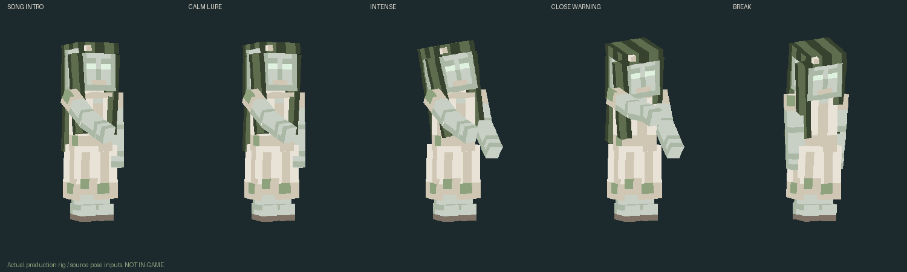
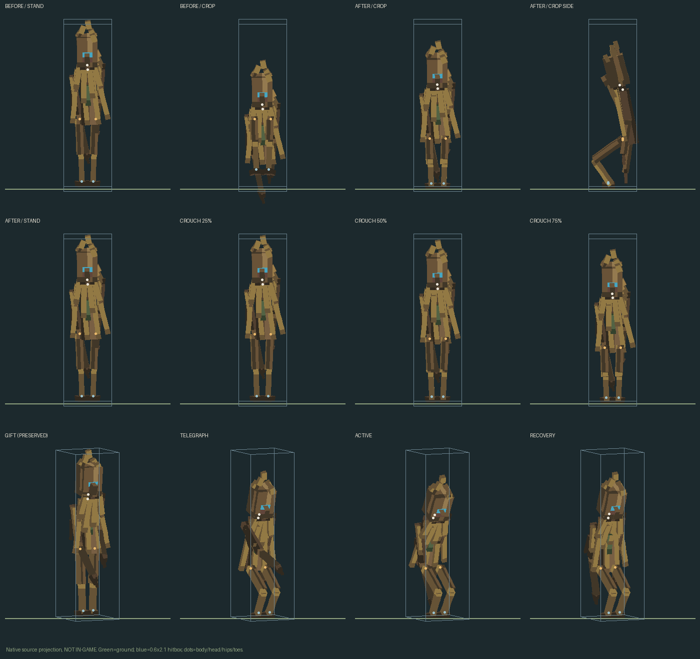

# #59 и #53 — исправления после отказа владельца

**IN_PROGRESS**, не DONE.
Предыдущая #49 не принята. Новые записанные аудио требуют прослушивания владельцем;
клиент/сервер/GameTest/PolyMC не запускались. Итоговую поставку #47 не выполняем.

## Русалка: реальные изменения #59

- Сначала наблюдение (около1секунды), затем вступление, спокойный цикл и нарастание.
  Первые5секунд песни защищены от агрессии только из-за сближения. После них
  подход ближе2.5блока даёт отдельное2-секундное предупреждение; отступление/LOS
  сбрасывают предупреждение. Удар игрока немедленно срывает песню, иммунитета нет.
- Реальные записанные C4–D4–A3–D4 (разные ноты/тейки, без pitch-shift и синтезатора).
  Трёхсекундное intro играет один раз, затем один calm/intense loop. Предыдущий
  экземпляр явно останавливается перед следующим; сохранены cap4/range20/LOS,
  очистка при смерти/unload/disconnect/resource reload. Интенсивность на charm75,
  угрозе отвечает отдельная синхронизированная поза. Charm/NBT/защита сохранены.
- Громкость файлов измерена ffmpeg ebur128: около−18.6…−24.7LUFS, peaks ниже−5dBFS;
  intro/loop около−22LUFS. Управляемый голос0.65 (intense0.70), fade-in≈0.5сек,
  реальное пространственное затухание20блоков. Это расчёт, не проверка слышимости
  в Minecraft; владелец оценивает громкость и тембр в игре позже.
- **Creative preview:** рядом с существующей спокойной Русалкой (≤12блоков)
  Creative+оператор выполняет `/slavicmyths dev rusalka_preview start`.
  30секунд пения/поз, последние10секунд — intense, без чар/атак/нового спавна.
  `/slavicmyths dev rusalka_preview stop` завершает раньше; выход Creative,
  удаление владельца/дистанция>20/урон прекращают предпросмотр. Обычное Creative
  поведение остальных мобов не менялось. Не запускалось, проверено на уровне кода.

## Слышимые кандидаты: A/B и происхождение

Все исходники — **записанный человеческий голос или записанная вода**, CC0;
сохранены публичные HQ MP3 с авторских страниц, не lossless оригиналы.
Редактура/таймкоды: `tools/rusalka_audio_59.py`; source URLs/license/hash:
[LICENSES](../../../art/audio/rusalka-59/LICENSES.md),
[источники](../../../art/audio/rusalka-59/sources.json),
[длительность, peak и LUFS каждого OGG](../../../art/audio/rusalka-59/outputs.json).
Кредиты входят в production JAR. Никаких лицензированных коммерческих сцен,
голосов мультфильмов или искусственного formant-мычания.

| Контекст | OLD (сохранён) | NEW OGG кандидаты |
|---|---|---|
| ambient | [синтетический](../../../src/main/resources/assets/slavicmyths/sounds/water/rusalka_ambient.ogg) | [1](../../../src/main/resources/assets/slavicmyths/sounds/water/rusalka/ambient_1.ogg), [2](../../../src/main/resources/assets/slavicmyths/sounds/water/rusalka/ambient_2.ogg), [3](../../../src/main/resources/assets/slavicmyths/sounds/water/rusalka/ambient_3.ogg) |
| intro | [прежняя песня](../../../src/main/resources/assets/slavicmyths/sounds/water/rusalka_song.ogg) | [вступление3сек](../../../src/main/resources/assets/slavicmyths/sounds/water/rusalka/song_intro.ogg) |
| loop | тот же OLD song | [четыре ноты7.32сек](../../../src/main/resources/assets/slavicmyths/sounds/water/rusalka/song_loop.ogg) |
| intense | отсутствовал | [другие записанные тейки7.32сек](../../../src/main/resources/assets/slavicmyths/sounds/water/rusalka/song_intense.ogg) |
| break | отсутствовал | [обрыв/вдох1.4сек](../../../src/main/resources/assets/slavicmyths/sounds/water/rusalka/song_break.ogg) |
| angry | [синтетический](../../../src/main/resources/assets/slavicmyths/sounds/water/rusalka_angry.ogg) | [резкий вдох1.1сек](../../../src/main/resources/assets/slavicmyths/sounds/water/rusalka/angry.ogg) |
| grab | отсутствовал | [записанный всплеск1.08сек](../../../src/main/resources/assets/slavicmyths/sounds/water/rusalka/grab.ogg) |
| hurt | [синтетический](../../../src/main/resources/assets/slavicmyths/sounds/water/rusalka_hurt.ogg) | [реакция1](../../../src/main/resources/assets/slavicmyths/sounds/water/rusalka/hurt_1.ogg), [реакция2](../../../src/main/resources/assets/slavicmyths/sounds/water/rusalka/hurt_2.ogg) |
| death | [синтетический](../../../src/main/resources/assets/slavicmyths/sounds/water/rusalka_death.ogg) | [затихающая реакция3.2сек](../../../src/main/resources/assets/slavicmyths/sounds/water/rusalka/death.ogg) |

Старые5OGG сохранены побайтно. Ни старые, ни новые записи пока не включены
в production event playback — сохранён карантин307419b3 до прослушивания.
Новые12OGG упаковываются как кандидаты; события зарегистрированы, но
**все Rusalka sound entries пока пусты**, client approval gate выключен.
Прежние event IDs сохранены. `water_070.sounds`
исключает Русалку из synth loop и восстанавливает её канонические события из
`art/audio/rusalka-59/events.json`; регенерация новых PCM проверена.
Decode/hash/LUFS не доказывают художественную пригодность; **человек не подтвердил
прослушивание, IN_GAME_AUDIO/VISUAL/GAMEPLAY=NOT_RUN**. Записи предоставлены
как реальные кандидаты, а не подмена одной заглушки другой.

## Полевик — отдельный возможный дефект #53

Исправлено именно исходниковое рассогласование: раньше body.y=8 опускало тело
при ногах на старом месте. Новое приседание использует согласованные hips,
thigh/knee/feet и геометрически вычисленное снижение таза; конечности и тело
следуют вместе, опора сохраняется. Вход/выход8тиков, возврат всех transforms,
64ограниченных индивидуальных blend weights. Gift/attack poses сохранены.
Текстура/UV/alpha и AI/damage/NBT/hitbox0.6×2.1 не менялись.

**Важно:** владелец уточнил в комментарии #53, что Полевик, вероятно, не тот моб,
о котором была жалоба. Этот fix не объявляется найденным объяснением жалобы.
Враждебные мини-боссы #54–#58 остаются следующим приоритетом; массового аудита нет.

## Проверки

Java21: `gradlew.bat clean build -PrusalkaOfflineCheck verifyRusalkaOffline verifyQualityCorrections`.
Preview: `python tools/quality_corrections_preview.py`.
Resource/audio/JAR: `python tools/verify_quality_59_53.py`.

Native tests: прежние20062 +233 encounter/crop assertions; реальные19poses и
360Polevik faces, UV/alpha, stance→crop→stance, preserved attack/gift, recorded
note frequencies, distinct hashes/PCM regeneration, source mapping/CC0, защита
от synth rollback, source/JAR parity. Это офлайн-проекции/политики/статическая
трассировка, не проигрывание в игре или живой сетевой тест.
[Итоговые gates, новый JAR hash и фактический установленный PolyMC hash](gates.json).

PolyMC проверен **read-only**: установлен один1.9.7.8 JAR с SHA244ffe8e… (30409976),
то есть прежняя поставка уже состоялась; старое утверждение Issue о522427d
не соответствует фактической последующей установке. Текущий кандидат из этого
исправления **ещё не установлен**. Миры, конфигурация и другие моды не менялись.

## Матрица обязательных результатов

| REQUIREMENT #59 | EVIDENCE | STATUS |
|---|---|---|
| Реальные записи и права | sources.json, LICENSES.md,12OGG + playable A/B выше | PASS (файлы/лицензии) |
| Отличия и художественная пригодность на слух | кандидаты доступны, владелец ещё не принял | NOT_RUN |
| Intro/loop/intense/break/grab callsites | RusalkaSound, RusalkaEntity, ModSounds, candidate events.json | PASS (source) |
| Production включение голоса | quarantine + APPROVED_VOCALS_AVAILABLE=false | BLOCKED (owner listening) |
| Encounter Survival/Creative | RusalkaEncounter, preview command, native tests | PASS (offline) |
| Совместимость/ресурсы/JAR | gates.json + Java21 clean build | PASS (offline) |
| Фактический PolyMC с этим исправлением | установлен прежний244ffe8e, кандидат не ставился | BLOCKED |
| Игровое пение/визуал/механика |0запусков по запрету | NOT_RUN |
| Итоговая приёмка владельцем | ожидается | BLOCKED |

| REQUIREMENT #53 | EVIDENCE | STATUS |
|---|---|---|
| Воспроизвести body.y=8 и переход | polevik-before-after.png, actual native mesh | PASS (source) |
| Физически связанное приседание/сброс | PolevikModel.sample,233policy/native assertions | PASS (offline) |
| UV/alpha/анимации/AI/NBT unchanged |360faces, preserved entity/resources, gates | PASS (offline) |
| Жалоба пользователя относится именно к Полевику | комментарий владельца говорит «вероятно НЕ он» | NOT_RUN / не утверждается |
| Игровая проверка и приёмка |0запусков, владелец не проверял | NOT_RUN |

Обе задачи OPEN. Эти полезные source changes — IN_PROGRESS, не завершённая
поставка. Новые исходники совмещены с307419b3 по прямому разрешению владельца;
карантин других82событий и новый processResources gate сохранены.

Последний gate на307419b3: Java21 clean build PASS (2m15s), quarantine PASS,
20062 +233 native/policy checks;36733audio/resource/JAR checks PASS.
Существующие deprecated/unchecked предупреждения остаются.
