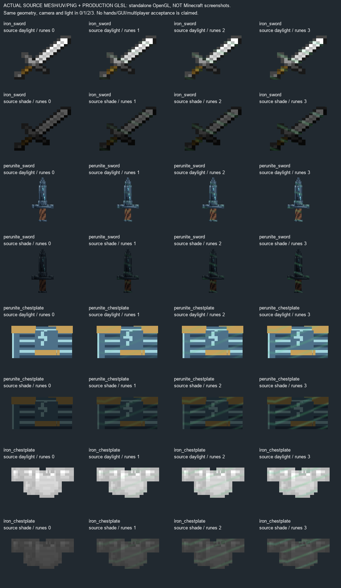

# #104 — универсальное руническое сияние, source1.9.7.42

**IN_PROGRESS / OWNER_VISUAL_REVIEW_PENDING. Не DONE, не RELEASE.** Прямое поручение
владельца после #103: реализовать эффекты на предметах с рунами. Внешний вид оружия
#87 отложен: его3 экспериментальные текстуры/writer сохранены в tools87/deferred,
а production восстановлен из реального before. Волн #105 нет.

## Реализовано в коде

Единственный источник количества — `RuneGlowStyle.of(Runes.list(stack).size())`,
clamp0–3. Legacy читает прежний ItemState/Runes, новые NBT/сетевые флаги не вводились.
0 возвращает исходный источник вершин.1 — зелёный #55C978;2 добавляет мягкую мятную
маску #A3E6BD;3 добавляет приглушённую бирюзовую #58CFC6. Вершинные alpha36/58/82
(~14/23/32%) дополнительно умножаются на общую текстурную интенсивность до204/255
и fog fade. Окончательная художественная интенсивность владельцем НЕ принята.

Один shader/одна32px data-текстура для всех вещей. Два RenderType используют этот
же shader/texture для обычной цели и Fabulous translucent-item цели. Оба имеют
собственные зарегистрированные fixed buffers: между normal и overlay не завершается
живой общий BufferBuilder. Параметры передаются в вершинах — два одинаковых меча
с1 и3 рунами в одном batch не делят глобальную uniform-интенсивность.

ItemRenderer получает локальную обёртку аргумента: GUI/руки/третье лицо/ground/frame
и custom renderer, если он использует переданный стандартный buffer source.
HumanoidArmorLayer получает новую обёртку на каждый equipment slot; сила не суммируется
по комплекту. Его existing getArmorModelHook покрывает Perunite/Dragon/Poloz/RewardArmor/
UniqueArmorModels. Отдельный TextileClothingLayer обёрнут для экипированной одежды.
Armor overlay подаётся только с первым material pass, чтобы окрашенные слои/trim
не удваивали руническую яркость. Vanilla glint POSITION_TEX не оборачивается.

Геометрия сохраняется; inverse текущего PoseStack переводит только UV overlay обратно
в единицы модели. GUI масштаб16× и разные атласы не меняют плотность. Нет shader tint
через глобальный RenderSystem.color, новых entities, tick polling, частиц или dynamic light.
Имеются fade тумана, depth EQUAL и только color-write. Рецепты/дроп/урон/сокеты/IDs/
RuneState/Runes и исходные item/armor PNG/JSON не менялись.

## Честные ограничения

**Сторонние immediate/outline sources без наших fixed buffers безопасно пропускаются.**
Иначе запрос overlay способен завершить их живой builder и обрушить рендер.
Non-QUADS форматы также пропускаются. Это явно ограниченная поддержка, не обещание
любого чужого renderer. Стандартный source с зарегистрированными buffers покрыт
кодом; реальный JEI и необычные модовые модели ещё не проверены. Нельзя считать
всю обязательную матрицу GUI/экипировки выполненной по одному source-preview.

Mixin application в запущенном Minecraft, shader reload внутри Minecraft, сочетание
с enchants/trim, MP-синхронизация, реальные перезаход/смерть и производительность —
**NOT_RUN / NOT_MEASURED**. Никаких заявлений об измеренном FPS/MSPT.

## Исходные A/B0–3

Это **не скриншоты Minecraft**: фактические Minecraft iron_sword PNG, actual perunite_sword
JSON mesh/UV/PNG, нативно запечённые ModelPart двух нагрудников, один и тот же shader
из production.0 — реальный source без overlay,1/2/3 — тот же source/camera/scale с ним.
Дневная/теневая яркость — контролируемый параметр отдельного source-renderer, не
освещение реального игрового мира. Native exporter `RuneGlow104Meshes.java`,
`native-armor-source.json`, `tools/rune104_shader_check.py --preview` и
`tools/rune104_preview_gl.py` воспроизводят результат. Никакой hand/player-позы
или игрового GUI здесь нет; художественная приёмка в игре остаётся обязательной.

Шейдер компилирован/связан настоящим OpenGL4.6 в невидимом отдельном WGL-контексте,
все собственные handles освобождены, видимых окон0. Vanilla fog import обработан
как GlslPreprocessor (вложенная #version убрана). Матрицы/fragment uniforms и varying
прошли linker. Это подтверждение GLSL, не исполнения Minecraft/Mixin.
[Точные SHA шейдеров](shader-compile.json), [рост source RGB-разницы1/2/3](source-gpu-metrics.json).

## Матрица требований

| REQUIREMENT | EVIDENCE | PASS/FAIL/BLOCKED/NOT_RUN |
|---|---|---|
| Аудит реальных render chains 1.21.1 NeoForge21.1.255 | AUDIT.md, pinned target bytecode ABI test | PASS source |
| Количество реально установленных рун,0–3; без новых flags | RuneGlowBuffers + неизменность ItemState/Runes | PASS source |
| Изумрудный → мятный → бирюзовый, разная alpha | RuneGlowStyle, GLSL, SOURCE-GPU-0-3.png | PASS source; OWNER_PENDING |
|0 не добавляет overlay | early return исходного source | PASS source; runtime NOT_RUN |
| Общий item hook без перекраски исходных моделей/PNG | ItemRendererRuneMixin; baseline whitelist | PASS source |
| Armor каждый slot + custom extensions + textile layer | ArmorRuneMixin, TextileClothingLayer | PASS source; runtime NOT_RUN |
| Batch isolation, geometry/UV projection, GUI/world scale | RuneGlow104Checks plain JVM | PASS |
| Fixed-buffer target поля и2 render method descriptors | RuneGlow104Checks actual compiled NeoForge ABI | PASS; apply NOT_RUN |
| Безопасность незнакомых immediate sources и неQUADS | explicit guard + AUDIT limitations | PASS source; unsupported overlay path |
| Shader syntax/link, реальные source GPU A/B0–3 | shader-compile.json, source-gpu-metrics.json | PASS standalone GL |
| Реальная полная GUI/руки/armor/enchants/MP/JEI/рelog матрица | RUNTIME-MATRIX.json | NOT_RUN |
| Реальная оценка производительности | не запускалась игра | NOT_RUN |
| Java21 clean build + plain JVM/native mesh fixtures | BUILD.log | PASS |
| Production JAR CRC/resources/classes, только client hooks | jar-check.json, build-source-sha256.json | PASS |
| Установка42 в PolyMC | installed.json: backup40, один JAR,6 модов сохранены | PASS / TEST PREVIEW |
| Ручная приёмка и реальные игровые A/B | решения ещё нет | NOT_RUN |

## Файлы и сборка

Новые production файлы:
- `src/main/java/org/slavicmyths/client/runeglow/RuneGlowBuffers.java`
- `src/main/java/org/slavicmyths/client/runeglow/RuneGlowConsumer.java`
- `src/main/java/org/slavicmyths/client/runeglow/RuneGlowRenderTypes.java`
- `src/main/java/org/slavicmyths/client/runeglow/RuneGlowStyle.java`
- `src/main/java/org/slavicmyths/client/runeglow/mixin/ArmorRuneMixin.java`
- `src/main/java/org/slavicmyths/client/runeglow/mixin/ItemRendererRuneMixin.java`
- `src/main/java/org/slavicmyths/client/runeglow/mixin/RuneBufferAccess.java`
- `src/main/resources/assets/slavicmyths/shaders/core/rune_glint.fsh`
- `src/main/resources/assets/slavicmyths/shaders/core/rune_glint.json`
- `src/main/resources/assets/slavicmyths/shaders/core/rune_glint.vsh`
- `src/main/resources/assets/slavicmyths/textures/misc/rune_glint.png`
- `src/main/resources/slavicmyths.rune_glow.mixins.json`

Изменены:
- `gradle.properties`
- `src/main/java/org/slavicmyths/client/TextileClothingLayer.java`
- `src/main/resources/META-INF/neoforge.mods.toml`

Java21 `clean build -I tools/rune104-offline.gradle checkRune104Offline exportRune104Meshes`
PASS1m5s. 7437 ресурсов, 1339 PNG, 1739 классов Java21
сверены с JAR, JSON/PNG/CRC/metadata валидны; offline fixtures вне production.
JAR `D:\slavic-myths\build\libs\slavicmyths-1.9.7.42.jar`, SHA256 `ddbfccabb8ccf2609ce38474f75e051b284fd764df6881a80f71a2f0917f91e5`.
Source base `f5d42cd5ff52cdcd0624dd8709bcd855b3809339` плюс незакоммиченный diff;
fingerprint `3b8c0d5a26b235dad802471cea4de6dcf795a3b4a2c838f637e37fad2c6f3775`. Автоматического commit/push нет.

PolyMC остаётся на1.9.7.40.42 не установлена. Minecraft/PolyMC/сервер/GameTest не запускались.
Issue104 OPEN. Для продолжения: игровая проверка всей RUNTIME-MATRIX, затем подбор
окончательной интенсивности; выявленные foreign-source исключения требуют отдельной
оценки фактических renderer-путей.105 не начинать до принятия104.

## Последующая установка и публикация — 20.10.2026

По прямому поручению владельца42 установлена после успешных gates; предыдущие
заметки о40/NOT_INSTALLED выше являются историей построения. [Квитанция](installed.json)
содержит installed path/SHA/backup; source commit будет закреплён в publication.json
после создания разрешённого владельцем коммита. Код этой сборки не изменялся.
Новые5 remote-коммитов содержат только3 дизайн-SVG; fast-forward сохранён без конфликтов.
Игровых запусков0, OWNER_PENDING и ограничения104 сохраняются.

### Публикация подтверждена

Source commit [2f9a143a](https://github.com/Deserag/slavic-myths/commit/2f9a143a902b075f71c69a37399372af815d5d4d)
опубликован вmain, integration commit `4f17670b0c8430c625fd2893f54e07133271c5eb`. Новые удалённые концепты оружия
сохранены обычным merge безforce. Все 8496 production-входов совпадают с
source commit под настроенными Git EOL-фильтрами. [Квитанция](publication.json).
installed.json теперь содержит фактический source commit. Никаких изменений игровых
проверок/приёмки: запусков0, #104 IN_PROGRESS / OWNER_PENDING.
