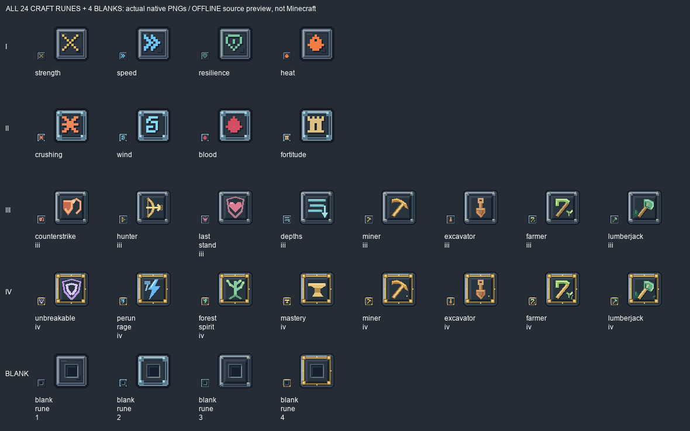

# #102 — вся согласованная серия, 1.9.7.38

Статус **IN_PROGRESS / OWNER_PENDING**, не DONE. Ошибочное ограничение четырьмя
пилотами отменено прямым поручением владельца о полной переработке.
Изменены 24 готовые руны и 4 заготовки, а также 13 мастер-PNG и точечные маршруты
старых генераторов. Production: только эти 28 PNG и номер версии.

[Все до/после](AB-all-28.png) — настоящие сохранённые production PNG до начала
#102 (.36), одинаковые размеры отображения и nearest. Это исходный offline-рендер
реальных текстур generated-item моделей, не скриншот Minecraft. ModelPart и UV
моделей не изменялись. Исторический .37 был только промежуточным пилотом.

## Охват

I: strength, speed, resilience, heat. II: crushing, wind, blood, fortitude.
III: counterstrike, hunter, last_stand, depths, miner, excavator, farmer, lumberjack.
IV: unbreakable, perun_rage, forest_spirit, mastery, miner, excavator, farmer, lumberjack.
Заготовки blank_rune_1–4. Уровень V не добавлен.

Аудит рецептов дополнительно обнаружил четыре `rare_rune_restore_*`:
flight, death, berserker, rare_protection. Они восстанавливают редкие руны из трёх
фрагментов, не используют крафтовые заготовки I–IV и не входят в утверждённые 24
чертежа #102. Их текстуры и механики сохранены; утверждение «в игре всего24
результата rune_crafting» было бы неверным. Полный охват здесь — именно каталог #102.

## Проверки

| REQUIREMENT | EVIDENCE | PASS/FAIL/BLOCKED/NOT_RUN |
|---|---|---|
| Все24 руны и4 заготовки | inventory.json, ALL-28.png, AB-all-28.png | PASS |
| Индивидуальные символы, единый квадратный стиль | ALL-28.png; tools/runes102_all.py + runes102_spec.json | PASS offline |
| Развитие III→IV, мотыга и топор сохраняются | ALL-28.png, исходные пиксели обеих пар | PASS offline |
| Нативные32/64px, бинарная прозрачность | verify_runes102_all.py | PASS |
| ID, NBT, Java, модели, рецепты и остальные ресурсы неизменны | baseline-source-sha256.json, проверка whitelist изменений | PASS |
| Воспроизводимость28 PNG, совпадение13 master PNG | verify_runes102_all.py | PASS |
| Java21 clean build | BUILD.log, BUILD SUCCESSFUL in59s | PASS |
| Production JAR, CRC, metadata38, parity ресурсов/классов | jar-check.json, build-source-sha256.json | PASS |
| Реальная игра: слоты, рука, GUI/JEI, перезаход | запусков0 | NOT_RUN |
| Ручная приёмка владельца | решения ещё нет | NOT_RUN |
| Установка .38 в PolyMC | не запрошена сейчас; установлена .36 | NOT_RUN |

JAR `build/libs/slavicmyths-1.9.7.38.jar`, SHA256
`672c84a878207b3f92c86110e65bc5eaaadecc22dba5b9ce9d1ef756b64afcb9`.
7431 ресурсов,1337 PNG,1732 Java21 классов проверены, smoke-код отсутствует.
Source HEAD f5d42cd5ff52cdcd0624dd8709bcd855b3809339 + незакоммиченные изменения;
точный fingerprint в jar-check.json. Коммит автоматически не создавался.
PolyMC/Minecraft/сервер/GameTest не запускались. Issue остаётся OPEN.

Ручной прогон владельца: сравнить28 иконок в слотах, в руке и интерфейсе установки;
проверить различимость назначения/уровня и отсутствие missing texture.
