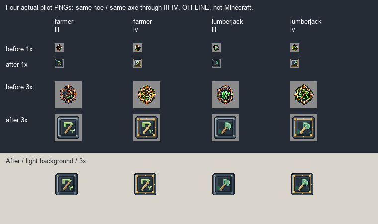
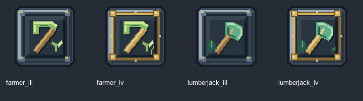

# Первый исполнительный пилот семейства крафтовых рун — 1.9.7.37

**IN_PROGRESS / OWNER_PENDING.** Исполнены четыре реальные иконки farmer_iii/iv и lumberjack_iii/iv. Это первый согласованный пилот, не реализация всех24рун/4основ и не приёмка всего #102. Последнее прямое поручение владельца «вс енравиться приступай к реализации пожалуйста» разрешает production-правки этого пилота; прежний запрет выполнять production в документационной #102 до поручения здесь уже снят владельцем. Новые item IDs/предметы/пятый уровень не добавлялись.

Перед вмешательством прочитаны AGENTS.md, три project docs, CRAFT_RUNE_ART_STANDARD.md, каталог и текущие recipes/models/master PNG. Старый III/IV TOOL_RUNES чертёж с ромбами — исторический; новый согласованный квадратный стандарт и сохранность инструмента имеют приоритет. Уточнения владельца в двух design MD сохранены, не откатывались. [Точная исходная база и авторизация](BASE.json).

## Четыре предмета

| ID | Исходник и дефект | Новый результат | Model/recipe | Проверка |
|---|---|---|---|---|
| rune_farmer_iii | Ромбовидная рамка прежнего семейства | Квадратная плитка, крупная мотыга, один небольшой росток | UNCHANGED tier3/perunite | PASS source, OWNER_PENDING |
| rune_farmer_iv | Орнамент теснит знак; требуется родство III→IV | Та же мотыга, тот же тематический зелёный, двойной обод и4крепления | UNCHANGED tier4/perunite | PASS source, OWNER_PENDING |
| rune_lumberjack_iii | Прежняя ромбовидная форма, дерево спорит с инструментом | Квадратная плитка, крупный топор, маленький лесной акцент | UNCHANGED tier3/perunite | PASS source, OWNER_PENDING |
| rune_lumberjack_iv | Богатый орнамент/деревья могут вытеснять топор | Тот же топор, та же хвойная палитра, усиленная отделка рамки | UNCHANGED tier4/perunite | PASS source, OWNER_PENDING |

[Полные ID→model→PNG→curated master→recipe, native64px и old/new SHA](inventory.json). Все четыре используют существующий `minecraft:item/generated` и прежний layer0. Рецепты содержат прежний rune_crafting, item result, blank tier3/4 material perunite. Золотистая отделка IV — художественный цвет, не изменение материала рецепта.

## Реальный before/after

Это **offline сравнение фактических PNG**, не Minecraft screenshot. Before не выдуман из концептов: оригинальные production/master PNG, model и recipe bytes лежат в before/. [Исходный вид](baseline.png). У пар III/IV одинаковый внешний alpha-силуэт и одни и те же реальные tool masks; рамка/обработка и вторичные детали развиваются. Мотыга/топор остаются крупнейшим центральным знаком. Native64×64 сохранён, binary alpha0/255; нет resampling production, blur, anti-alias, микротекста, renderer glow или частиц.

## Реализация и регрессии

`tools/runes102_pilot.py` — воспроизводимый целочисленный pixel source ровно четырёх иконок; формирует production PNG и четыре соответствующих `tools/tool-runes-art/` master PNG. Старый `tool_runes_resources.py` уже копирует эти curated masters; менять его логику или запускать полный generator с перезаписью рецептов не потребовалось. Master/production byte-identical, повторный targeted render проверен в отдельной sandbox директории.

Production diff относительно [полного baseline .36](baseline-source-sha256.json): **ровно4 PNG + gradle.properties .36→.37**. Остальные20крафтовых рун,4заготовки, редкие/боссовые/покупные руны, все сторонние PNG, registry IDs, model JSON/UV/CustomModelData, NBT/RuneState/RuneBase/сокеты/эффекты/дроп/recipes/tiers, HUD/JEI и vanilla ресурсы байтово не менялись. Никакого V registry/рецепта/PNG не создано.

## Обязательная матрица

| REQUIREMENT | EVIDENCE | PASS/FAIL/BLOCKED/NOT_RUN |
|---|---|---|
| Согласованные 4пилота, явное исполнительное поручение | BASE.json, стандарт/уточнение владельца | PASS |
| Реальные4ID/привязки/recipes tiers/materials | inventory.json, asset-check.json | PASS source |
| Квадратное родство и сохранение инструментов III→IV | shared actual tool_masks + actual PNG A/B | PASS offline / OWNER_PENDING |
| Мотыга/топор главные, растительность вторична | native-detail.png и slot1×/3× | PASS offline / OWNER_PENDING |
| Native64/alpha/curated master/repeatability | asset-check.json, source/sandbox render | PASS offline |
| Все соседние production files, models и gameplay прежние | exact baseline SHA diff4PNG+version | PASS source |
| Воспроизводимость существующего writer |4master bytes=4production, generator copy path inspected | PASS source |
| Java21 clean build | BUILD.log, BUILD SUCCESSFUL in1m52s | PASS |
| Production JAR/metadata/resource/class parity | jar-check.json | PASS offline |
| Minecraft inventory/in-hand/интерфейс установки/JEI/освещение | Игровых запусков0, не проверялось | NOT_RUN / OWNER_PENDING |
| Приёмка этих4игровых PNG перед массовой серией | Владелец принимал направление, новые PNG ещё не принял | NOT_RUN / OWNER_PENDING |
| PolyMC37 | Не устанавливалась, текущая36 не затрагивалась | NOT_RUN / POLYMC_NOT_INSTALLED для37 |

## Следующий шаг

После просмотра этих четырёх реальных иконок владелец подтверждает конкретный пилот либо задаёт поправки. Только затем переносить стиль на следующие малые партии24рун/4основ. Массовую серию не начинать автоматически по приёмке одних концептов. Не выставлять owner-accepted и не закрывать #102 вместо владельца. Minecraft/PolyMC/GameTest/сервер агентом не запускались, commit/push не выполнялись.

## Итоговые offline gates

JAR `D:\slavic-myths\build\libs\slavicmyths-1.9.7.37.jar`

SHA256 `3f18a4e785c7d2aee250059da10bd3bd5fea3a334165694b7e60fa160c389342`

Source base `f5d42cd5ff52cdcd0624dd8709bcd855b3809339`, working tree **UNCOMMITTED**. Source fingerprint `0758b2822e61d6ce6d068774cc3692b206cfb8ce13daa0dd343ad803f91faa45` ([full manifest](build-source-sha256.json)). Проверены7431processed resources, 1337PNG и1732Java21classes byte-for-byte против JAR. JSON/PNG/ZIP/meta version37 PASS; тестовые fixtures исключены. Runtime запусков0. [PolyMC36 сохранён](polymc-unchanged.json).
