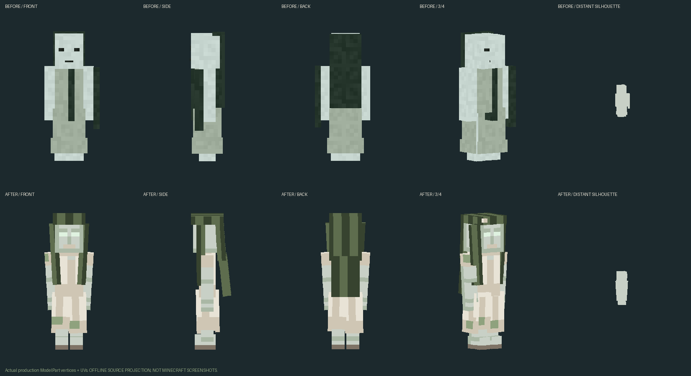

# #49 — Русалка: native rig, поведение и офлайн-проверка

Статус: **PARTIAL_NEEDS_AUDIO_SOURCE**. Это реализация одной Русалки на базе
`b4fb788e4e5267deff6da53ceae928f53b86a11b`; версия остаётся **1.9.7.8**.
Minecraft / клиент / сервер / GameTest / PolyMC: **0 запусков**, `NOT_RUN`.
Финальная визуальная и звуковая приёмка владельцем ещё не состоялась.

## Реальный результат модели




Это офлайн-проекция native `ModelPart` с фактическими UV и установленным PNG,
не Minecraft и не референсные SVG. Верхний ряд сравнения — неизменённая
`WaterSpiritModel(true)` и её прежняя текстура из baseline Git; нижний — новый
`RusalkaModel`. Скрипт не дорисовывает лицо, одежду или геометрию поверх модели.

Отдельный риг: 31 часть, ноги и босые ступни, старое светлое платье с передними,
задними и боковыми полотнищами, неровным низом; секционные тяжёлые волосы,
тонкий венок и два редких цветка. Атлас 128×64, десять утверждённых цветов,
пиксельные кластеры в реальных UV; исходная 256×256 не масштабировалась.
Водяной остаётся на прежних модели, рендерере и текстуре.

13 экспортированных поз: idle, observe, walk, swim, song start, lure, break,
windup, grab, recovery, dive, hurt, death. Ключ windup — тик11 предупреждения;
grab — active pose удара; recovery — тик3 восстановления; начало песни — тик12.
Состояние действий и часы передаются через SynchedEntityData. Переходы по5тиков,
пение поднимает руку за24тика; grab/break не задерживаются crossfade.
Память переходов отдельная для каждого UUID, ограничена64 существами.
Каждый sample сбрасывает transforms и visibility; нет клиентского `getTarget()`.

## Серверная механика

- Charm сохраняет ключи `SlavicWaterCharm`/`SlavicSinger` и прежние пороги
  25/50/75/90, накопление, гусли×0.25, амулет Велеса×0.5, глубины×0.7.
  Активное притяжение проверяет LOS каждые5тиков; при потере песни/LOS/дистанции
  чары убывают прежним шагом. Пение отключается при агрессии/уроне.
- Удар:12тиков телеграфа →1active →7recovery →1cooldown; одна фактическая
  попытка удара при входе active, повторная проверка цели/LOS/дистанции2блока.
  Базовые HP28 (болото36), speed0.23, damage3, range20 сохранены.
  Прежний импульс вниз−0.07 и cooldown100тиков сохранены; добавлены splash.
- Нырок: цель4–8блоков, заранее проверяется путь до3.8блока с шагом≤0.38;
  8тиков предупреждения, до10тиков физического движения, cooldown160тиков.
  Проверки объёма воды ниже/выше hitbox, loaded chunks, границы мира и коллизий;
  повторная проверка перед каждым перемещением. Нет teleport/chunk loads,
  дополнительного урона, неуязвимости или стана. Мелководье/суша/препятствие
  отменяют манёвр. Поворот и погоня сохраняют существующие механизмы AI.
- Старые inherited NBT/Knowledge, registry ID, hitbox0.55×1.85, loot, рецепты,
  spawn и предметы защиты не менялись. Новые NBT таймеры ограничены при загрузке;
  активная атака/нырок не восстанавливаются и не переигрывают урон.

## Звук: исправлена жизнь loop, финального вокала пока нет

Один loop на UUID, не более4 рядом; тихая громкость0.22–0.30 с fade-in,
дистанция20 и LOS. Остановка при song break, смерти, удалении, потере LOS,
выходе из радиуса, смене мира/измерения и disconnect. ClientTick очищает
ограниченный реестр даже при отсутствии EntityTick, а также после остановки
SoundManager/resource reload. Ambient не накладывается на песню.
Статические проверки этих веток не заменяют проигрывание в Minecraft.

| Существующий файл | Длительность | Назначение / статус |
|---|---:|---|
| [rusalka_ambient.ogg](../../../src/main/resources/assets/slavicmyths/sounds/water/rusalka_ambient.ogg) |1.8с|ambient, legacy|
| [rusalka_song.ogg](../../../src/main/resources/assets/slavicmyths/sounds/water/rusalka_song.ogg) |8с|loop, legacy|
| [rusalka_angry.ogg](../../../src/main/resources/assets/slavicmyths/sounds/water/rusalka_angry.ogg) |1.8с|агрессия, legacy|
| [rusalka_hurt.ogg](../../../src/main/resources/assets/slavicmyths/sounds/water/rusalka_hurt.ogg) |1.8с|hurt, legacy|
| [rusalka_death.ogg](../../../src/main/resources/assets/slavicmyths/sounds/water/rusalka_death.ogg) |1.8с|death, legacy|

Все5OGG оставлены побайтно прежними. Четыре WAV-эскиза сохранены отдельно в
`art/references/`; не установлены вместо голоса. Декодирование/длительность/
стык loop проверяются программно; **прослушивание и художественная адекватность
не подтверждены**. Новых заглушек, синтезаторного «финального вокала» и фиктивных
SoundEvents нет. Финальные intro/loop/intensity/break/grab,2–3ambient,2hurt/death
и их отдельные вызовы/субтитры остаются частью `NEEDS_AUDIO_SOURCE`.

**Нужен конкретный источник:** оригинальная запись женского голоса без слов
(моно WAV48kHz, желательно24bit, сухая, без музыки/реверберации), разрешение
правообладателя на обработку и распространение в моде. Сессия:2–3тихих
вдоха/напева;4ноты с паузой, отдельные intro и устойчивый loop; тот же мотив
напряжённее; резкий обрыв/вдох; усилие для захвата;2коротких hurt и1затихающий
death. После получения — монтаж OGG, законное происхождение/атрибуция,
новые события/субтитры и отдельная проверка на слух. Issue#49 остаётся открытой.

## Воспроизведение проверок

PowerShell, Java21:

```powershell
$env:JAVA_HOME='C:/Program Files/Java/jdk-21.0.12'
./gradlew.bat clean build -PrusalkaOfflineCheck verifyRusalkaOffline
python tools/rusalka_preview.py
python tools/verify_rusalka_49.py
```

`verifyRusalkaOffline` — отдельный JavaExec без NeoForge run/Bootstrap/мира:
реальная геометрия/UV,13поз, полный reset, интерливинг двух UUID, предел памяти,
AttackTimeline single-hit/cancel, production path-policy, настоящий CompoundTag
roundtrip/старые ключи/отсутствующие и повреждённые поля. Это **не** игровой
перезаход или живой сетевой тест. Fixture не попадает в production JAR.

Python: Pillow; для OGG — имеющиеся `.tools/audio-libs` (soundfile/NumPy).
Проверка генерации исполняет именно ветку animals старого water_070 из AST
с заглушенными посторонними write/material, не запускает массовую регенерацию.
Новый scoped generator воспроизводит PNG побайтно. Старый генератор делегирует
ему Русалку и больше не синтезирует её голос. Остальные ресурсы не генерируются.

Итоговые SHA/OGG decode/число resource parity проверок — [offline-gates.json](offline-gates.json).
Последний прогон: **Java21 clean build PASS, 55с, все7tasks executed**;
`RUSALKA_OFFLINE_PASS checks=20062 parts=31 poses=13`; Python **6869 checks PASS**.
Предупреждения проекта deprecated/unchecked сохраняются; ошибок компиляции нет.
JAR SHA256: `244ffe8e98c846991a1f24971494d233763537c3583522dbdd8eeb40e3762a4d`.
Короткая ручная проверка владельцем после будущей безопасной установки:
силуэт/плавание → начало/срыв песни → уход за стену → телеграф/захват →
ограниченный нырок в глубокой воде; отдельно голос после поставки источника.
