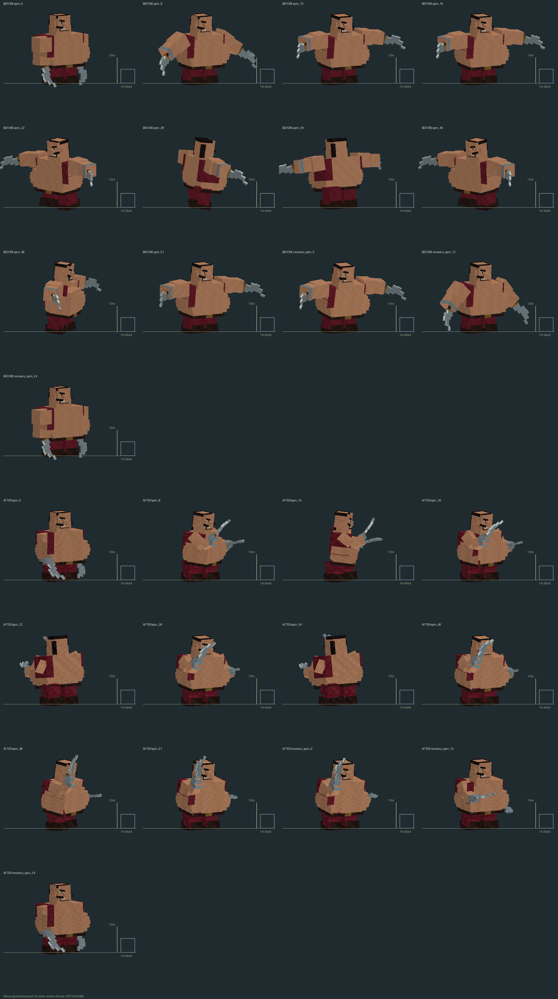
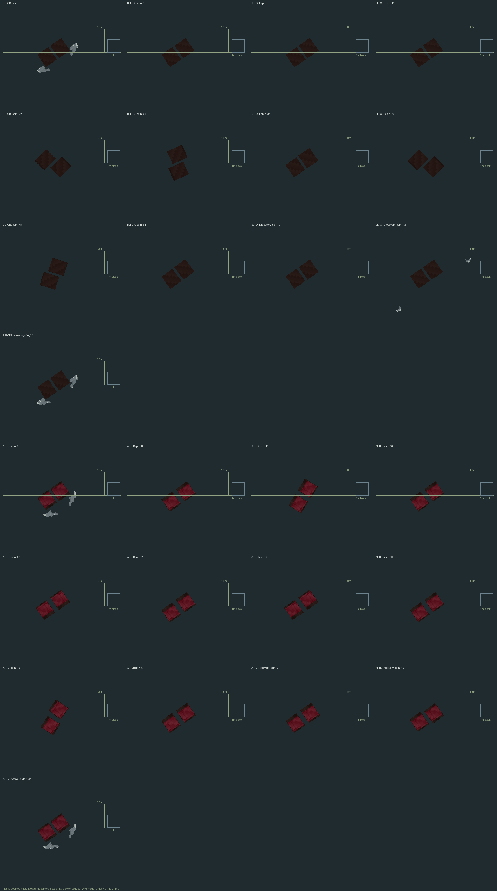
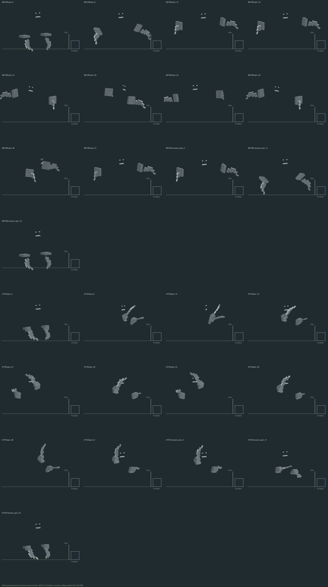
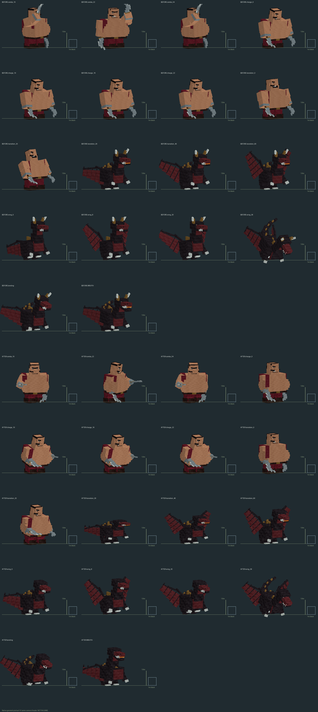
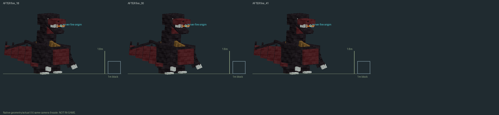

# #56 — Тугарин: IN_PROGRESS

Задача OPEN. Изменения модели не означают завершение задачи: новые реальные
foley ещё не поставлены, ручной приёмки и установки нет. Minecraft, PolyMC,
GameTest и сервер не запускались. Версия остаётся 1.9.7.8.

## Что показывают изображения

Это настоящие baked ModelPart vertices/UV с действующими PNG, не игровые
скриншоты и не концепт. Baseline bcec6355 сохранён до изменения геометрии/
анимаций. Камера и масштаб одинаковы: 3.2 пикселя на model unit, 16 units на
блок; показаны куб 1 блок и метка роста 1.8 м. Верхний ракурс использует явно
обозначенный срез y≥8 model units, открывающий нижнюю часть ног под большим
корпусом; в срез могут попадать низко опущенные клинки. Metal sheet выбирает
реальные UV материалов стали и включает наручи/рукавицы, а не подменяет модель.

По 44 одинаковых timing samples для четырёх фактических форм: warrior,
serpent, Likho, Mor Likho. Для перехода renderer по-прежнему выбирает воина
до 30-го тика, Змея — с 30-го: эта же последовательность показана в sheet.

## Реализовано в source

- Локальные pelvis/knee/ankle/wrist pivots первой формы. Клинки/силуэты двух
  тесаков сохранены, рукояти в рукавицах. Таз вращается отдельно от body;
  плечи, локти, кисти и колени двигаются независимо. Root не служит вращалкой
  T-позы. Ассиметричная подготовка 0–15, три оборота 16–52 с разной высотой/
  сгибом рук и усилением, затем 24 тика торможения и восстановления.
- Переступание с согнутыми коленями, компенсация угла стопы и высоты таза;
  хотя бы одна опора сохраняется. Walk/charge используют настоящий limbSwing.
  Нет новой анимации ходьбы, зависящей только от времени простоя.
- Combo содержит перекрывающийся recovery предыдущего взмаха вместо обрыва
  позы на границе 12 тиков. PUNCH, SWEEP, STONE, SLAM, CHARGE имеют отдельные
  плечо/локоть/корпус/опоры. Контактные часы: punch10, combo10/22/34,
  sweep14, stone18; SLAM использует фактический default windup14 scheduler.
- Переход: человеческое напряжение до30; затем рост/распрямление тела и шеи,
  крылья раскрываются 30–40, к60 полная форма. WING_DIVE: takeoff0–8,
  glide8–20, dive20–36, landing/recovery; у крыла и нижнего шарнира разные
  движения. BREATH готовит шею/челюсть к событию18. Отдельная ограниченная
  transform chain ставит настоящий центр mouthGlow в прежнюю точку server fire
  (eyeHeight4.15−0.2, heading1), включая hurt; после42 шея восстанавливается
  плавно в существующем RECOVERY. Нет новых hit events. Рога второй формы
  короче и отклонены назад, вертикальный масштаб root0.94: голова/рога при
  idle и активном дыхании укладываются в прежние4.85, коллизия не менялась.
- Большие material regions получили более заметные пиксельные кластеры/
  швы. Фактические Tugarin atlas всегда были **1024×1024**, а не 512 из
  старого текста issue: размер и UV не масштабировались. Другие PNG сохранены.
- WorldBossModel делегирует только Tugarin чистому TugarinPoses. Все 44 native
  позы обеих форм Лиха побайтно совпадают с исходными координатами/UV.
  Геометрия/текстуры/модель Соловья не менялись.
- Генератор --tugarin-model-only воспроизводит Java/manifest/два PNG и не
  пишет sounds.json, lang или ресурсы Соловья. Обычный генератор также хранит
  новые суставы/палитру и не возвращает T-позу (позы принадлежат Java helper).

TugarinCombat.java, WorldBoss.java, BossRules.java и WorldBossRenderer.java
сохранены. Удары SPIN16/28/40, 52 тика + recovery24, damage/range/cooldown,
фазы/NBT/UUID/bossbar/no-replay/offhand escrow не менялись. Вооружённый idle
помещается в прежний hitbox3.5×4.85. Во время атак клинки выходят за collision
box; крылья/длинный хвост второй формы также выступают, как в исходной модели.
Это не утверждение о полном вмещении всей раскрытой формы/атак в collision box.

## Звук — незавершённый обязательный пункт

Старые callsites RAVAGER_ROAR в начале SPIN, PLAYER_ATTACK_SWEEP на16/28/40,
RAVAGER_STEP при завершении и существующие boss events НЕ объявляются новым
набором foley. Новых записей в этой итерации нет; старые файлы не менялись.

Найдены авторские CC0-кандидаты: [реальные два взмаха мечом SamsterBirdies](https://freesound.org/people/SamsterBirdies/sounds/353708/),
[запись бамбукового swoosh qubodup](https://freesound.org/people/qubodup/sounds/59992/),
[boots/gravel Sheyvan](https://freesound.org/people/Sheyvan/sounds/524319/).
Это только найденные источники, не поставленные ассеты. Получение публичных
превью не удалось: HTTP403; плеер в браузере ERR_BLOCKED_BY_CLIENT. Канонические
адреса файлов из плеера не подтверждены. Оригиналы за входом не скачивались,
ограничения не обходились; лицензия страницы не выдаётся за наличие файла.
Нет синтезированных замен, pitch-копий или фиктивного прослушивания. Нужны
реальные различимые записи/монтаж, event→file→callsite, лицензии, old/new и
ручная приёмка по #60/#59. Звук остаётся IN_PROGRESS / NEEDS_AUDIO_SOURCE.

## REQUIREMENT | EVIDENCE | STATUS

| REQUIREMENT | EVIDENCE | STATUS |
|---|---|---|
| SPIN0/8/15/16/22/28/34/40/48/51, recovery0/12/24 | Native before/after, support/metal sheets | PASS (source) |
| Таз/корпус/локти/кисти/колени/опоры | Actual transformed boots and grips, 52 spin + 48 walk/charge phases | PASS (offline) |
| Combo/charge/transform/wing dive | Actual rig/UV sequence выше | PASS (source) |
| Нет четвёртого оборота при позднем sync | Native sample t100 ограничен тремя оборотами | PASS (offline) |
| Исходные hit events/NBT/баланс/renderer сохранены | Exact source scope/hash vs bcec6355 | PASS (source) |
| Лихо и Мор-Лихо не изменились | Exact 44-pose native equality each form | PASS (offline) |
| Геометрия Соловья не изменена | Manifest bytes, исходные PNG/model unchanged | PASS (source) |
| Atlas/UV/generator/production JAR | Native fixture + gates.json | PASS (offline) |
| Пасть совпадает с прежним fire origin на18/30/41 | Реальная transform chain, включая hurt | PASS (offline) |
| Высота idle/дыхания второй формы | Actual native bounds; рога и root scale исправлены | PASS (offline) |
| Границы крыльев/хвоста/weapon arcs | Измерены в gates.json; appendages выходят за collision box | PASS (измерено); полное вмещение не заявлено |
| Реальные новые выразительные foley | Actual OGG отсутствуют, старые vanilla cues сохранены | BLOCKED |
| Old/new listening и source→file→callsite для новых записей | Не выполнено | NOT_RUN |
| Runtime бой/переход/NBT/relog/анимация | Игровых запусков нет | NOT_RUN |
| Установка/ручная приёмка | POLYMC_NOT_INSTALLED, INSTALL_BLOCKED по #59/#47 | BLOCKED |

## Проверки

`gradlew.bat clean build -PtugarinModelOfflineCheck verifyTugarin56 verifyTugarinModels`
под Java21. `python tools/tugarin_56_previews.py` — фактические изображения;
`python tools/verify_tugarin_56.py` — scope, детерминизм генератора, native UV,
Likho equality, static bounds, JAR parity/CRC и отсутствие fixtures.
Java21 clean build PASS (1m59s), 505739 native checks, прежний fixture10160 checks;
179115 source/resource/JAR checks PASS, включая фактические .class внутри JAR.
Точные результаты в [gates.json](gates.json). Компиляция не считается игровым
тестом; сохранение NBT-кода не считается настоящим перезаходом.
