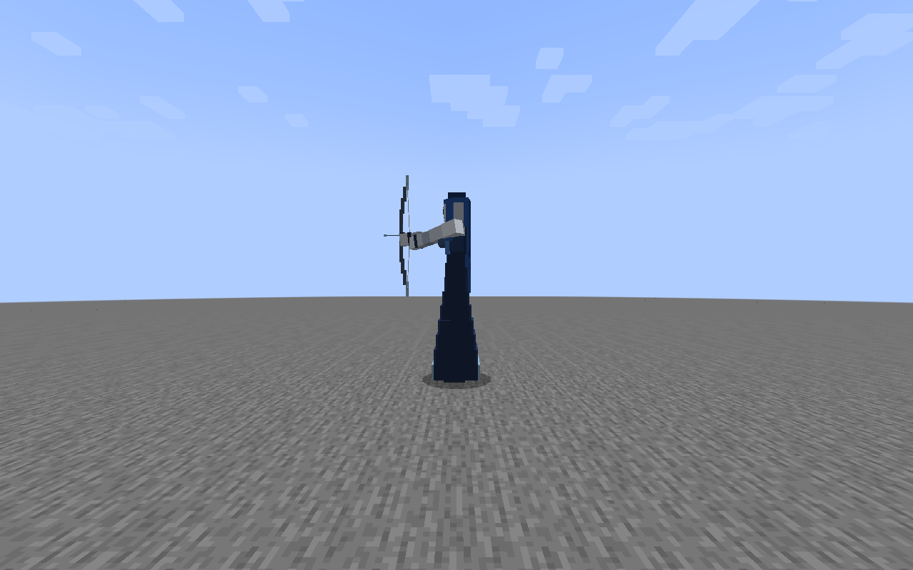
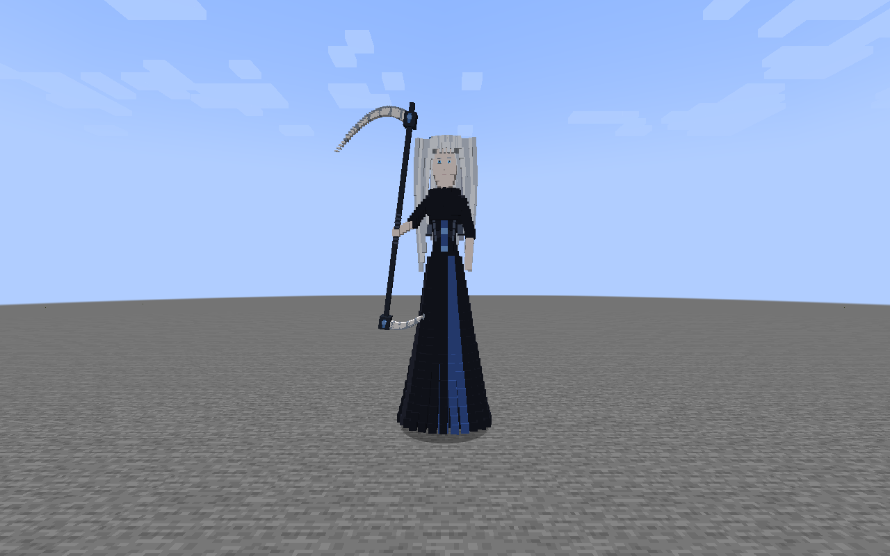
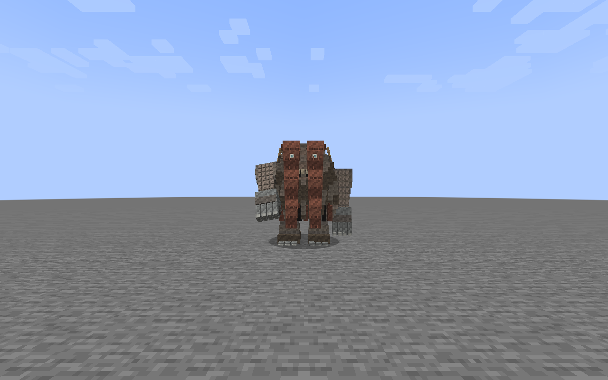

# Boss audit release-2.5 — evidence report, acceptance NOT COMPLETE

Production baseline: `5738a4038f615dc292403cd6308d794cbc2915cc` (`release-2.5`). QA branch: `codex/qa-bosses-release25-20261106`. Owner explicitly authorized QA commits/push and GitHub Actions. No production code/art/balance/registry IDs changed; no merge. This report does not certify every boss or every attack.

## A. Registry and acceptance

Native registry export constructs69 candidates without errors. Shared classes contain helpers/non-boss variants. The47 selected ranked/conditional encounter candidates include Ataman (no BossEvent field); this broader set is not a claim that every candidate is a mandatory boss.

- [Per-boss acceptance matrix](ACCEPTANCE_MATRIX.md), [registry/source and actual renderer/model](BOSSES.csv).
- [Actual model parts/cuboids](ACTUAL_MODELS.csv), [actual named transforms](ACTUAL_MODEL_TRANSFORMS.json).
- [Attack/state/damage matrix](ATTACK_MATRIX.csv):7680 preliminary cells, NOT a certified exhaustive legal attack matrix. Generic inherited controllers still require verification. Declared-only `Lomeya.GIANT_WINDUP` and `Viy.OPEN_EYES` are explicitly distinguished from actions selected by current native controllers; injecting them does not prove natural eligibility.

`NOT_RUN` in the acceptance table means the whole requested category is incomplete even when a scoped check below passes. No model is marked accepted merely because it renders.

## B. Findings

| ID | Priority | Confirmed result |
|---|---|---|
| BQA-001 | P2 | Boss trophy particle sprites absent from the block atlas; warnings reproduced in8/8 initial clients. Entity skins are not thereby missing. |
| BQA-002 | P2 | `mytar_shackled_sickle` recipe fails native decode: output registry ID is absent. |
| BQA-003 | P2 | Raven constructs with1024 maximum health against its source1600 attribute and existing1600 regression contract. Main Raven lifecycle test fails before later assertions; minion ownership test passes. |

[Exact paths/lines, causes, repros, expected/actual results, evidence, proposed fixes and risks](DEFECTS.md). [Native resource reload excerpts](RESOURCE_RELOAD_EXCERPTS.txt).

Separate stability observation: local performance JVM wrote all188 cases, then crashed in native `jvm.dll` on `GC Thread#0` while shutting down. Run exit FAIL. This is not attributed to mod code without reproduction. Preserve `work/boss-audit/performance2/hs_err_pid4052.log`.

## C. Executed checks and limits

| Check | Result | Evidence and limit |
|---|---|---|
| Java21 clean production build | PASS | JAR byte-identical to integrated baseline; final log `work/boss-audit-final-build2.log`. Compilation is not gameplay acceptance. |
| Source/production resource integrity | PASS structural scope |9532resources,5608JSON,1758PNG,2434models,2451Java21classes. Runtime atlas stitching/registry recipe decode still fail as above. |
| Registry construction | PASS |69candidates,0constructor errors;47selected rows. |
| Synchronous incoming damage | Collection complete |1554probes across7recent bosses;1554actual health losses,0immediate action resets. Private action/frame entry, some ineligible frames/states, no full natural progression; critical candidate and old mob-self source are not certified critical/mob tests. |
| Native arrow flight | PASS limited collider scope |21/21actual world-ticked collisions at10/50/90% of the main collider height for7new bosses. [Raw](native-arrow-flights.json).3Г—3loaded flight corridors; stationary NoAI/noGravity actors. Not visible-part wing/tail/head mesh coverage or active-attack projectile resilience. |
| Native30second pressure | Scoped progression observed |10boss cases,610server ticks and30.2–30.5wall seconds, wooden sword every10ticks. Explicit native ServerPlayer.doTick advances equipment/cooldown; attack strength normally0.84–1.0; invulnerable Survival proxy follows at1.2blocks beyond AABB. [Raw](dedicated-legal-pressure.json). |
| Tryaseya pressure retry | PASS ticking/pressure scope |Initial pressure series stopped ticking beyond loaded region. Bounded test-only route loading added6chunks; retry610actual entity ticks,30.4s,60accepted sword hits, all5legal action IDs observed. [Raw](dedicated-tryaseya-loaded.json). Not an AI/world-loading production change. |
| Nine-Mor pressure | Incomplete incoming-hit coverage |610actual entity ticks, but only1accepted hit. Packed head-frame changes are not attack counts. Cannot certify sustained damage during every head/window. |
| Real dedicated restart | PASS limited persistence scope |Two separate JVMs, same disposable world:7/7UUID/health restored. Lomeya, Neveya, Viy naturally entered phase2before saving and retained it. [Raw](restart-after.json). No actual client reconnect, active-attack resume or encounter session restoration claim. |
| Existing Viy tests | PASS2/2 |Actual phase/eyelid progression and three servants' cleanup after absent owner. Existing tests do not cover every ability. |
| Fire Zmey rules smoke | PASS |19pure-logic checks; not gameplay tests. |
| Sister partner death | PASS scoped3/3 |Both killed-partner directions trigger rage; discard-only control does not. Final actors tick40/40/29times. [Raw](partner-events.json). No client relog/partner-session restart claim. |
| Hosted initial visuals | Capture complete, not acceptance |8clients,712frames across47IDs.56removed-actor frames rejected; receipt manifest records them. [Manifest](VISUAL_EVIDENCE_MANIFEST.json). |
| Hosted model metadata | Collection complete |2additional clients,47frames each; corrected fixtures leave0removed actors. Metadata uses actual renderer/model objects. |
| Controlled attack poses | PASS synchronized pose identity, not complete animations |222frames across7bosses,37declared states Г—3injected frames Г—2views. Final run checks actual client action/frame;0mismatches. [Receipts](SYNCHRONIZED_POSES.json). Includes declared-only states and phase-ineligible controlled poses. |
| Dedicated performance |188cases collected; run exit FAIL |47IDsГ—counts0/1/5/10,40warmup+100sample ticks. [Summary](SERVER_PERFORMANCE.csv), [raw](server-performance.json).13cases have invalid alive/ticking counts. Process crashes at shutdown as described. No client FPS inference. |
| Client frame timing |188cases +188grouped repeats collected |Actual120render-frame intervals per scene after60client-tick warmup. [First](CLIENT_PERFORMANCE.csv), [repeat](CLIENT_PERFORMANCE_REPEAT.csv). Software llvmpipe, controlled NoAI scenes; not user GPU FPS/full combat. Repeated10Nine-Mor scene has only6client-loaded actors; Poloz scenes have0. Those loads are invalid, and the first run did not record client-loaded counts. Dedicated Nine-Mor retry now confirms0/1/5/10server-alive and client-loaded actors with a compact placement footprint. [Raw](NINE_CLIENT_RECHECK.json). |

Native damage was accepted while actions continued in the pressure fixtures. This does not prove every attack completes, its damage lands at the correct frame, or every phase survives every damage type. The invulnerable target prevents accepting outgoing boss damage/balance from these runs.

### Screenshots (controlled poses)





These are Minecraft framebuffer captures, not external model previews or art approval.

### Environments, artifact and commands

Minecraft1.21.1, NeoForge21.1.255, official mappings. Local OracleJDK21.0.12.1, i7-12700, JVM2active processors and1800MiB for dedicated fixtures. Hosted Temurin21, Ubuntu/Xvfb/Mesa llvmpipe; client1280Г—800,3GiB,2active processors, render/simulation distance5, vsync off. Timing scenes cap260FPS. Host and CPU allocation differ between hosted jobs; each has its own empty-scene baseline. Single ordered measurements do not establish statistically controlled performance regressions against another mod release.

Production `build/libs/slavicmyths-2.5-INTEGRATION-20261105-viy-fix3.jar`, SHA256:
`0e77f1da9fecffacd5a54dbfb78539b7250d88ce9e7c9cdf1d395a28273d10a7`.
No QA packages in the production archive. Existing gameplay SmokeAging/smoked-food resources are not QA code.

Commands actually used (Java21 JAVA_HOME set only for the command):

```text
gradlew.bat --no-daemon -I tools/boss-audit-runtime.gradle clean build compileBossAuditJava --console=plain
python tools/verify_resources.py
gradlew.bat --no-daemon -I tools/boss-audit-visual.gradle compileBossAuditVisualJava --console=plain
gradlew.bat --no-daemon -I tools/boss-audit-runtime.gradle runBossAuditDedicated -PbossAuditLegalPressure=true -PbossAuditIds=gneteya,tryaseya,agneya,ledeya,lomeya,neveya,viy,morovoy_raven,morovoy_fire_zmey,nine_mor_serpent -PbossAuditDir=work/boss-audit/legal-pressure3
gradlew.bat --no-daemon -I tools/boss-audit-runtime.gradle runBossAuditDedicated -PbossAuditLegalPressure=true -PbossAuditIds=tryaseya -PbossAuditStressName=dedicated-tryaseya-loaded -PbossAuditDir=work/boss-audit/tryaseya-loaded1
```

On PowerShell quote the whole comma-separated `-PbossAuditIds=...` argument. All worlds are disposable fixtures. Visual run tasks preserve both GitHub-hosted guards and were never launched locally; the exact hosted commands are in `.github/workflows/boss-audit-*.yml`. Initial/retry/aborted fixtures are retained under ignored `work/boss-audit`, not hidden as passes.

Key hosted runs: [initial712frames](https://github.com/Deserag/slavic-myths/actions/runs/42166613024), [47model metadata](https://github.com/Deserag/slavic-myths/actions/runs/42167831835), [native phase restart](https://github.com/Deserag/slavic-myths/actions/runs/42169195428), [21arrow flights](https://github.com/Deserag/slavic-myths/actions/runs/42169159922), [synchronized222poses](https://github.com/Deserag/slavic-myths/actions/runs/42169017630), [client188scenes](https://github.com/Deserag/slavic-myths/actions/runs/42168005667), [grouped repeat](https://github.com/Deserag/slavic-myths/actions/runs/42170168768), [Raven health failure/Viy pass](https://github.com/Deserag/slavic-myths/actions/runs/42168680626).

### Real launch counts

22GitHub-hosted Minecraft client/integrated-world launches;10local dedicated/GameTest world launches;12hosted dedicated/GameTest world launches. Additionally1hosted Raven startup failed before its world test because of the missing QA mixin. Compile-only failures are not counted as launches. Aborted, accelerated and invalid-fixture runs are included in these real-launch counts but are not passes. [Launch ledger](RUN_LEDGER.json). No Minecraft client was launched on the user's desktop during this audit.

## D. Remaining acceptance and fix order

**NOT RUN / incomplete:** exhaustive legal attack matrix for inherited/generic controllers; every outgoing hit window and phase under sword/confirmed critical/projectile/rapid/knockback/other mob/area effect/shield/lethal/two attackers; real2network-client multiplayer; main visible limb/wing/tail/multipart-head contact mapping; complete natural movement/attack/hurt/death animation cycles and clipping at every camera angle; actual reconnect and active-session restart; leak/cleanup and multiple bossbar visibility under real clients; controlled comparison to a previous release; Poloz valid encounter performance. These are not silently counted as PASS. Owner art acceptance is not supplied by automated screenshots.

1. Resolve health contract BQA-003 and reproduce any combat/AI issue only with valid fixture coverage. Complete missing damage-window, multipart and network cases before proposing combat fixes.
2. Review model parent hierarchy and full dynamic cycles before geometry/animation edits; the current poses only establish selected synchronized states. Weapon silhouettes/materials must remain distinct.
3. Fix BQA-001 atlas references, then BQA-002 intended output contract in a separately authorized production task. Retest affected trophy variants/particles and crafting.
4. Profile Nine-Mor server outliers and native JVM crash separately; repeat controlled loads before attributing a cause. Software rendering shows high cost for ten Fire Zmey/Gneteya/Neveya actors, but supplies no hardware FPS normative. Preserve gameplay/art and registry IDs during any later optimization.

No production fixes or merge were performed. The build and scoped checks above must not be presented as completed comprehensive boss acceptance.
