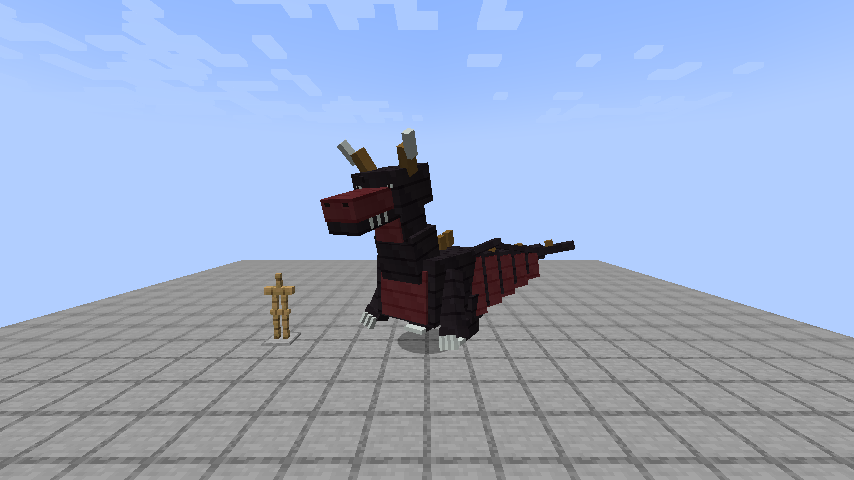
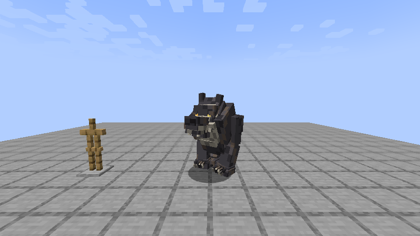

# Переработка трёх боссов — 2026-10-09

Реализованы правки моделей, анимаций, боя и локализации по ТЗ и приложенным референсам. Production JAR: `build/libs/slavicmyths-1.5.1-boss-rework.jar`. Версия общей рабочей копии 1.5.1 сохранена; в ней параллельно развивается город Чуди. Этот отчёт подтверждает проверки указанной переработки боссов, а не приёмку всех параллельных изменений.

## Что изменено

- Соловей: переработаны пропорции костей/геометрии обеих форм, тело около1.525 блока, с причёской1.887/1.893; renderer scale1.0. Сохранены лесная/мультяшная формы, переход и существующие навыки. Коллизия0.95×1.85, глаза1.25. Обычный удар достаёт2.2 блока, комбо2.35; длинный силуэт старой модели больше не определяет ближний бой.
- Тугарин I: глубокий широкий живот, плечи/короткие опорные ноги, увеличенные предплечья и отдельные серповидные клинки, оскал/брови. Нейтральная геометрия4.866 блока высотой и4.382 шириной с руками, коллизия3.5×4.85, глаза4.15. Ширина рук превышает ширину твёрдого корпуса. Условие свободного места в BossAnchors учитывает увеличенный корпус.
- Тугарин II: отдельный вытянутый корпус, двухзвенная шея, звериная морда/клыки, задние лапы, складываемые крылья, четырёхзвенный изогнутый хвост и гребень. Нейтральная высота с рогами5.207; расправленная геометрия крыльев7.804 шириной. Крылья/хвост декоративно выходят за центральный AABB, атаки используют собственные ограниченные зоны. В фазеII входящий урон умножается на0.5 перед ванильной бронёй; защита перехода0.15 сохранена. Фаза и защита сохраняются в NBT.
- Вращение Тугарина:16 ticks подготовки,3 оборота за36 ticks,3 ограниченных круговых удара по16 урона на16/28/40 ticks, радиус5.2,24 ticks восстановления, cooldown180. На каждую революцию одна попытка попадания по цели; штатные i-frames/броня/щит/LOS сохранены. Анимация вращает весь rig и возвращает руки в нейтральную позу; добавлены штатные звуки замаха/вращения/торможения.
- «Проклятый Оборотень»: отдельная от старого Волколака Variant B интерпретация,95 суставов/96 кубоидов, связанный загривок/светлый воротник и грудь, длинные сильные предплечья, когти/клыки, янтарные глаза, рубцы. Атлас512, пиксельные группы вместо одиночного шума. Коллизия1.65×1.9 на четырёх лапах и1.65×2.8 стоя. Стойки сохраняются несколько атак подряд; шаги зависят от реально пройденного расстояния.
- Оборотень сохраняет400HP. Скорость0.42, стоя×0.85, поздняя фаза×1.12; коготь15, укус17, двойное комбо13+13, тройное13+13+18, прыжок20, фланг16, захват24. Телеграфы/промах/восстановление и cooldown сохранены, комбо ускорены. «Дурная кровь», кровотечение, ограниченная пассажирская хватка, псевдосмерть/побег и квестовые nonce/награды сохранены.
- Видимые RU/EN строки босса/поручения/подсказок/субтитров переименованы. Стабильный registry ID `cursed_volkolak` и NBT-ключи сохранены; отдельный старый `volkolak` по-прежнему называется «Волколак». Новых предметов/реестров эта итерация не вводит.

## Проверки и реальные запуски

- `gradlew.bat -I tools/boss-rework-isolated.init.gradle clean build`: PASS (последний журнал clean-build-final.log). Отдельный build directory исключает конфликт с очистками общей рабочей копии; production JAR скопирован в build/libs с суффиксом boss-rework, без замены другого JAR общей задачи.
- Финальные native GameTests:34/34 PASS. Три headless запуска: первый выявил2 ошибки fixture/инициализации глаз, исправлены; второй31/31, третий34/34. Проверены3 удары вращения/восстановление/радиус/стена,50% защиты/NBT, физические размеры/старый моб, дальность Соловья/переход фаз,25 регрессий Оборотня/квеста/крови/хватки/награды.
- Нативный коготь по полной железной броне снимает10.5HP, по полной алмазной5.25HP; это один удар без защиты чарами. Для зачарованной брони, щита/зелья и полноценного боя по времени эти числа не являются оценкой сложности.
- Последние native baked-model проверки:10064 для Тугарина/Соловья/Лихо и2332 для Оборотня PASS; конечные UV внутри атласов. Они проверяют данные, не качество боя.
- `verify_boss_rework.py`: 21807 проверок PASS. JSON/PNG/OGG и связи звуков, допустимые пути ресурсов, локализация, размеры, CRC JAR, Java21, побайтовое совпадение ресурсов/классов. Opt-in GameTests/BossSceneProbe не входят в production.
- Повторный запуск трёх генераторов:4925 файлов,0 отличий. Источник/атласы/геометрия/тексты воспроизводимы.
- Всего8 запусков клиента:1 и8 — меню,2/4/5/6/7 — настоящие игровые сцены в копии одноразового мира,3 — неуспешный из-за удаления общего build/classes во время работы (NoClassDefFoundError). После изоляции сборки повторения ошибки нет. Финальный запуск7 сохранил7 игровых кадров и корректно завершил интегрированный сервер, ERROR/FATAL в его runtime log нет.
- Ручной осмотр сохранённых кадров выполнен: обе формы Соловья, обе формы Тугарина, две стойки Оборотня, вращение. Сценарий создаёт сущности с NoAI и заданной позой; это проверка реального рендерера/загрузки мира, не ручной survival бой. Ручное управление окном недоступно: две попытки Computer Use получить кадр завершились `FrameArrived timed out`. Не заменено скрытыми вводами или сторонним захватом экрана.

SHA-256 production JAR: `f5e947b9cffbceab3105cbf849aeaef6f27f325db8ad00ede71b32cf82c44b82`.

## Что ещё не принято

Ручной survival бой с каждой фазой, субъективная близость art к референсам, звуковое впечатление, бой с чарами/щитами, multiplayer, настоящий relog/restart квеста и измеренный MSPT остаются NOT TESTED. Клиентские снимки не доказывают плавность всех атак и pathfinding; NBT-тест не является настоящим перезаходом. Поэтому полную игровую приёмку ТЗ не объявляю завершённой. Коммит/установка в PolyMC этой итерацией не выполнялись; пользовательские миры не изменялись.

## Короткая ручная проверка

В отдельном тестовом мире Minecraft1.21.1/NeoForge21.1.255 включить команды. Установить только один JAR slavicmyths: использовать boss-rework вместо предыдущего экземпляра мода.

```mcfunction
/summon slavicmyths:nightingale ~ ~ ~5
/summon slavicmyths:tugarin_zmey ~ ~ ~8
/summon slavicmyths:cursed_volkolak ~ ~ ~5
```

Проверять по одному боссу на открытой площадке. В Survival: дождаться перехода Соловья/Тугарина при50%HP, у Тугарина увидеть подготовку/три оборота/восстановление и сравнить одинаковые удары до/после превращения; у Оборотня проверить оба положения, когти/укус/прыжок/фланг/хватку в железной и алмазной броне. В квесте Серого Волка отдельно проверить псевдосмерть/побег/череп/одноразовую награду после реального перезахода. Тестовый `/summon` не заменяет встречу, привязанную к квесту.

## Артефакты

[Ресурсный отчёт](resources.json), [воспроизводимость](generator-parity.json), [финальный clean build](logs/clean-build-final.log), [34 GameTests](logs/server-3-34-pass.log), [финальные модели](logs/final-model-checks.log), [финальный клиент](logs/client-7-final-scene.log).




После baked-model проверки выполнен заключительный clean build и повторный production аудит: параллельная общая разработка и повторная компиляция изменили сторонний class Чуди; финальный JAR повторно сверён с текущим build output. Предыдущая контрольная SHA не выдаётся за финальную.

## Установка по последующему запросу пользователя

Проверенный JAR установлен в PolyMC `Slavic-Myths-1.21.1-Testing` (Minecraft1.21.1/NeoForge21.1.255). Предыдущий JAR сохранён в `.slavicmyths-backups`; один активный slavicmyths JAR, SHA-256 совпадает с production. Миры/настройки/прочие файлы сохранены побайтово. После установки клиент не запускался. [Квитанция](polymc-installation.json).
