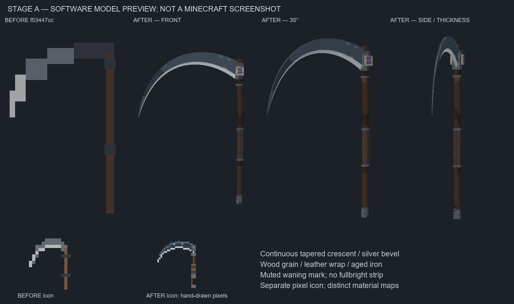

# Этап A — Коса Карачуна, 2026-10-14

**Готов к независимой проверке; этап не принят.** Ветка `fix/weapon-visual-qa-197`, база `b7616080` включает предыдущий оружейный патч `f53447cc` и ревизию брони. Версия1.9.7 и все registry IDs сохранены. Этапы B–D не выполнялись; PolyMC не изменялся.

## Что изменено

| Проблема | Изменение |
|---|---|
| Ступенчатый крюк / фиксированное требование8 кубоидов | Замкнутая непрерывная OBJ-сетка на штатном NeoForge21.1.255 loader: широкий серповидный клинок, плавный обух, сужающееся опущенное острие и отдельная серебристая фаска. Проверки топологии/UV/толщины вместо числа деталей |
| Одноцветный полосатый атлас | Семь собственных32px материалов: древесные волокна, кожаный хват, старое железо, холодная сталь, серебристая кромка, костяные накладки и небольшой приглушённый знак Угасания. Нет emissive-ленты. Остальное оружие сохраняет прежние ресурсы до этапа B |
| Грубая иконка | Отдельная рисованная32px иконка с читаемой дугой; это не скриншот3D-модели |
| Неудобный held-вариант | Отдельные правый/левый transforms, смещение в бок/вниз. Third-person attachment учтён по установленному vanilla ItemInHandLayer; по превью исправлен прежний разворот вдоль корпуса |
| Скачок −1→+1 на тике удара | Непрерывная smoothstep подготовка, выпуск и возврат. Три направления взмаха сохранены; штатный first-person equip transform сохранён, обычный sword swing не накладывается поверх кастомного |
| Поза покоя / наложение ванильной атаки | Обычный PlayerRenderer в покое; двуручная поза только в активном Swing, плавная степень влияния0→1→0. В кастомной позе исключён второй vanilla attack channel; offhand коса не повторяет main-hand взмах |
| Смена оружия/выход оставляли номер комбо | Отмена очищает временное комбо, обычное завершение сохраняет короткое окно серии. Pose duration=0 и клиентский expiry из предыдущего патча сохранены |

Архитектура: `scythe_stage_a_assets.py` — только коса. Исторический weapon overlay делегирует ему; karachun/rare/gorynych/rewards hooks доходят до этого overlay. Старые проверки8 частей и идентичности boss/player mesh удалены. Модель босса, её атлас и звуки не регенерировались. Никаких новых world scans, регистрации предметов или изменений баланса.

## Проверки и доказательства

Финальная `gradlew.bat clean build -I tools/karachun-offline.gradle nightOfflineChecks`: PASS,34s. Native regression Карачуна:40 проверок/10000 reward simulations/8352 UV vertices; это офлайн проверка старого босса, не игровой визуал.

Финальный **GameTest server:37 сценарных проверок PASS**. Нативный сервер/реальные `LivingEntity.hurt`/коллизии projectiles; тестовый игрок имеет заглушку транспорта пакетов. Подтверждены:

- Отложенный удар: корова100→88 HP, зомби100→85; до windup урона нет. Дальность3,5/сектор/стена; NPC и приручённый волк защищены.
- Strength I:15 HP; Weakness I:8; Sharpness III:14; броня уменьшает урон. Config baseDamage=0 и invulnerability намеренно дают ноль.
- Wither I/80 ticks за третий успешный удар по цели; лечение2 HP один раз за5s; убийство нежити+3 HP.
- Black Harvest создаёт три настоящих снаряда; физическое попадание13,2 HP не дублируется. Last Breath:16,8 HP; cooldown, durability и защита NPC/pet работают.
- Смена слота, удаление/замена экземпляра, cleanup routine и окончание промаха очищают Swing. Непрерывность трёх кривых движения проверена на нативном helper.

**Всего8 серверных запусков:3 успешных,5 неуспешных из-за ошибок стенда.** Причины: пропущенный `ServerPlayer.doTick` при экипировке, неверное исходное HP приручённого волка, неточная постановка стены, её контакт с питомцем и сохранённая стена на пути бокового снаряда. Эти ошибки исправлены в tools-only fixture; последний полный прогон PASS. [Сценарное evidence](server-evidence.json), [краткий итог](summary.json).

Production JAR: `build/libs/slavicmyths-1.9.7.jar`, SHA256 `35e360cf3d2702ec68c0593b60e6459989466e2af817ae2cbe9b2a4db5e19294`. Test classes/fixture namespace не входят в JAR. Генератор воспроизводим; фактические OBJ/MTL/PNG и packed bytes проверены. [Проверки](checks.json).

Сравнение с установленной ревизией брони:7863 file entries побайтно сохранены,463 различаются только CRLF/LF;8 содержательных различий относятся только к косе. Два armor PNG из установленного JAR отсутствуют уже в Git-базе `b7616080`: `gambeson_layer_2.png`, `plate_layer_2.png`. Оружейный diff их не удаляет. Перед этапом D минимальное решение — вернуть эти generated assets в Git в задаче брони; их фактическая необходимость в игровом рендере здесь не проверялась. Они не скопированы в оружейный коммит.

## Визуальные материалы — вне игры

[Правая/левая рука, FOV70/90/110](images/scythe-fov-projection.png) · [Взмах по native pose samples](images/scythe-swing-reference.png) · [Third-person attachment reference](images/scythe-thirdperson-reference.png).

Это software projection модели и схематического манекена, **не кадры Minecraft и не подтверждение игрового рендера**. Third-person reference использует vanilla hand attachment order и параметры новой позы, не настоящий PlayerRenderer/skin/armor. Фактический OBJ bake на клиенте, реальные first/third-person позы Steve/Alex, HUD/bobbing/lighting/armor overlays и визуальная приёмка остаются OPEN. Клиентов0; реального MP/relog0; FPS/MSPT не измерены. Вызов server cleanup routine не равен настоящему перезаходу или смене измерения игроком.

## Краткий ручной список для приёмки

1. Открыть косу в GUI/руке/на земле/в рамке/head; проверить texture bake и отсутствие missing-texture.
2. Правая/левая ведущая рука, FOV70/90/110, покой/все три взмаха/способности. Steve/Alex, броня/аксессуары, взгляд вверх/вниз. Прицел свободен, поза возвращается без скачка.
3. Попадание/промах, смена слота/другой экземпляр/выбрасывание/открытие меню, смерть/измерение/реальный перезаход. Проверить серверные HP и отсутствие застывших рук.
4. Два игрока: PvP off/on, защита союзника/NPC/питомца, синхронизация взмаха и отмены. Проверить дальность, броню, зачарования, руны и обе способности.

Технический просмотр не заменяет независимую оценку автора/ChatGPT. По разделу10.2 задания после публикации коммита/PR работа останавливается на контрольной точке A; к остальным моделям и балансу переходить только после одобрения.
